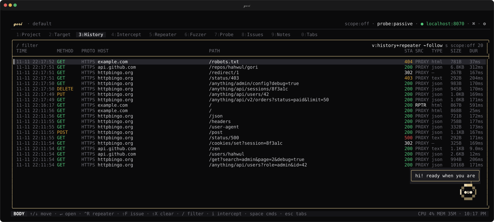
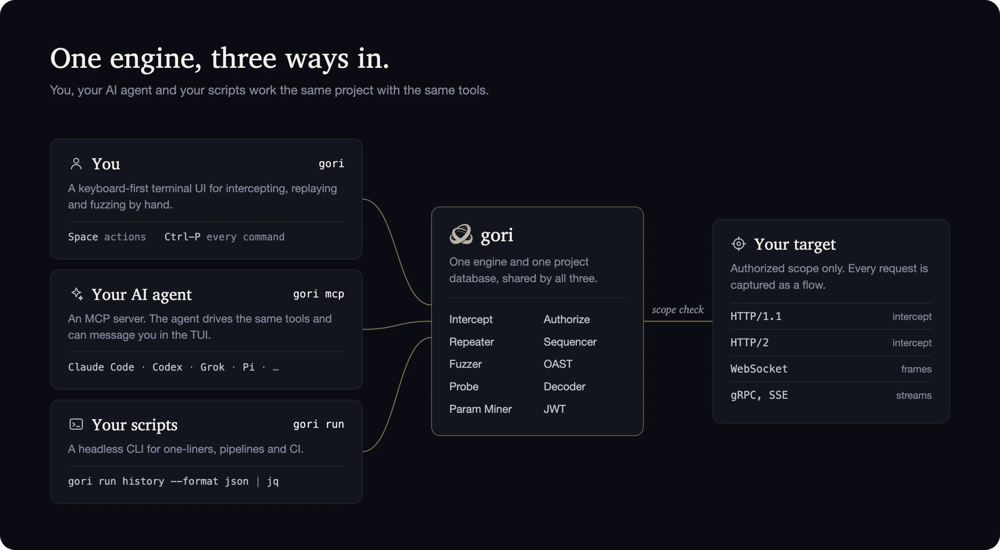

<div align="center">
  <br>
  
  <p>A fast, keyboard-driven HTTP intercepting proxy and pentesting toolkit for the terminal,<br>built for humans and AI agents.</p>
</div>
<p align="center">
<a href="https://github.com/hahwul/gori/blob/main/.github/CONTRIBUTING.md">
</a>
<a href="https://github.com/hahwul/gori/releases">
</a>
<a href="https://crystal-lang.org">
</a>
</p>

<p align="center">
  <a href="#installation">Installation</a> •
  <a href="#usage">Usage</a> •
  <a href="docs/">Documentation</a> •
  <a href=".github/CONTRIBUTING.md">Contributing</a>
</p>

---

**gori** (고리, Korean for *ring, link, loop*) sits in the loop between your client and its target.
It captures every request and response as a *flow* you can replay, fuzz, and scan across HTTP/1.1,
HTTP/2, WebSocket, gRPC, and SSE, and holds HTTP/1.1 and HTTP/2 traffic for editing in flight.
The TUI, `gori run`, and MCP share one engine and one project, so scripts and AI agents can drive
the same engagement. The [capability matrix](https://gori.hahwul.com/reference/capabilities/)
lists what each protocol and surface supports.



<details>
<summary><strong>Features</strong></summary>

### Capture & Intercept
- Capturing proxy for HTTP/1.1, HTTP/2, WebSocket, gRPC, and SSE
- Intercept on HTTP/1.1 and HTTP/2, gRPC included: hold, edit, forward, or drop in flight. WebSocket messages too, with `proto:ws`
- Searchable History with a query language
- Scope rules, hostname overrides, and match & replace

### Replay, Fuzz & Decode
- Repeater for crafting and re-sending requests, including WebSocket and gRPC
- Fuzzer with four attack modes
- Decoder for chained encode / decode / hash, including signed session cookies
- Comparer for diffing two flows
- Inline JWT / SAML / GraphQL / protobuf / MessagePack / CBOR decoding, hex view, and pretty-printing
- Copy a request as cURL, Python, `fetch`, Go, httpie, or a CSRF PoC

### Discover & Scan
- Probe: a passive and light-touch active vulnerability scanner
- Param Miner for hidden parameters
- Authorize: replay one request under several identities to find broken access control
- Sequencer for grading the randomness of session, CSRF, and reset tokens
- Cookie workbench to verify, crack, and re-sign Flask / Rack / Django session cookies
- OAST collector for blind SSRF, XXE, and injection
- Findings triage with Markdown / JSON / SARIF export

### Keyboard-first Workflow
- Command palette (`Ctrl-P`) and space menu (`Space`) reach every action
- Rebindable hotkeys and colour themes
- Mouse support, multi-line editing, and go-to-line

### Headless & Scriptable
- `gori run` for scripts and CI
- `gori mcp`, an MCP server for AI agents (it does not start a capture proxy)

</details>

## Installation

### Quick install (macOS / Linux)

```bash
curl -fsSL https://gori.hahwul.com/install.sh | bash
```

Update with `gori update`. On a Chocolatey, Homebrew, Snap, or AUR install it prints the package manager's command.

On Windows, use [Chocolatey](#chocolatey), or download `gori-windows-x86_64.exe` from [Releases](https://github.com/hahwul/gori/releases/latest), rename it to `gori.exe`, and put it on your `PATH`.

### Chocolatey

The [Chocolatey package](https://community.chocolatey.org/packages/gori) installs the Windows x86_64 binary:

```powershell
choco install gori
```

### Homebrew

```bash
brew tap hahwul/gori
brew install gori
```

### Nix

```bash
nix run github:hahwul/gori               # run without installing
nix profile install github:hahwul/gori   # install
```

### From source

Requires [Crystal](https://crystal-lang.org/) `>= 1.21.0` and `pkg-config`.

```bash
git clone https://github.com/hahwul/gori.git
cd gori
shards build --release   # writes bin/gori
```

> System libraries (Brotli / Zstd), offline builds, and other options are in the
> [Installation guide](https://gori.hahwul.com/getting-started/installation/).

## Usage

One engine and one project, three entry points.



### For humans: `gori` (TUI)

```bash
gori
```

The proxy listens on `127.0.0.1:8070`. A short first-run wizard picks the theme, and a new
**global default** bind if that port is taken (projects can pin their own later). To intercept
HTTPS, trust gori's root CA: **Open browser** in the palette (`Ctrl-P`) launches a browser that
already trusts it and is proxied. Captured traffic lands in **History**. `Ctrl-P` opens the
command palette and `Space` the context actions.

```bash
gori --listen 0.0.0.0 --port 8080   # global bind for this run only (not persisted)
```

### For AI agents: `gori mcp` (MCP server)

`gori mcp` is a [Model Context Protocol](https://modelcontextprotocol.io) server. An AI client
spawns it over stdio, reads your traffic, and uses the tools you do. Write the config for your
agent, then restart the client:

```bash
gori mcp --install-claude-code   # Claude Code   (~/.claude.json)
gori mcp --install-claude        # Claude Desktop
gori mcp --install-codex         # OpenAI Codex
gori mcp --install-agy           # Antigravity CLI
gori mcp --install-grok          # Grok
gori mcp --install-hermes        # Hermes        (~/.hermes/config.yaml)
gori mcp --install-pi            # Pi            (~/.pi/agent/mcp.json)
```

Pi needs an MCP adapter, such as [pi-mcp-adapter](https://github.com/nicobailon/pi-mcp-adapter)
(`pi install npm:pi-mcp-adapter`). The installer honors `PI_CODING_AGENT_DIR` when set.

An installed entry serves the `@recon` tool profile (read and map the capture, replay a request,
record issues and notes); add `--tools='*'` for every tool. Add `--read-only` for an untrusted
agent: read tools only, no live requests. The
[AI Setup guide](https://gori.hahwul.com/getting-started/ai-setup/) covers connecting an agent and
running a first request.

### For scripts: `gori run` (headless CLI)

`gori run` runs the same engines without the UI, for scripts, CI, or an agent's shell:

```bash
gori run history --format json      # dump captured flows as JSON
gori run sitemap                    # endpoints seen so far
gori run --help                     # every subcommand
```

All three share one project database. The full guide is in the
[documentation](https://gori.hahwul.com) and in the app's **Help** tab.

## Development

```bash
shards build          # debug binary at bin/gori (add --release to optimise)
shards run gori       # run without installing
```

If linking fails with undefined `BrotliDecoder*` symbols, `libbrotlidec` is missing or
`pkg-config` cannot find it. The
[Installation guide](https://gori.hahwul.com/getting-started/installation/) covers the system
libraries and the `-Dwithout_native_codecs` offline build.

## Contributors

[](https://github.com/hahwul/gori/graphs/contributors)

Contributions are welcome. See [CONTRIBUTING.md](.github/CONTRIBUTING.md) to get set up. The line
under each name says what the contribution was, because bug reports and reproductions count too.
To credit someone, edit [`.github/contributor-mural.yml`](.github/contributor-mural.yml).

## Why "gori"?

gori (고리) is Korean for **ring, link, or loop**, which is where the tool sits: in the loop
between your client and its target. *Sit in the loop.*
