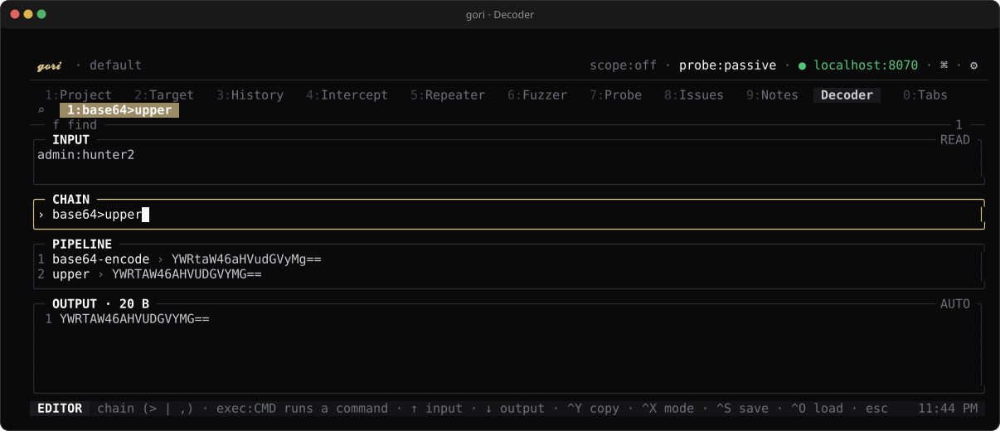

+++
title = "Decoder: Encode, Decode, and Hash"
description = "Encode, decode, hash, and transform data in a multi-step pipeline inside the TUI."
weight = 40

[extra]
group = "Workbenches"
shot = "decoder"
+++

The **Decoder** tab is a scratch workbench for encoding, decoding, hashing, and transforming data. Paste input, build a chain of converters, and read the intermediate and final results.

<figure class="tui-shot">
  
  <figcaption>The <strong>Decoder</strong> workbench: an input, a chain of converters, and the per-step pipeline with the final output below.</figcaption>
</figure>

## Layout

Four cards stack top to bottom:

| Pane | Role |
|------|------|
| **INPUT** | Source text (editable) |
| **CHAIN** | Pipeline spec: converter names separated by `|`, `>`, or `,` (all equivalent) |
| **PIPELINE** | One row per step with its intermediate output |
| **OUTPUT** | Final result (text / hex / base64 display modes) |

You can keep several conversions open as **sub-tabs** (new, rename, duplicate, close from the space menu). Open sub-tabs are saved with the **project**, so they come back when you reopen it and do not appear in other projects.

## Building a Chain

Type converter names on the CHAIN line. Steps run left to right:

```text
url-decode | base64-decode | jwt-decode
hex-encode | upper
gzip-decompress | json-unescape
```

Aliases work the same as the primary name (`b64` → `base64-encode`, `url` → `url-encode`, and so on). Autocomplete helps when the name is fuzzy.

Save a chain under a name (`Ctrl-S`, or **Save chain by name** from the palette) and reload it later. The save prompt starts from the sub-tab's own name, and saving under a name that already exists updates it. **Load a saved chain** (`Ctrl-O`) opens a picker over everything you've saved, showing each chain's spec next to its name. Type to filter, and `Ctrl-X` deletes the highlighted entry from the library. Both keys work wherever you are in the tab: the sub-tab strip, the tab bar, or inside a pane.

Named chains live under the `decoder` section of settings and are shared by every project. The data you run through a chain stays with the project. Rewriter rules work differently: each rule is [global or project-scoped](/guide/proxy/#global-and-project-rules).

A saved name is also a **converter**: type it as a step and the saved spec runs in that position.

```
myenc > url-encode
```

This works wherever gori accepts a chain: the `Ctrl-Q` chain editor on a Repeater or Fuzzer `§…§` marker, `gori run decoder`, and the MCP `decode` tool. Autocomplete lists saved names next to the built-in converters, and `gori run decoder list` shows them with the category `saved`.

Saved chains can call each other. A recursive definition fails that step with a message instead of hanging, and a name a built-in already answers to (including its aliases) is refused when you save it, so a saved chain can never shadow `base64-decode` and change what existing specs mean.

## Converters

| Category | Examples |
|----------|----------|
| **Encoding** | `base64-encode` / `base64-decode`, `base64url-encode`, `url-encode` / `url-decode`, `url-encode-all` (every byte, WAF-bypass style), `hex-encode` / `hex-decode`, `base32-encode` / `base32-decode`, `ascii85-encode` / `ascii85-decode`, `base58-encode` / `base58-decode`, `base36-encode` / `base36-decode`, `base62-encode` / `base62-decode`, `quoted-printable-encode` / `quoted-printable-decode`, `punycode-encode` / `punycode-decode` (aliased `idn-encode` / `idn-decode`), `nfc` / `nfd` / `nfkc` / `nfkd`, `rfc2047-q-encode` / `rfc2047-b-encode`, `rfc2047-q-decode` / `rfc2047-b-decode` / `rfc2047-decode`, `windows-bestfit-<codepage>`, `codepoint-overflow` |
| **Number bases** | `decimal-encode` / `decimal-decode`, `binary-encode` / `binary-decode`, `octal-encode` / `octal-decode` |
| **Compression** | `gzip-compress` / `gzip-decompress`, `zlib-compress` / `zlib-decompress`, `raw-deflate` / `raw-inflate` (headerless, RFC 1951), `brotli-decompress`, `zstd-decompress` |
| **Serialization** | `msgpack-decode`, `cbor-decode` (a binary document as JSON text), and the native-serialization readers `java-deserialize`, `dotnet-viewstate`, `php-unserialize`, `pickle-disasm` |
| **Token** | `jwt-decode` (header + payload; signature shown, not verified), and the signed-session-cookie readers `cookie-decode` (auto-detects the framework), `flask-decode` (itsdangerous), `django-decode` (`django.core.signing`), `rack-decode` (Ruby) |
| **Hash** | `md5`, `sha1`, `sha224`, `sha256`, `sha384`, `sha512`, `sha3-256`, `sha3-512`, `crc32` |
| **Escape** | `html-escape` / `html-unescape`, `html-encode-all`, `json-escape` / `json-unescape`, `unicode-escape` / `unicode-unescape`, `xml-escape` / `xml-unescape`, `c-string-escape` / `c-string-unescape`, `shell-escape`, `powershell-escape` |
| **Text** | `rot13`, `rot47`, `upper`, `lower`, `reverse`, `homoglyph`, `typo` |

`brotli-decompress` and `zstd-decompress` are decompress-only: gori links the brotli decoder library and wraps libzstd's decompressor, which is what reading an origin's response needs. Both accept the `br` and `zstd` aliases a `Content-Encoding` spells them with, and both tolerate a truncated stream, as in a body copied out of a capture-capped flow. A gori built with `-Dwithout_native_codecs` still knows the names and reports that this build lacks them, so the error does not look like a typo.

The four session-cookie readers decode the envelope and show what the cookie carries. They never verify a signature. Cracking the signing key, forging a cookie, and verifying one live happen in the [Cookie workbench](/guide/cookie/). This tab is its read-only half, usable inside a chain.

`msgpack-decode` and `cbor-decode` decode a binary document into JSON and have no encoding direction. Values JSON cannot hold come back as named wrappers: `{"$bin": …}` for a byte string, `{"$tag": …}` for a CBOR tag, `{"$ext": …}` for a MessagePack extension, a decimal string for an integer too wide for a JSON number. A document that runs out of input renders what it read and marks the spot with `{"$partial": …}`, as happens with a body the capture cap cut short. A document whose own map key is literally `$bin` or `$tag` renders the same shape as a wrapper. Keys are not escaped, so the two cannot be told apart.

The four **native-serialization** readers decode the Java / ViewState / PHP blobs that `serialized_object` flags in a cookie or a parameter. `java-deserialize` walks the `ObjectOutputStream` grammar into `{"$object": …}` per instance with its declared fields and its `writeObject` annotation. `dotnet-viewstate` reads the `ObjectStateFormatter` token tree and says whether a MAC is present (`"mac": false` is the finding). `php-unserialize` demangles `\0Class\0prop` back to `prop` and keeps the visibility in `$private` / `$protected`. `pickle-disasm` disassembles the stream without executing it and lists every callable the stream names under `globals`, with a `reduce` count beside it. All four are read-only: a back-reference comes back as `{"$ref": n}` and is not expanded, and nothing is re-encoded (gadget-chain generation stays an out-of-tool `ysoserial` step). They take bytes, so a blob from a cookie goes through `base64-decode > java-deserialize`. A converter is more permissive than the detail pane's marker sniff, since you picked it by name. `pickle-disasm` reads a protocol-0 pickle, which has no header and which the pane declines.

A few entries only go one way, and the chain will not undo them. `shell-escape` and `powershell-escape` wrap a value in a quoted literal. `homoglyph` swaps ASCII letters for Unicode lookalikes, and is partial: a letter with no established confusable is left alone. `typo` is a generator: it emits one near-miss variant per line, built from omissions, adjacent-character swaps, and QWERTY neighbour keys. The Unicode normalization steps are one-way: NFKC/NFKD expose compatibility folds such as `fi` → `fi`, `⁵` → `5`, and fullwidth `／` → `/`. The visually similar U+2044 `⁄` FRACTION SLASH is not compatibility-normalized. The Windows Best-Fit tables map it to `/` on CP 1250, 1252, and 1254. RFC 2047 encoders emit UTF-8 Q or Base64 encoded-words, folding at the 75-octet limit. The decoders accept UTF-8, US-ASCII, ISO-8859-1, and Windows-1252, join adjacent words before decoding the charset (so a character split across two words survives), and leave a malformed word as literal text. `codepoint-overflow` emits raw bytes (the character U+0140 → `0x40`), so append `hex-encode` to inspect non-text results. `windows-bestfit-<codepage>` previews the bundled Microsoft Best-Fit mappings for CP 874, 932, 936, 949, 950 and 1250-1258. Characters absent from a page's table become its default `?` character, one per UTF-16 code unit as `WideCharToMultiByte` counts them, so an emoji outside the BMP becomes `??`. The tables are redistributed under Unicode License v3; source and license details are in `src/gori/decoder/bestfit/README.md`.

`html-unescape` (and MCP `decode`) decodes a named entity missing its `;` only for the HTML5 legacy names, as a browser does: `&amp=` and `&copy` still decode, while `&lang=en` in a query string stays as written.

`Ctrl-X` cycles OUTPUT's display mode (text → hex → base64) for binary results. Copy with `y` in READ mode, `Ctrl-Y` while editing INPUT in INS, or use the space menu.

## When to Use It

- Decode a JWT or nested Base64 blob from History without mutating the flow
- Build the same transform you'll apply as a Fuzzer payload processor
- Hash or URL-encode values while writing Repeater requests

Decoder sends no network traffic. Every step runs locally.

## Next Steps

- [Repeater & Fuzzer](/guide/repeater-and-fuzzer/): payload processors use similar encode/hash steps
- [Proxy & History](/guide/proxy/): JWT / SAML / GraphQL / JSON-RPC (MCP) / LLM API calls are also decoded inline on captured flows
- [Hotkeys](/guide/hotkeys/): rebind Decoder-scoped actions
