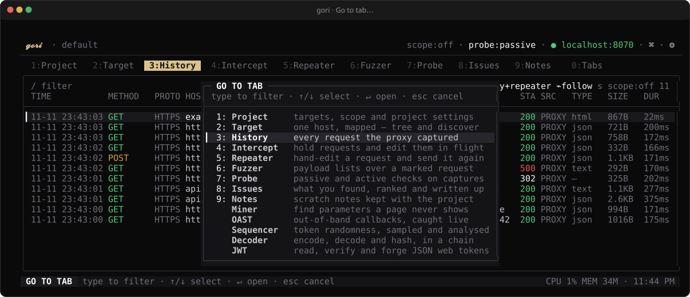

+++
title = "Keyboard Shortcuts"
description = "Rebind gori's keyboard shortcuts from the Preferences modal."
weight = 110

[extra]
group = "Customize"
shot = "command-palette"
+++

gori's keyboard shortcuts are rebindable from the **Hotkeys** editor. Reach it from Preferences (`Ctrl-,` → **Editor & Keys** → **Hotkeys**, then `↵`), or jump straight there with **`settings:hotkeys`** in the command palette (`Ctrl-P`). The editor lists every rebindable action grouped by where it fires (GLOBAL, HISTORY, REPEATER, FUZZER, INTERCEPT, …). Pick a row and press a new key.

```text
Ctrl-,  → Editor & Keys → Hotkeys
Ctrl-P  → settings:hotkeys
```

## Key budget (how new shortcuts earn a key)

Bare letter keys are scarce. New actions should pick a **price tier** before taking a chord:

| Tier | Price | When | Examples |
|------|-------|------|----------|
| **L0 Structural** | `Esc` `Enter` `Tab` arrows `Space` (leader) | Always | focus, open/close, READ/INS, space menu |
| **L1 Loop** | bare letter or sticky family (`^R`) | many times / minute | History/Issues `j/k` `/` `y` `t` (mark), History `v` (view), sub-tab strip `t` (mark), Repeater send |
| **L2 Session breath** | Global bare (cap: `c` `i` `s` only) | many times / session | capture, intercept, scope lens |
| **L3 Contextual** | `Space` then mnemonic | occasional, pane-local | compare, mine, send-group, copy-as |
| **L4 Rare / config** | palette (`Ctrl-P`) or Preferences (`Ctrl-,`) | rare | settings, Match & Replace, notifications |

Rules of thumb:

- Default for new pane actions is L3 (space menu only). Promote to a direct key only after the loop proves it.
- **Ctrl** is for actions that must work while typing (INS), and for run/stop on a workbench (`Ctrl-R` / `Ctrl-X`). It is not a general upgrade from bare.
- **Shift** carries the whole-tab wipes. `⇧X` is `Clear` in every tab that has one (History, Probe, Authorize, Issues, and the Project ACTIVITY feed), with `X` as the space-menu letter beside it. The letter is `x` because bare `x` is bound in none of those five scopes, while bare `c` is live in all of them (`capture.toggle`, and `dismiss` on the Probe list), and a project wipe should not sit one shift above a key pressed all day. A destructive chord must also be named where it can be read before it is pressed (the Help sheet and the tab's own body hint, not the space menu alone), and it must ask first.
- **`d` destroys.** Bare `d` deletes or dismisses the selected row in every scope that binds it (sixteen of them). The Repeater's response diff is on `⇧D` instead, so a `d` never lands on a display toggle. Its menu row is `Z` `d` (**Display…** → **Response diff**). The first-level `d` is **Duplicate sub-tab**, as on every sub-tab strip (see [the space menu](#space-menu)). A new pane action that is not a delete does not get `d`.
- **A pane's own key answers only in that pane.** The Repeater's `p` (pretty bodies) and `⇧D` (diff) act in the response pane, and the Fuzzer's `m` (matched only) and `v` (distribution sidebar) in RESULTS. In the request and template panes the bare key does nothing, since those lenses draw nothing there. In the Fuzzer template `v` is the menu's **Clear selection**.
- **Copy works while typing.** `y` copies in READ, and `Ctrl-Y` copies in INS as well, in every text box. In INS a bare `y` is a literal character, and typing it over a `Shift`+arrows selection replaces the selection, so copy needs a chord there. Both are the same verb (`*.copy`). A rebind moves the READ letter, and `Ctrl-Y` stays pinned in every scope, even through an explicit unbind. Unbinding `y` affects READ mode only, so a text pane always keeps a way to copy what you selected.
- **Every list that holds something worth copying binds `y`.** A pane that shows bytes, a row, or a line of record and does not answer `y` is a gap. The Intercept queue, the Evidence archive, the Project ACTIVITY feed and the OAST callback detail all answer it. Where two copies live in one place and mean opposite things (OAST's list copies the payload gori *sent*, its detail copies what came *back*), only one can hold the chord (a scope has no focus dimension in the keymap), and the other keeps its space-menu letter.
- **`/` filters the list you are looking at.** Every list long enough to scroll answers it, including the three rule lists: Colormarker, Match & Replace and the Probe **RULES** sub-tab (~40 built-in rules across three sections). The bar is a **lens**: it hides rows and never disables one, and `Esc` clears it. On the two lists where order decides which rule wins, a move is refused while a query is held, because the filtered list does not show the order the rule engine holds.
- **`f` has two tiers and one exception.** It is **freeze** in every evidence context (an Issue's RELATED card, the evidence viewer) and **find** on the sub-tab strip. The two are different tiers, so they cannot collide. History's follow and the Comparer's fold-unchanged are `Space` menu entries, since both are session-rare toggles (L3). The exception is the **Intercept queue**, where `f` forwards the held request and `⇧F` forwards them all. That is the tab's own loop key and its `f`/`⇧F` pair is consistent, so it stays, as `Ctrl-R` does for History → Repeater.
- **`x` selects a line; `t` flips a row's flag.** `x` means "select this line" in fifteen scopes. The four rule lists (Colormarker, Match & Replace, the Probe **RULES** list and the OAST providers) enable or disable a rule with `t`, which matches `t` as **mark** in History, Issues, the Sitemap and the Intercept queue. A rule list has no marks, so nothing collides, and the Rewriter's toggle is an ordinary rebindable chord.
- **`s` goes to the source, or flips the scope lens.** Those are its only two meanings. On the Evidence archive, an Issue's RELATED card, and the Probe list and detail, `s` opens the tab a row lives in. Everywhere else it is the Global scope lens. Swap A ⇄ B on the Comparer and the Diff is `w`, and global ⇄ project on the Colormarker and Match & Replace rule lists is a `Space` menu entry, so the lens is not shadowed there. One shadow remains: the Project **ACTIVITY** feed's `s` cycles the source chip, because that pane's `/` bar is a free-text query that does not parse `source:` / `level:` / `actor:`, so the three chips cannot fold into it.
- The space menu does not work in INS. Text editors take keys first, so `Space` stays a literal character there. An action that has to be reachable while typing needs a Ctrl chord, not only a mnemonic. For this reason `Ctrl-Q` carries the Repeater/Fuzzer decoder-chain editor, which gave `Ctrl-Y` up to Copy.
- **History → Repeater** and **Repeater send** stay on **`Ctrl-R`** (same muscle memory). Do not move History→Repeater to bare `r`.
- **`r` sends to the Repeater; `Ctrl-R` runs.** Bare `r` is "send this row to the Repeater" in the five scopes that have a flow to send, and nothing elsewhere: the Diff's Run moved to `Ctrl-R` (which already owns Run in nine scopes), OAST's Resume listener moved to `Shift-R`, and the Project ACTIVITY feed's Refresh is palette-only (`Ctrl-P` → **Refresh feed**), since the feed already re-reads on entry, on a peer's write and on the poll. The sub-tab strip renames on `e`, the menu's Rename letter, not `r`.
- Match & Replace and Notifications ship keyless (palette / badge); rebind them if you want a Global chord.

## One bare letter, one question {#grammar}

Each bare letter answers one question on every tab. An action takes one of these only if it
answers that letter's question. Anything else starts at L3 (the space menu).

| Key | Means |
|-----|-------|
| `Enter` | show this row in place |
| `o` | open this row's own detail (`Enter`'s alias; on the Sitemap `Enter` expands, so `o` is the only one) |
| `s` | go to the tab this row lives in, else the scope lens |
| `d` | delete / dismiss the selected row |
| `y` | copy |
| `t` | flip this row's flag (mark, or a rule's on/off) |
| `a` | add a row here |
| `e` | edit the selected row |
| `/` | filter this list |
| `f` | freeze (evidence) · find (the sub-tab strip) |
| `r` | send this to the Repeater |
| `Ctrl-R` | run |
| `w` | swap A ⇄ B |
| `x` | select this line |
| `Shift-X` | clear this tab (asks first) |
| `Space` | this tab's command menu |

There are three exceptions, each a tab's own loop key: **Intercept** `f` forwards (and
`Shift-F` forwards all), **History → Repeater** and **Repeater send** stay on `Ctrl-R`, and the
Project **ACTIVITY** feed's `s` cycles the source chip.

## Editing {#editing}

The editor opens a working copy. Nothing is saved until you press `Enter`, and `Esc` discards every change.

| Key | Action |
|-----|--------|
| `↑` / `↓` (or `j` / `k`), wheel | Move the selection |
| `/` | Search the action list |
| `e` or `Space` | Rebind the selected action, then press the new key |
| `x` or `Backspace` | Unbind the selected action |
| `r` | Reset the selected action to its default |
| `Shift-R` | Reset every action to its defaults |
| `←` / `→` | Cycle the OS default profile (see below) |
| `Enter` | Save + apply (live, no restart) |
| `Esc` | Discard and close |

When you start a rebind the footer shows *"press a key to bind"*. Press the chord you want, modifiers included, except the ones listed under *Reserved keys* below. If the key is reserved or already used by another action in the same place, the editor refuses it and tells you why. Capture stays open so you can try another key.

A row's chord shows `(unbound)` when nothing is bound. The `●` marker means you've changed it from the default; `·` means it's at the default.

## Conflicts

Two actions may share a key only if they fire in different places. `s` is "scope lens" almost everywhere but "go to source" on Probe. `c` is "toggle capture" globally, but the Intercept queue cycles the catch direction with it, and Probe dismisses, Cookie cracks, Evidence compares and the Sequencer reconfigures. The editor blocks only a same-place collision, because there the keymap could keep just one of them.

## The Digit Family {#digits}

The tab bar is **nine numbered slots**, and the numbers are the primary way to move:

| Key | Action |
|-----|--------|
| `1`-`9` | Jump to slot N on the tab bar |
| `0` | **Go to tab…**: a type-to-filter list of all 21 tabs, each with a line on what it is for |
| `⇧1`-`⇧9` | Jump to sub-tab N of the active tab |
| `⇧0` | **Find sub-tab…**: the same picker `f` opens from the strip |

<figure class="tui-shot">
  
  <figcaption><code>0</code> opens the whole catalog. The nine on the bar wear the digit that reaches them; the rest wear none. That is the only difference being off the bar makes.</figcaption>
</figure>

These work from everywhere (the tab bar, the sub-tab strip, a list body, a drill-in
detail, a read-only pane) except while a field is taking text (an editor in INS, a `/`
query bar or search, a line prompt, a picker's filter, the CVSS scorer, the Decoder's
CHAIN field). There a digit is a character, as `Space` is, so `base64`, `sha256` and
`rot13` can be typed into a conversion chain.

The bar paints the numbers by default (**Preferences → Display → Tab numbers**, `settings:display`).
The pill just past the last tab reads `0:Tabs`: the key, and what it opens. It sits two
columns after the ninth slot, so `→` walks the tabs in reading order. When the strip no
longer fits beside it, it pins right and the tabs scroll. It shows in every layout, because
`0` reaches the whole catalog, the nine on the bar included. The space to its right is kept
free for a readout that is not a tab.

### Nine slots, and the tenth tab

`settings:tabs` refuses a tenth tab and says so. Press `⇧K` on a row below the seam instead
to trade it onto the bar and the last slot off. A layout saved by an older
build (the bar used to be unbounded) is truncated to its first nine, in your own order,
and gori names the folded tabs once on the launch that does it.

One tab can still ride past the ninth slot: an off-bar tab you jumped to with `0` sits at the
far right of the bar, without a number, until you leave it.

If you want the old unbounded bar back, turn off **Preferences → Display → Tab bar slots**.
The bar then scrolls with `‹` `›` again, `1`-`9` still reach its first nine tabs, and `0`
still reaches every tab.

### Keyboard layouts

A terminal speaking the **kitty keyboard protocol** reports `⇧3` as `3` plus a shift flag,
and gori binds that. Every other terminal sends the shifted digit as a **character** (`#` on
a US layout), which gori folds back onto `⇧3`. On a **non-US layout** that character is a
different one, so `⇧1`-`⇧9` work where your terminal reports the shift modifier and not
otherwise. Two fallbacks always work: `f` on the sub-tab strip opens the same picker
`⇧0` does, and `Ctrl-1`…`Ctrl-9` is the alias for `⇧1`-`⇧9` on terminals that deliver it.

The rest of the shifted punctuation row goes the other way. A character that only exists with
Shift (`>`, `?`, `{`, `}`, `~`, `|`, …) already says Shift was held, so gori drops the shift
flag a terminal reports beside it (kitty's report-all-keys, xterm's `modifyOtherKeys`). A bare
`>` opens [Send flow to…](#send-flow-to) and `?` opens Help on those terminals too.

## The space menu {#space-menu}

> **Learning the menus?** [Space Menu & Palette](/guide/space-menu-and-palette/) walks through the space menu, its second cards and the palette's search, with a five-minute exercise. This section is the reference: the rules behind every letter and the full tables.

`Space` in a navigable pane opens the action menu for where you are: the
pane's own verbs, grouped under `COMMON` and the focused area's label, each fronted by one
mnemonic letter. Unlike the palette, it has no typing or filter. Each row runs on one
keypress.

### Moving inside the menu {#menu-nav}

`↑`/`↓` or `j`/`k` move the selection, `←`/`→` or `h`/`l` change column, and `↵` runs the
highlighted row. No row is ever lettered `h`, `j`, `k` or `l`, at either level, so those four
always move, as on every list in the app. gori refuses to start if a row breaks this. The
**Send selection to…** card (`S`) is a picker, not a menu level. It letters JWT `j` and
Cookie `k`, and moves with the arrows.

Under this rule, **Link…** and **Manage links** are `L` on every tab (formerly `k` or `l`),
**Add host to scope** is `H` (formerly `h`), and the Activity feed's **Filter by level** is
`v` in the menu (its bare key is still `l`). The Discover tab's next and previous run and the
Fuzzer's **Add List payload set** are in the [palette](#palette-only) only.

### Finding a tab's action by name {#palette-search}

To find an action by name instead, type it into the palette (`Ctrl-P`). Once you type a query,
the palette searches the actions of the pane you opened it from as well as the app-wide
commands. It uses the same set `Space` would show there, plus the actions that have no menu
letter. The pane's matches come first under `THIS TAB`, then the app commands under `APP`.
Each tab row shows its fast path on the right: its key if it has one, else its menu letter
(`␣ t` means `Space`, then `t`; `␣ > c` is a row inside [Send flow to…](#send-flow-to)). If you have rows marked, the title reads
`COMMANDS · 3 MARKED`, as in the space menu, and a batch action acts on all of
them. With the query empty, the palette lists only the app commands.

Opened over a History flow detail, the palette searches the detail's actions. `Esc` from the
palette returns you to that detail, and an action you pick runs against the flow on screen.

### Actions only the palette lists {#palette-only}

The space menu holds what you press often, and the palette holds the rest. An action that
only repeats a key you already have, for an editing or navigation convenience, or that you use
about once a session to configure something, has no menu row. Type its name into `Ctrl-P` from
the tab it belongs to and it is listed under `THIS TAB`. Its key, where it has one, still
works, and Help names the route: the key, or `^P → <name>` for an action with none.

| Tab | Action | Key |
|-----|--------|-----|
| Repeater | Mark word · Edit decoder chain · Pretty-print request | `Ctrl-K` · `Ctrl-Q` · `Ctrl-U` |
| Repeater | Minimize request · Use as refresh for slot… · GraphQL: insert introspection query · GraphQL: insert legacy introspection query | palette |
| Repeater | GraphQL: multiply operation (batched array) · GraphQL: multiply operation (aliased) · Edit gRPC message as JSON · Add gRPC field · Send WS message as binary (hex) | palette |
| Fuzzer | Mark word · Edit decoder chain · Pretty-print template | `Ctrl-K` · `Ctrl-Q` · `Ctrl-U` |
| Fuzzer | Add List payload set · Save results | `Ctrl-L` · `⇧E` |
| Fuzzer | Run history | palette |
| History | gRPC: reflect schema | palette |
| JWT · Cookie | Toggle decode/encode (decode/forge) · Cycle signing alg (format) | `Ctrl-T` · `Ctrl-A` |
| Comparer | Next change · Previous change | `⇧N` · `⇧P` |
| Decoder | Save chain by name · Load a saved chain · Cycle output mode | `Ctrl-S` · `Ctrl-O` · `Ctrl-X` |
| Issue detail | Edit title/severity · Retest… | `t` · `⇧R` |
| Issue detail | Raise severity · Lower severity | palette (**Set severity** keeps `Space` `s`) |
| Rewriter · Colormarker | Move up · Move down | `⇧K` · `⇧J` |
| Rewriter · Colormarker | Reload rules | palette |
| Discover | Previous run · Next run | palette |
| Sequencer | Export report (JSON)… | palette (**Export report** keeps `Space` `E`) |
| Project | Refresh feed (ACTIVITY) · Change prefix (ENV) | palette |
| Notes | Go to line | palette |

### One menu per tab, whatever has focus

Nine tabs carry a **sub-tab strip**: Repeater, Fuzzer, Miner, Sequencer, Decoder, JWT,
Cookie, Comparer and Notes.

The strip's actions form their own `SUB-TABS` bucket, and it is in the menu from every level
of a tab that has a strip: the body panes, the strip itself and the tab bar. `⇧1`-`⇧9` can drop
you anywhere, so what `Space` offers does not depend on which row the cursor is on.

In a body pane the bucket is one row, `T` **Sub-tabs…**, which opens a card with the
bucket on the letters below. `Space` `T` `w` closes the sub-tab from the request editor.
With the strip or the tab bar focused, the strip is the context, so the bucket is drawn in full at the top level and there is no Sub-tabs… row. The
letters are the same either way: `n` from the strip is `T` `n` from a pane. **Paste cURL**
(`U`, Repeater) also keeps its own row in the panes, and `Ctrl-N` / `Ctrl-W` work everywhere.

### The same nine letters on all nine strips

Every strip uses the same letters. A tab that lacks an action omits the row and never
uses that letter for something else.

| Key | Action | Direct chord |
|-----|--------|--------------|
| `n` | New sub-tab | `Ctrl-N` |
| `w` | Close sub-tab (or every marked one) | `Ctrl-W` |
| `d` | Duplicate sub-tab | |
| `e` | Rename sub-tab | `e` on the strip |
| `t` | Mark or unmark the active sub-tab | `t` on the strip |
| `f` | Search sub-tabs (the `⌕` picker) | `f` on the strip, `⇧0` anywhere |
| `/` | Filter the strip (name / host / method / tag) | `/` on the strip |
| `T` | Mark every sub-tab the filter shows | `⇧T` on the strip |
| `N` | Clear the sub-tab marks | `Esc` on the strip |
| `g` | Tag sub-tab (Repeater) | |

`Ctrl-N` and `Ctrl-W` are shown beside their rows, and they work from any pane on all nine
tabs. Miner and Sequencer seed their sessions from a run, so they have no `n`.

From a pane, `T` `T` marks every sub-tab (a lone `T` used to), so the old reflex lands in the right card. The
menu's `t` is the strip's own `t`, marking the sub-tab you are on, so the Repeater's Tag is
on `g`, a letter no strip key answers.

The nine letters are reserved in the COMMON rows of those tabs, which share the card with
the expanded bucket on the strip, and gori refuses to start if a COMMON row breaks it. A pane's
own rows may use them, since from a pane the bucket is one level down. Only `T`, the
Sub-tabs… row, stays taken there. Some pane actions gave the nine up while every pane still
drew the whole bucket, and keep their other letters for now: Mark word in the Repeater/Fuzzer
editors and the JWT and Cookie lens toggles (now [palette-only](#palette-only) on `Ctrl-K` and
`Ctrl-T`), JWT and Cookie's copy OUTPUT (`C`) and Notes' `$EDITOR` (`o`).

### One intent, one letter {#one-intent-one-letter}

An action that recurs across tabs has the same menu letter on every tab that has it. The
letter comes from one table in the source (`Verb::Lexicon`), so two tabs cannot disagree
on it:

| Key | Action |
|-----|--------|
| `/` | Filter this list |
| `d` | Delete or dismiss the selected row |
| `x` · `v` | Select the line · clear the selection |
| `y` · `Y` · `S` | Copy · Copy as… · Send selection to… |
| `t` · `T` · `N` | Mark · mark all · clear marks (on a rule list, `t` enables/disables) |
| `o` | Open the selected row (the `↵` alias) |
| `a` · `e` | Add · edit; on most tabs `a` also files an issue |
| `r` · `s` | Run, send or reload (the menu echo of `Ctrl-R`) · stop, swap A ⇄ B, the scope lens, set an issue's severity |
| `E` | Export |
| `K` | Clear the workbench input (asks first) |
| `I` | Insert a `§` marker |
| `C` | Clear every `§` marker · set an issue's status · duplicate a rule |
| `L` · `H` | Link… (attach to an issue or note, or manage links) · add the host to scope |
| `O` · `M` · `V` | Insert (or, in History, copy) an OAST payload · mock this response · set an issue's CVSS |
| `X` | Wipe the tab (asks first), and nothing else |

`/` `d` `x` `y` `Y` `S` `t` `T` `N` and `X` are **reserved**: on a tab that has the action, no
other row wears the letter. The rest are the action's wherever it exists and free for a tab-local row where it
does not. Rewriter and Colormarker's **Enable/disable everywhere** is `T` because `X`
wipes.

No row is `c` or `i` on a tab that does not bind the letter itself. There a press that loses its
`Space` reaches the global keys, and those two stop capture and hold all traffic. Status, rule
duplicates and marker clears are `C` instead, and Diff's **Add issue** is `F`, its own `⇧F`.

### Send flow to… {#send-flow-to}

Handing the selected flow to another tool is one row, **`>` Send flow to…**, which opens a
second card. Inside it every tool has the same letter on every tab:

| Key | Sends the flow to |
|-----|-------------------|
| `r` | Repeater |
| `f` | Fuzzer |
| `c` | Comparer |
| `m` | Miner (the Params tab's Mine parameters too) |
| `s` | Sequencer |
| `a` | Authorize |
| `D` | Discover |
| `b` | the browser (Open response in browser) |

`Space` `>` `c` sends to the Comparer from History, the Sitemap, a Repeater tab or a Fuzzer
result alike. A tab lists only the tools it can send to. The letters match the
**Send selection to…** card (`S`): Sequencer is `s` in both, and Decoder keeps its `d`
there, so Discover is `D`.

- **`>` on its own opens the card too**, on every tab that has it: `>` `f` sends to the Fuzzer
  without the `Space`, and a dropped `Space` still lands in the same card. No tab binds `>` to
  anything else.
- **Send to Repeater keeps its own letter too**: `r` on History, the detail, the Sitemap, Probe,
  Evidence and an issue, `R` on the Fuzzer and the Miner, where `r` runs the tab.
- The `>` row is drawn whenever the tab has a send, even when nothing is selected. The card then
  says **nothing here right now**, so `Space` `>` `r` typed quickly never reaches the pane
  underneath.
- `Esc` or `Backspace` goes back one level, and `Esc` again closes. Any other key closes the
  whole menu, as at the first level.
- The title reads `SPACE › SEND FLOW TO`, with `· 3 MARKED` when rows are marked.
- Direct keys are unchanged: `Ctrl-R` / `r` to the Repeater and `⇧I` to the Fuzzer still work.

On History these used to be `c` `z` `m` `q` `u` `d` `⇧B`. With Discover off `d`, Delete is `d`,
its own bare key. The detail's Delete is `d` too.

### Display… and Protocol… {#display-protocol}

The toggles are two more cards. **`Z` Display…** holds what changes how a pane draws what it
holds, and **`P` Protocol…** holds what changes what a Repeater or Fuzzer request sends. An
action that rewrites the request itself, such as pretty-print request (`Ctrl-U`), is not a toggle
and stays out of both cards.

| Display… | | Protocol… | |
|-----|---|-----|---|
| `x` | Hex (History detail, both Repeater panes) | `2` | HTTP/2 |
| `p` · `u` · `b` | Pretty · Unicode escapes · whitespace | `s` | SNI override |
| `d` · `e` | Response diff · envelope/decoded | `c` | Auto Content-Length |
| `s` · `f` · `c` | Static assets · follow · Columns… (the Fuzzer's Extractors…) | `w` | Reuse Sec-WebSocket-Key |
| `g` · `q` · `J` | Fold ids · fold queries · JS references | `r` · `f` | gRPC reframe · gRPC field editor |
| `m` · `v` · `G` | Fuzzer: matched only · distribution · group by shape | `t` | TLS fingerprint |
| `t` · `z` | Comparer: requests/responses · fold unchanged | `o` · `b` | WebSocket live session · Engine.IO heartbeat |
| `a` | Show all: Probe's closed findings, the Params tab's standard headers | | |
| `C` | Probe: group by check (on by default) | | |
| `S` | History detail: request beside response (on by default, saved) | | |

Both cards are **sticky**. After a row runs, the card comes back at the same row, so you can
flip several settings in one visit. Each row shows its state: `●` on, `○` off, or a
value such as the TLS preset's name. `Esc` closes the card. It does not come back when a row
opened something of its own, such as the SNI field, the gRPC field list, the request hex editor
or the column editor, or when the row moved focus.

- **`⇧Z` and `⇧P` on their own open the cards too**, like `>`: `Z` `c` without the `Space`
  still reaches Columns…, rather than a bare `c` that stops capture.
- Display… is `Z`, not `V`: under the `vim` keyset `⇧V` selects a line in every pane that has
  these toggles, so a dropped `Space` would select instead of opening the card.
- The Fuzzer's **Cycle sort** stays a direct row (`Space` `o`), because it is the one you press
  most while reading results.
- Direct keys are unchanged: `Ctrl-X` hex (in the Repeater, the pane that has focus: the
  request's hex edit or the response's hex dump, and both rows show it), `p` pretty, `u` Unicode, `b` whitespace, `⇧D` diff,
  `Ctrl-T` envelope, `a` show all, `Ctrl-V` HTTP/2, `Ctrl-S` SNI, `Ctrl-L` auto Content-Length.

Hex used to be `e` in the History detail, `x` in the Repeater request pane and `h` in its
response pane, and is now `Z` `x` in all three. Probe's **Show closed** and the Params tab's
**All headers** were `Space` `a` and are `Z` `a`, and Mine parameters on Params was `Space` `m` and
is `>` `m`; their bare `a` and `m` still work. Save results on the Fuzzer is no longer `P`. It is
`⇧E`, the Export chord, and [palette-only](#palette-only). The History detail has no **Copy flow** row. `Space` `Y` (Copy as…)
on the REQUEST pane has **Raw request**, the same text.

## Editor Keysets {#editor-keysets}

gori's text panes are **modal**: `Esc` and `i` move between READ and INSERT, and in READ the bare letters are commands. The shipped grammar is helix-shaped: select first, then act. `x` selects the line, then `y` copies it or `d` deletes it, and `p` pastes. vim spells the same edits `yy`, `dd` and `p`, or `V` then `y` / `d`.

**Preferences → Editor & Keys → Keys → Editor keyset** (`Ctrl-,`), or **`settings:keys`** in the palette, switches it. Typing `vim`, `helix` or `keyset` into the palette (`Ctrl-P`) finds that row too. The first-run wizard (`gori wizard`) does not ask. Its Review step shows the keyset in use and points here. The **Keyset playground** row under Editor keyset opens a three-line practice pad that answers in the keyset you are trying, with every READ-mode key of that keyset listed beneath it, so you can try `x` `d` against `dd` before choosing. `↑`/`↓` switch keysets, and `⇥`, `↵` or any letter moves into the pad. The playground does not change your keyset. Pick it on the Editor keyset row above. The pad's copies stay in gori's paste register and never reach your clipboard, and the playground puts the register back as it was when it closes.

| Keyset | Select line | Delete line | Copy line | Paste | Undo | Find | Append | Top / bottom |
|--------|-------------|-------------|-----------|-------|------|------|--------|--------------|
| **helix-ish** (default) | `x` | `x` then `d` | `x` then `y` | `p` | `Ctrl-Z` | `Ctrl-F` | — | — |
| **vim-ish** | `⇧V` | `dd` | `yy` | `p` | `u` | `/` | `a` | `g` / `⇧G` |

Everything not in that table is the same under both keysets, because gori already spells it the way vim does: `i` enters INSERT, `Esc` leaves it, `Ctrl-G` goes to a line, and arrows plus `Shift` extend a selection. In READ, `h` `j` `k` `l` move the caret in every text pane as the arrows do, and `⌥←` / `⌥→` (`Ctrl` on Linux and Windows) step a word. The delete and copy keys act on any selection too, not only on a line: under `vim-ish`, `⇧V` then `d` or `y` works as it does in vim.

A line selection stays whole lines while it grows: `⇧↑` / `⇧↓` add a line at a time under both keysets, and under `vim-ish` a plain `j` / `k` does too, so `⇧V` `j` `j` `d` deletes three lines. A sideways step turns it into an ordinary character selection. `Esc` over any READ selection clears it, under both keysets. The next `Esc` leaves the pane as before.

`vim-ish` also steps a word with `w` / `b` in READ, and `⇧A` / `⇧I` start typing at the end / start of the caret's line.

### Delete and paste in READ {#read-edits}

These work in every text editor pane: the Repeater request, the Fuzzer template, the Intercept editor, Notes, an issue's notes, the Project description, and the Decoder, JWT and Cookie inputs.

- **Delete** (`d` after a selection, `dd` under `vim-ish`) removes the text and keeps it for `p`. A whole-line selection is removed with its line break, so no blank line is left behind.
- **Paste** (`p`) puts back the last thing you copied or deleted, after the caret. Whole lines go in as new lines below the caret's line. Anything else is inserted inside the line.
- gori keeps what `p` pastes in its own **paste register**, filled by every gori copy (`y` and the copy pickers) and by every delete. It does not read the system clipboard: terminals refuse to hand it back, or ask first. To bring in text from another program, paste it with your terminal as before. That opens INSERT on its own. A delete does not overwrite the system clipboard.
- An edit made in READ is an ordinary edit, and the pane treats it as if you had typed it: the Repeater keeps `Content-Length` in step, the Fuzzer still guards its `§` markers, and an issue's notes are saved as `Esc` saves them. `Ctrl-Z` (`u` under `vim-ish`) takes a delete back in one step, and a paste the way a terminal paste in that pane undoes: in one step, except in the Project description and an issue's notes, which take a paste key by key and undo it line by line.
- With nothing selected, `d` under `helix-ish` says so instead of deleting. Under `vim-ish` the first `d` or `y` waits for the second. Any other key cancels it, and `Esc` cancels it without a message. With nothing selected, `y` under `vim-ish` waits for `yy` rather than copying the whole pane, so use `Ctrl-Y` for that.
- Read-only panes keep their own letters: `p` is still **Pretty bodies** in the Repeater response and the History detail.

### A keyset is a mapping, not an emulation

It is a named bundle of key **overrides** for a small, fixed set of editor actions: the same mechanism as the [OS default profiles](#os-default-profiles), one layer up. It does not add motions after an operator, counts, text objects, named registers, or any editing operation gori's panes do not already have. A READ-mode pane has a caret, a selection, a copy, a delete and a paste, and a keyset names keys only for those.

These vim spellings are not offered:

- **`gg` and every other two-key sequence except `dd` and `yy`.** A gori chord is one keystroke. `dd` and `yy` are the exception: their first press waits for the second. `g` alone is the top of the pane. `d` and `y` take no motion, so `dw`, `dj` and `d2d` are cancelled.
- **`$` and `0`.** `$` arrives as `⇧4`, which jumps to the fourth sub-tab, and `0` opens Go to tab. An editor binding either would take that key away inside text panes. `End` and `Home` reach the line edges under both keysets.
- **`:` commands, including `:42`.** A bare `:` is [reserved](#reserved-keys) for gori's own command line, so go-to-line stays `Ctrl-G` under both keysets.
- **`x`, `D`, `P`, `o`, `J` and the rest of vim's editing keys.** Delete and paste are the READ-mode edits gori has. Everything else happens in INSERT.
- **A rule list's enable/disable** (Colormarker, Probe rules, OAST providers, Rewriter), which is `t` on all four. It is not a selection, so no keyset moves it.
- **The Intercept queue's select-line**, which has no key. That pane reaches it from the space menu, and a keyset only respells existing keys, so it does not add one.

### The override order

Four layers, most specific first:

```text
your own rebinding  >  the keyset  >  the OS default profile  >  the shipped chord
```

If you pick `vim-ish` and then rebind one action in the [Hotkeys editor](#editing), that one stays where you put it. "Reset to default" on a row puts it back to the active keyset's spelling, not to the shipped one.

Every surface reads the effective keymap, so all of them follow the active keyset: the status hint strips, the Help tab, the command palette, the space menu and the Hotkeys editor's own conflict messages. Under `vim-ish` the Notes footer reads `/ find` where it read `^F find`, and binding something to `⇧V` is refused by name because Select line is there.

### It does not touch the space menu's letters

A keyset moves the key you press in the pane, not the letter the [space menu](#space-menu) puts in front of a row. Any per-action rebind follows the same rule, so menu letters never change. Under `vim-ish` the menu still fronts Select line with `x`, and prints the live chord beside it:

```text
│ x Select line   ⇧V │
```

so the card shows both. The nine `SUB-TABS` letters (`n` `w` `d` `e` `t` `f` `/` `T` `N`, inside **Sub-tabs…** from a pane) likewise mean the same thing on all nine strips whichever keyset you pick. The two cannot collide, because the menu is modal and a keyset only writes to the keymap.

This includes `/`, which is a `SUB-TABS` letter and `vim-ish`'s find key. The menu letter acts on the strip while the card is up, and the chord searches the text pane you are in. The one pane-key overlap is `u` in the Repeater's read-only response: it toggles display-only JSON Unicode decoding. The request editor is still in the Editor scope, where `u` means undo. `validate_chords!` checks same-scope collisions at boot; the cross-scope exception is pinned in `spec/verb/keyset_spec.cr`.

A few menu letters are also a `vim-ish` motion in an editor pane: Auto-mark `a` (append), `g` on the Repeater, Cookie and issue detail (top), Send race `⇧G` (bottom), Set CVSS `V` (select line), and Insert marker `⇧I` and Probe active `⇧A` (start typing at a line edge). If the `Space` before one of them is lost, the key does what vim would, which moves, selects or starts typing, and never sends, writes or deletes. The editing letters are the other overlap, under both keysets. Inside a text editor `d`, `y` and `p` are the editor's, so a lost `Space` before the menu's `d` (Delete issue in an issue's notes) or `y` (Copy) edits or copies the text in that pane, says so, and can be undone. A menu letter that lands on anything else in the pane is refused.

### What still works whatever you pick

`Ctrl-Z` still undoes inside INSERT under `vim-ish`, because that guard runs before the keymap in every text editor. `Ctrl-F` still opens the find prompt, INSERT included. `/` is added in READ alongside it. `i` is refused with a message on a read-only pane that sits beside an editor (the Repeater response, the Fuzzer results, the Decoder output), under both keysets.

## Reserved Keys {#reserved-keys}

Some keys can't be rebound because the terminal or gori needs them:

- **Quit**: `Ctrl-C`, `Ctrl-D`.
- **Indistinguishable from named keys**: `Ctrl-M` / `Ctrl-J` (Enter), `Ctrl-I` (Tab), `Ctrl-H` (Backspace), `Ctrl-[` (Escape).
- **Structural**: `Enter`, `Esc`, `Tab`, `Backspace`, `Space` (the space-menu leader), and a bare `:` (the command line).
- **gori shortcuts claimed before the keymap**: `Ctrl-G` (go to line), `Ctrl-F` (find, then `Tab` for find & replace), `Ctrl-B` (reveal whitespace), `Ctrl-E` (external editor), `Ctrl-P` (command palette), `Ctrl-N` (new repeater/fuzz/note), `Ctrl-W` (close the sub-tab, or every marked one), `Ctrl-Z` (undo, consumed by every text editor: Repeater, Fuzzer, Notes, Issues, Intercept, Decoder, JWT, Cookie, Rewriter and the Project description), `Ctrl-,` (Preferences), and `Ctrl-1`…`Ctrl-9` (switch sub-tab, the **alias** for `⇧1`-`⇧9`; see [The digit family](#digits)). These are handled by a hardcoded guard before the keymap, so a binding on them would never fire. For the same reason **Command palette**, **Reveal whitespace**, **Quit**, **Back to projects**, each tab's **New …** (Repeater, Fuzzer, Decoder, JWT, Cookie, Notes, Comparer) and its close-sub-tab action aren't listed in the editor. Their key is fixed.

  You can't move an individual key out of that family, but you can give the whole family a second modifier. See [Command modifier](#command-modifier) below.

  `Ctrl-G` / `Ctrl-F` act on whichever multi-line pane has focus: the Repeater's request and response, the History detail, the Intercept editor, Notes, the Project description, the Decoder's INPUT and OUTPUT, and the Fuzzer's template and result detail. `Tab` switches find to find & replace on the six that are editable. The others are read-only, and the prompt says so instead of offering a replace.

Flow-control/signal chords like `Ctrl-S` are not reserved. gori runs the terminal in raw mode, so they reach the app (Repeater's SNI toggle ships on `Ctrl-S`).

## OS Default Profiles {#os-default-profiles}

The `←` / `→` profile selector picks which **default** key set a fresh (un-overridden) binding uses: `auto` (tracks the platform gori was built for), `macOS`, `Linux`, or `Windows`. Your own rebindings always sit on top of the chosen profile, regardless of OS.

The per-OS defaults are currently identical. In a terminal, `Ctrl`+letter chords reach the application on macOS, Linux, and Windows alike, and the hazardous keys are the reserved control characters above (blocked everywhere). The profiles exist so a per-terminal clash can be fixed without touching dispatch. Use `auto`.

## Command Modifier {#command-modifier}

The chord family listed under *Reserved keys* is fixed because a hardcoded guard runs before the keymap. That matters when your terminal never delivers the Ctrl form:

- **`Ctrl-1`…`Ctrl-9` is undeliverable on many terminals**: there is no control character for it, so the sub-tab jumps never arrive. You do not need it. `⇧1`-`⇧9` is the primary sub-tab jump (see [The digit family](#digits)), and on a sub-tab strip `f` lists and searches every open sub-tab, from whichever chip you are on. The `⌕` at the strip's left edge opens the same list. Click it, or press `←` from the first chip.
- **A multiplexer eats the chord first.** tmux's default prefix is `Ctrl-B`, which gori also uses for reveal-whitespace.

**Preferences → Editor & Keys → Keys → Command modifier** (`Ctrl-,`), or **`settings:keys`** in the palette, switches that family between `Ctrl` and `Option (⌥)`. It adds an alias and keeps Ctrl: with Option selected, both `⌥P` and `^P` open the palette. Only the advertised form changes: status hints, the Help tab and the palette all start showing `⌥P`, `⌥N`, `⌥1-9`.

| Modifier | Effect |
|----------|--------|
| `Ctrl` (default) | `^P` `^N` `^W` `^G` `^F` `^B` `^E` `^Z` `^,` `^1`-`^9` |
| `Option (⌥)` | the above **plus** `⌥P` `⌥N` `⌥W` `⌥G` `⌥F` `⌥B` `⌥E` `⌥Z` `⌥,` `⌥1`-`⌥9` |

Because Ctrl keeps working, picking Option cannot lock you out of the palette. **On macOS your terminal must be set to send Option as Meta/Esc+**, or `⌥P` arrives as `π` and nothing happens:

- **Terminal.app**: Settings → Profiles → Keyboard → *Use Option as Meta key*
- **iTerm2**: Settings → Profiles → Keys → Left/Right Option key → *Esc+*

It does not touch chords the editor can already rebind (`^R` send, `^S` SNI, …). Rebind those per action instead. If you had bound an action to an `Option` chord in the family (`alt-n`, say), turning the alias on shadows it: the guard wins, that action reverts to its default, and the save toast names it.

The first-run wizard recaps this on its Review step, so you can pick a modifier before reaching the app.

## Where It's Stored

Saved to `~/.gori/settings.json` (override the directory with `$GORI_HOME`) under a sparse `hotkeys` block. Only the bindings you changed are written, as a list of chord labels per action id. An empty list is an explicit unbind:

```json
{
  "hotkeys": {
    "os": "auto",
    "command_modifier": "alt",
    "keyset": "vim",
    "bindings": {
      "rules.edit": ["g"],
      "scope.edit": []
    }
  }
}
```

`command_modifier` is `"ctrl"` (the default) or `"alt"`, and `keyset` is `"helix"` (the default) or `"vim"`. See [Editor keysets](#editor-keysets). An unknown value for either falls back to the default rather than to no keys. An untouched install writes no `hotkeys` block.

An absent action uses the profile default. Unknown ids and unparseable chords are ignored on load, so a hand-edit or a file from another version still loads.

## Limitations

- Only an action's **primary** chord is shown/edited; navigation aliases (the arrow-key duplicates of `j` / `k`, for example) aren't listed.
- Every surface that names a rebindable chord reads it from the effective keymap: the **command palette**, the **space menu**, the **Help** tab and its popup, the status-bar hint strips, and the empty-state cards. What stays literal is not a verb: the claimed `^P` / `^N` / `^W` / `^1-9` family (the sub-tab alias) and structural keys (`esc`, `↵`, arrows, `↹`).
- Space-menu mnemonic letters are fixed per action (Helix-like). Rebinding changes the direct chord, not the space-menu letter.
- Where the **sub-tab strip** binds a letter for an action, the menu spells that action with the same letter: `t` marks the sub-tab, `f` lists and searches the sub-tabs, `⇧T` marks the whole strip, and `e` renames. `r` is `Run`/`Send` (the menu echo of `Ctrl-R`) in the Repeater, Fuzzer, Miner and Sequencer, so Rename on the strip (formerly `r`) is the menu's `e`, and `r` on the strip does nothing. See [the space menu](#space-menu) for the whole table.
- The editor actions are rebindable individually, and as a set via [Editor keysets](#editor-keysets). The rebind editor does not move the few whose chord a hardcoded guard answers first: `Esc` (back to READ), `Ctrl-Z`, `Ctrl-F` and `Ctrl-G`. They are listed in the Help sheet so you can read them, and a keyset can give them a second, bare spelling, which is how `vim-ish` reaches `u` and `/`.
- Press **`?`** from a navigable context to open the key cheat-sheet as a popup over the pane you are in, starting at that tab's section. Press **`?`** again inside it for the full **Help** tab.

## Next Steps

- [Settings](/guide/settings/): the Preferences modal and every section in it
- [Themes](/guide/themes/): switch or create colour themes the same way
- [Configuration Reference](/reference/config/): the `hotkeys` key in `settings.json`
