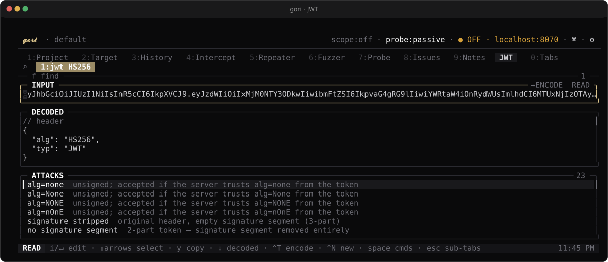

+++
title = "JWT 보안 테스트"
description = "JSON Web Token을 HMAC과 비대칭 알고리즘 전반에서 디코드·검증·편집·재서명하고, alg:none, weak-secret, header-injection, algorithm-confusion 페이로드를 생성합니다."
weight = 50

[extra]
group = "워크벤치"
shot = "jwt"
+++

**JWT** 탭은 JSON Web Token을 다루는 워크벤치입니다. 토큰을 디코드하고, claim을 편집해 재서명하며, 서버에 시험해 볼 대표적인 공격 페이로드를 생성합니다. [Decoder](/ko/guide/decoder/)의 읽기 전용 `jwt-decode` 컨버터는 파트를 보여주기만 합니다.

<figure class="tui-shot">
  
  <figcaption><strong>JWT</strong> 탭은 토큰을 실시간으로 디코드하고(header, payload, signature), 바로 보낼 수 있는 공격 페이로드(alg:none, weak-secret, header injection)를 나열합니다.</figcaption>
</figure>

어디서든(**History** 상세 패널, **Notes** 등) 토큰을 선택하고 `Space` `S`(**Send selection to…**) → `j` **JWT**를 누르면 그 토큰으로 새 워크벤치 서브탭이 열립니다. 세션은 휘발성이라 디스크에는 아무것도 기록되지 않습니다. 이 탭은 기본적으로 바 밖에 있습니다. **`0`**을 누르고 "jwt"를 입력하거나, 커맨드 팔레트(`Ctrl-P` → **Go to JWT**)를 쓰거나, Preferences에서 슬롯을 내주세요.

## 두 개의 렌즈 {#two-lenses}

세션 하나를 두 가지 뷰로 보며, `Ctrl-T`로 전환합니다. 각 렌즈의 맨 위 카드 테두리에 전환 칩이 있습니다(INPUT에는 ` →ENCODE `, HEADER에는 ` →DECODE `). 칩을 클릭해도 전환됩니다.

- **Decode**: INPUT에 토큰을 붙여 넣으면 header, payload, signature가 실시간으로 디코드됩니다. 그 아래에는 생성된 **공격 페이로드**를 고를 수 있는 목록이 있습니다.
- **Encode**: HEADER와 PAYLOAD를 JSON으로 편집하고, 알고리즘을 선택하며(`Ctrl-A`로 HMAC 계열 → `RS`/`PS`/`ES`의 256/384/512 → `EdDSA` → `none` 순환), SECRET을 설정하면 재서명된 토큰이 OUTPUT에 실시간으로 나타납니다. 비대칭 알고리즘에서는 카드가 **KEY**로 바뀌며, 입력한 시크릿 대신 PEM 개인키 경로를 받습니다.

`Space` → **Load decoded claims**는 현재 Decode 쪽에서 디코드된 토큰을 Encode 편집기로 불러와 claim을 고치고 재서명할 수 있게 합니다. 결과는 `y`로 복사하세요.

> signature는 디코드되어 표시되지만 **Decode 쪽에서는 검증되지 않습니다**. 따라서 디코드 결과로는 토큰에 담긴 주장만 알 수 있고, 신뢰할 수 있는지는 알 수 없습니다. Encode는 지정한 키와 알고리즘으로 서명하고, 키가 있다면 `gori run jwt --verify`(또는 MCP `jwt_verify`)로 서명을 검증합니다.

## 알고리즘 {#algorithms}

HMAC(`HS256` / `HS384` / `HS512`)은 직접 입력한 시크릿으로 서명합니다. 비대칭 계열은 사용자가 제공한 PEM 키로 서명합니다. gori는 키를 만들지 않으므로, `RS256` 토큰을 위조하려면 `RS256` 개인키가 있어야 합니다:

| 계열 | 알고리즘 | 키 |
|--------|------------|-----|
| **HMAC** | `HS256` `HS384` `HS512` | 공유 시크릿을 인라인으로 입력 |
| **RSA PKCS#1** | `RS256` `RS384` `RS512` | 서명은 RSA 개인키, 검증은 공개키 / 인증서 |
| **RSA-PSS** | `PS256` `PS384` `PS512` | 같은 RSA 키. salt 길이는 다이제스트 길이(RFC 7518 §3.5) |
| **ECDSA** | `ES256` `ES384` `ES512` | P-256 / P-384 / P-521 키. 서명은 JOSE가 규정한 고정 폭 `r‖s` 형식이라 `ES512`는 128이 아니라 132바이트입니다 |
| **EdDSA** | `EdDSA` | Ed25519 키 |
| **미서명** | `none` | 키 없음: 인증 우회 형태 |

키는 PEM 본문을 그대로 넣거나 `.pem` 파일 경로로 지정합니다. PEM 블록이 없는 파일은 `<file> is not a PEM key`로 거부합니다. 파일에 담아 둔 HMAC secret은 `--key`가 아니라 `--secret`으로 넘기세요. 검증에는 X.509 **인증서**(IdP가 `x5c`로 공개하는 것)나 개인키도 쓸 수 있습니다.

## 암호화된 토큰(JWE) {#encrypted-tokens-jwe}

`header.encrypted_key.iv.ciphertext.tag` 형태의 5-세그먼트 토큰은 **JWE**, 즉 암호화된 JWT입니다. gori는 JWS를 인식하는 모든 곳(JWT 탭, Decoder, 본문 pretty-printer, `gori run jwt`, MCP `jwt_decode`)에서 JWE도 인식하고 **보호 헤더**를 보여줍니다. 콘텐츠 암호화 키를 감싼 `alg`, 클레임을 암호화한 `enc`, `kid`입니다.

gori는 복호화하지 **않습니다**. 클레임은 암호화됨으로 표시되고 그 자리에 아무것도 추측해 넣지 않습니다. 클레임을 다루는 기능은 토큰을 거부합니다. `--attacks`는 아무것도 생성하지 않고(조작할 클레임 세그먼트도, 제거할 서명도 없습니다), `--verify`는 지원하지 않는 알고리즘이라고 하는 대신 암호화된 토큰이라고 알려줍니다.

## 공격 페이로드 {#attack-payloads}

gori는 디코드된 토큰에서 흔한 JWT 검증 결함을 시험하는, 바로 보낼 수 있는 변형을 생성합니다:

| 공격 | 테스트 대상 |
|--------|---------------|
| **alg:none** | signature를 제거하고 `alg`를 `none`으로 설정합니다(`None` / `NONE` / `nOnE` 대소문자 변형 포함). 서명 없는 토큰을 받아들이는 서버를 겨냥합니다. 원래 header를 유지하는 페이로드도 둘 있습니다. **signature stripped**(세 번째 세그먼트가 빈 토큰)와 **no signature segment**(세그먼트가 둘뿐인 토큰)입니다. |
| **Weak secret** | 흔한 약한 HMAC secret 목록으로 토큰을 재서명해, 추측 가능한 서명 키를 잡아냅니다. |
| **Header injection** | `kid`, `jku`, `x5u`, `jwk` header 파라미터를 조작합니다. 공격자가 제공한 키 자료를 신뢰하는 서버를 겨냥합니다. |
| **Algorithm confusion** | 서버의 공개키를 줬을 때만 생성됩니다(`--attacks --key`, MCP `public_key`). `RS`/`PS`/`ES` 토큰을 `HS256`으로 낮추고 공개키 바이트를 HMAC 키로 써서 서명합니다. 토큰의 `alg`로 분기하면서 검증 키를 재사용하는 서버를 겨냥합니다. 서버가 가지고 있을 법한 표기마다 페이로드를 하나씩 만듭니다. OpenSSL이 쓰는 정규 SPKI PEM, 그리고 입력한 바이트에 끝 개행이 있는 형태와 없는 형태입니다. |

선택한 페이로드를 `y`로 복사해 **Repeater** 세션(또는 이미 편집 중인 요청)에 붙여 넣고 대상에 시도하세요.

## 헤드리스 {#headless}

```bash
gori run jwt eyJhbGci...                       # decode (default)
gori run jwt eyJhbGci... --encode --alg HS256 --secret s3cret
gori run jwt eyJhbGci... --encode --set role=admin --secret s3cret   # claim 하나를 패치해 재서명
gori run jwt eyJhbGci... --encode --payload '{"sub":"1","admin":true}' --secret s3cret   # claim 전체를 교체
gori run jwt eyJhbGci... --encode --set-header kid=../../dev/null --secret ''   # 헤더 필드 주입 후 재서명
gori run jwt --encode --header '{"jku":"https://evil"}' --payload '{"sub":"admin"}' --secret s3cret   # 토큰 없이 발급
gori run jwt eyJhbGci... --encode --alg ES256 --key ./private.pem     # 비대칭 키로 서명
gori run jwt eyJhbGci... --verify --key ./public.pem                  # 이 토큰은 유효한가?
gori run jwt eyJhbGci... --attacks             # print the attack payloads
gori run jwt eyJhbGci... --attacks --key ./public.pem                 # ...algorithm confusion까지
cat token.txt | gori run jwt --attacks         # token from stdin
```

토큰은 인자나 stdin으로 받습니다. 프로젝트나 캡처를 쓰지 않고, 모든 계산은 로컬에서 합니다. `--format`은 `text` 또는 `json`입니다. `--encode`에서 `--set KEY=VALUE`는 claim 하나를 패치하고(반복 가능. 값이 JSON으로 파싱되면 그 타입을 유지하므로 `admin=true`는 불리언, `role=admin`은 문자열입니다), `--payload JSON`은 claim 객체 전체를 교체합니다. 둘은 상호 배타적입니다. `--set-header FIELD=VALUE`와 `--header JSON`은 헤더에 같은 일을 하며, `kid` / `jku` / `jwk` 헤더 주입 페이로드는 여기서 만듭니다. `alg`는 항상 `--alg` 값을 씁니다. `--header`와 `--payload`를 둘 다 주면 `--encode`는 토큰을 읽지 않고 새 토큰을 발급합니다. 하나만 주면 나머지는 토큰에서 가져옵니다(`""`나 `</dev/null`을 주면 `{}`에서 시작). `--secret`과 `--key`는 같은 자리를 채우므로 하나만 넘기세요. `--verify`에는 `--secret`이나 `--key`가 필요하고(빈 secret을 확인하려면 `--secret ''`), `verified: yes|no`와 함께 no일 때는 `reason`을 출력하며, `gori run cookie --verify`처럼 토큰이 검증될 때만 0으로, 그렇지 않으면 1로 종료합니다. `--format json`에서는 no에 `code`도 붙습니다. `signature_mismatch`와 `key_mismatch`(토큰의 alg에 맞지 않는 종류의 키)라면 다른 키로 성공할 수 있습니다. `unsigned`, `alg_unsupported`, `signature_malformed`, `jwe` 등은 어떤 키로도 검증되지 않는다는 뜻입니다. `--secret`과 `--key`를 함께 넘기면 `--secret ''`이라도 거부됩니다. [CLI Reference](/ko/reference/cli/#run-jwt)를 참고하세요.

MCP에서는 `jwt_decode` / `jwt_verify` / `jwt_encode` / `jwt_attacks`가 네트워크를 건드리지 않고 아무것도 쓰지 않는 read 도구라, `--read-only`에서도 사용할 수 있습니다. `jwt_encode`도 같은 `header`, `set` / `payload` 편집과 같은 `key`를 받으며 `header`나 `payload`가 주어지면 `token` 없이 새로 만듭니다. `jwt_attacks`는 `public_key`를 받습니다. 다만 `key` / `public_key`는 **경로**도 받으므로 이 두 인자는 호출자가 지정한 파일을 읽습니다. 클라이언트가 파일시스템에 접근하면 안 된다면 PEM을 인라인으로 넘기세요.

## 다음 단계 {#next-steps}

- [Decoder](/ko/guide/decoder/): 더 긴 변환 체인 안에서 JWT를 디코드합니다
- [Sequencer](/ko/guide/sequencer/): JWT가 아닌 토큰의 무작위성을 평가합니다
- [Repeater & Fuzzer](/ko/guide/repeater-and-fuzzer/): 공격 페이로드를 대상에 전송합니다
