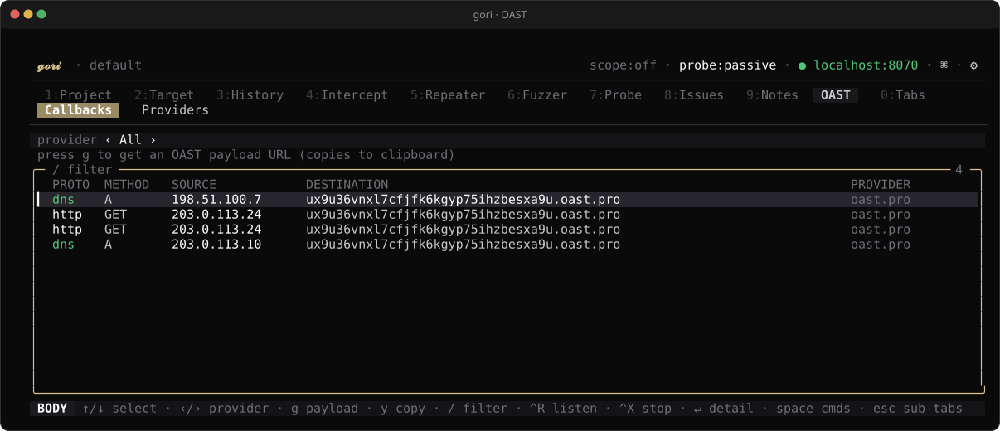

+++
title = "OAST for Blind Vulnerabilities"
description = "Catch out-of-band callbacks (interactsh & friends) to confirm blind SSRF, XXE, injection, and remote file inclusion."
weight = 70

[extra]
group = "Workbenches"
shot = "oast"
+++

Some bugs never show up in the response. A blind SSRF, a blind XXE, an out-of-band SQL injection, or a stored payload that only fires in a back-office browser all reach out to *some other server* instead of answering you. **OAST** (Out-of-band Application Security Testing) gives you that server. gori registers a payload URL with an interaction listener, you plant the payload in a request, and any DNS, HTTP, or SMTP callback the target makes to it shows up as a hit.

The **OAST** tab is off the bar by default. Press **`0`** and type "oast", use the command palette (`Ctrl-P` → **Go to OAST**), or give it a slot in Preferences. It has two sub-tabs: **Callbacks** (the hits, default) and **Providers** (the listeners you've configured).

<figure class="tui-shot">
  
  <figcaption>The <strong>OAST</strong> tab registers a payload and lists every DNS, HTTP, or SMTP callback the target makes to it, decrypted and timestamped.</figcaption>
</figure>

## The Loop

1. On the **OAST** tab, press `Ctrl-R` to start listening. gori registers with the selected provider and begins polling. A new project has no provider yet, so add one first on the **Providers** sub-tab (`a`; public interactsh is prefilled).
2. Press `g` (get payload) to mint a **payload** (a unique hostname/URL) and copy it. `g` starts the listener if one isn't running, and `y` copies the current one again. Or insert it into a request from **Repeater** / **Fuzzer** (`Space` → **Insert OAST payload** drops it at the cursor). From **History**, `Space` → **Copy OAST payload**.
3. Plant it wherever the target might dereference a URL or resolve a hostname: a URL parameter, a `Host`/`X-Forwarded-For` header, an XML entity, a webhook field.
4. When the target's infrastructure resolves the name or connects back, the callback lands in **Callbacks** with its protocol (`dns` / `http` / `smtp`), source IP, timestamp, and the full sub-identifier so you can tell which payload fired.

A callback is proof the target reached a server it shouldn't have. The absence of one is not proof of safety (egress may be filtered), only that this path stayed quiet.

## Providers

Each listener is a **provider**. Add one from the **Providers** sub-tab (`a` add, `e` edit, `t` enable / disable, `d` delete). A public preset auto-fills the server host when you pick its type.

The bar above the callbacks table selects which provider `g` and `Ctrl-R` act on. `←` / `→` cycle it (the bar draws the pick as `‹ name ›`), and **All** shows every provider's callbacks at once. Getting a payload or starting a listener needs one provider, so on **All** with two or more providers enabled, `g` and `Ctrl-R` open a picker card. Pick a row with `↵` and the bar follows. With a single enabled provider the action runs without asking.

| Provider | What it is |
|----------|-----------|
| `interactsh` | Self-hosted or public [interactsh](https://github.com/projectdiscovery/interactsh) servers. Catches encrypted **DNS, HTTP, and SMTP** callbacks. Public presets: `oast.pro`, `oast.live`, `oast.site`, `oast.fun`, `oast.me`. The default type for a new provider and for `gori run oast listen` / `oast_start`. |
| `custom-http` | A plain HTTP endpoint you control and poll for hits. |
| `webhook.site` | The public [webhook.site](https://webhook.site) service (HTTP only). |
| `BOAST` | A [BOAST](https://github.com/marcohextor/BOAST) server (public preset `odiss.eu`). |
| `postbin` | A PostBin instance (`postb.in`). |

With interactsh, gori generates an RSA key pair locally, registers the public key, and decrypts each callback (the private key is stored `0600` in the project database and never logged). The payload id is derived locally from the correlation id, so you can mint many payloads from one registration without another round trip.

## Resuming a Listener

Many callbacks arrive late: a stored payload that only fires when someone opens a back-office page, a webhook a nightly job replays, an injection behind a queue. A listener outlives the session that started it.

`Ctrl-X` stops polling but keeps the registration, and so does quitting gori or leaving the project. The payloads you already planted keep resolving. Press `Shift-R` to open **RESUME LISTENER**, pick a saved session, and gori starts polling it again. Every callback the provider buffered while you were away lands on the next poll, and the session's existing callbacks are still there under it.

| Key | In the picker |
|-----|---------------|
| `↵` | Resume polling this session |
| `x` | Release it: deregister the server-side state for a finished engagement. Its callbacks stay. |

Callbacks are durable per-project history. gori does not resume a listener on startup, so reopening a project does not reconnect you to a third-party provider without asking.

All three surfaces resume the same sessions. `gori run oast list` / `resume` / `release` and the MCP `list_oast_sessions` / `oast_resume` / `oast_release` act on the rows this picker shows, and a resumed headless listener writes its callbacks into the project, where the tab shows them too. `gori run oast listen` and MCP `oast_start` are ad-hoc by default. They register with no project behind them, and those registrations end with the process. `--save` / `persist: true` writes the same kind of row, so a headless or agent-driven listener lands in this picker too.

A resumed session polls with the saved provider it was started with, even when several saved providers point at the same server with different tokens. A session saved by an older gori did not record its provider, so gori matches it by the token it registered with. When that still leaves more than one provider, the tab does not resume it (it points at `gori run oast resume ID`), and `gori run oast resume` and `oast_resume` poll with the session's own stored token and say so.

No surface resumes on its own. Opening a project, binding an MCP server, or starting a `gori run` never re-arms a listener.

## Keys

| Key | Action |
|-----|--------|
| `Ctrl-R` | Start listening (register with the provider and begin polling) |
| `Ctrl-X` | Stop polling (the session is kept; resume it with `Shift-R`) |
| `Shift-R` | Resume a saved listener |
| `g` | Get / copy the current payload (asks which provider on **All**) |
| `←` / `→` | Cycle the provider the bar acts on |
| `y` | Copy the current payload (on the list), or the selected callback (inside its `↵` detail) |
| `Shift-F` | File the selected callback as an Issue |
| `/` | Filter the callback list |
| `a` / `e` / `t` / `d` | Providers sub-tab: add / edit / enable or disable / delete |

## Filing a Callback

A callback shows that the target's infrastructure contacted a server it had no reason to contact. `Shift-F` (or `Space` → **Add issue**) files the selected callback as an **Issue**, prefilled with its protocol and source and carrying the raw interaction in as the notes. It opens at **HIGH**. Tab to the severity row and use `←` / `→` to re-rate it before you commit.

## Headless

`gori run oast listen` is an ad-hoc, store-free listener by default. It registers a payload, prints it to stdout, then streams callbacks until you stop it. With `--save` it is a project session. Its callbacks are written into the project, the registration is kept on exit, and the out-of-band probe rules have something to mint against.

```bash
gori run oast presets                          # list the built-in public providers
gori run oast presets --check                  # …and probe each one for reachability
gori run oast listen                           # interactsh, poll until Ctrl-C
gori run oast listen --provider webhook.site   # a different provider
gori run oast listen --once --json             # poll once, emit JSON lines
gori run oast listen --save                    # …and keep it as a project session
```

### When Registration Fails

Registration talks to a third-party server over HTTPS, so it can fail four ways that look identical from the outside: the name does not resolve, the port is filtered, this machine's trust store rejects the certificate, or the provider is down. gori reports the stage that failed, and each stage has its own fix:

| Stage | What it means | What to do |
|-------|---------------|------------|
| `dns` | The name never resolved, so nothing was dialed | A restricted or split-horizon resolver. Check whether the other presets resolve |
| `connect` | TCP connect refused, filtered, or timed out | Egress filtering, or that host is down. Try a sibling preset with `--server=URL` |
| `proxy` | Your upstream proxy refused before any provider was contacted | `network.upstream_proxy*` in settings.json. Another provider takes the same leg |
| `tls-verify` | The certificate chain was rejected | Either this machine's trust store (see below) **or** that host's own certificate having expired. `--check` tells them apart |
| `tls` | The handshake broke before any certificate was judged | Not a trust problem; a CA bundle cannot help |
| `timeout` | The port accepted the connection and then said nothing | A silent drop (inline IPS, black-holed egress) |
| `exchange` | Connected fine, then the transfer broke, or the provider refused | A reset or a silent peer. If the provider answered, read its verdict and check `--token` |
| `dial` | The provider URL itself is malformed | Fix `--server` |

`gori run oast presets --check` probes every built-in provider at once and prints that stage per preset. One host failing while its four siblings answer is an outage. All of them failing at `tls-verify` points at your CA store.

```bash
gori run oast presets --check
[ ok ] interactsh    Public Interactsh (oast.pro)   https://oast.pro    ok         HTTP 200
[fail] interactsh    Public Interactsh (oast.fun)   https://oast.fun    dns        DNS lookup for oast.fun failed — …
```

It exits non-zero only when no provider answered, so a script can use it to check whether this machine can do OAST. Pass `--project NAME` (or `--db PATH`) to probe the way that project dials, through its pinned upstream proxy and timeouts, so the result matches that project's runs.

### Custom CA Bundles

If you run behind a TLS-inspecting proxy, or against a self-hosted interactsh signed by a private CA, `tls-verify` is what you will see. Point `SSL_CERT_FILE` at a PEM bundle containing that CA (or `SSL_CERT_DIR` at a directory of them):

```bash
SSL_CERT_FILE=/path/to/corp-ca-bundle.crt gori run oast listen
```

For gori's own service traffic (OAST providers and the updater) the bundle is added to the system trust store, so a bundle holding only your corporate root does not stop the public presets from working. Target traffic keeps the usual replace-the-store semantics (see [verify_upstream](/reference/config/)). There is no `--ca-file` flag. The environment variable covers every provider and surface, and the other tools you run beside gori. `--insecure-upstream` (or `-k`) does not apply to an OAST server. It is for a target with a broken certificate, and gori always verifies its own service traffic.

The project's saved sessions (the ones the picker above resumes) are reachable headlessly too:

```bash
gori run oast list                             # id, provider, payload host, hits, last poll
gori run oast resume 7                         # re-arm session #7 and stream its callbacks
gori run oast resume 7 --once --json           # one poll, JSON lines, then exit
gori run oast release 7                        # deregister it; its callbacks stay
```

`resume` keeps the registration on exit (Ctrl-C only stops polling) and persists every callback it catches into the project, so the OAST tab shows the same hits. `listen --save` behaves the same way from its first poll. `release` tears down either.

A saved session is also what arms the blind active checks. `ssrf_oast`, `xxe_oast`, `cmd_injection_oast` and `rfi_oast` plant a payload and wait for the target to call home, so they mint against a stored session. With none they plan and send nothing, and `gori run probe --active` (and MCP `probe_scan`, under `out_of_band`) reports it, so an empty result does not read as "no blind vulnerability".

The saved providers (the **Providers** sub-tab's rows) are manageable headless too, with `gori run oast providers add|update|enable|disable|delete|list`, and both `listen` and `resume` take `--interval SEC` (default 5) for the poll cadence.

See the [CLI Reference](/reference/cli/#run-oast) for every flag. Over MCP, an agent drives the same engine with `oast_presets` / `oast_payload` / `oast_poll` / `list_oast_sessions` (read; `oast_payload` and `oast_poll` are still withheld under `--read-only`) and `oast_start` / `oast_stop` / `oast_resume` / `oast_release` (action). `oast_start` is the ad-hoc counterpart of `listen`, and takes `persist: true` for the `--save` behaviour. `oast_resume` returns a `session_id` that `oast_poll` and `oast_payload` take, and its polls are persisted like the CLI's. `oast_stop` on a persisted or resumed session stops polling but keeps it resumable, as `Ctrl-X` does.

> A callback means the target contacted a third-party interaction server, and public interactsh/webhook servers see that callback's metadata. Only run OAST against systems you are authorized to test, and prefer a self-hosted server for sensitive engagements.

## Next Steps

- [Repeater & Fuzzer](/guide/repeater-and-fuzzer/): plant payloads and fuzz them across positions
- [Scanning & Issues](/guide/scanning/): promote a confirmed callback into an Issue
- [MCP Server](/guide/mcp/): let an agent register a payload and poll for hits
