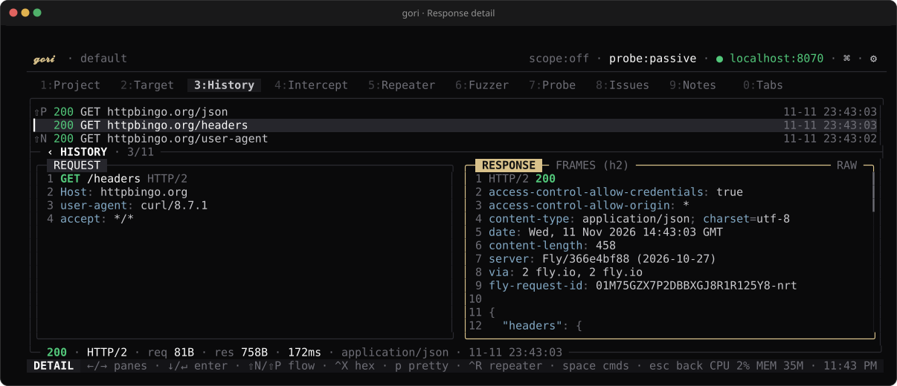
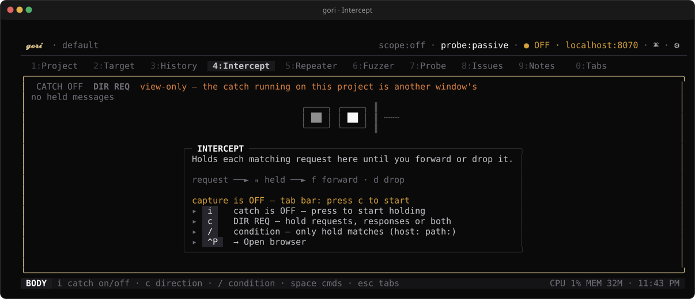
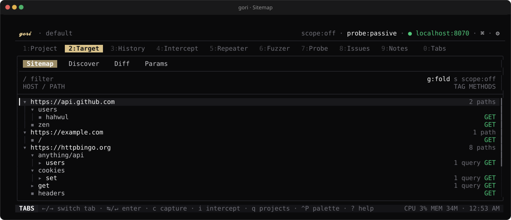
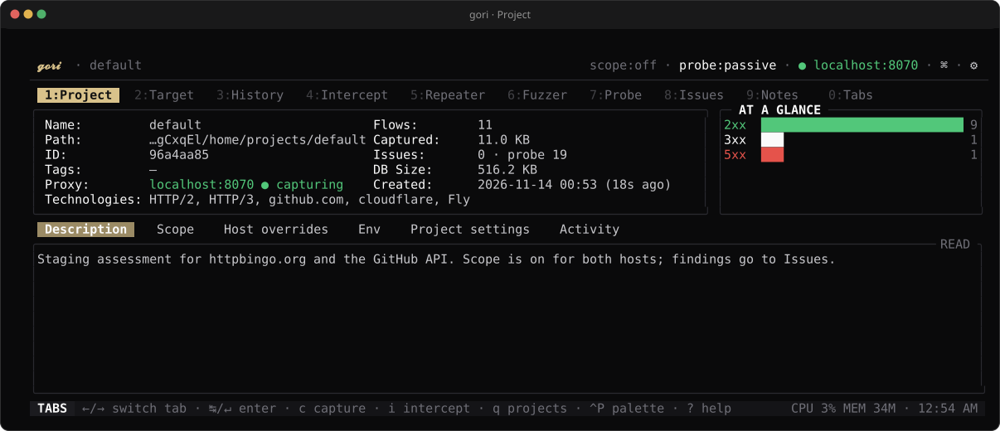

+++
title = "Proxy & History"
description = "Capture traffic, intercept requests, scope your target, and inspect every protocol."
weight = 10

[extra]
group = "Core"
shot = "history"
+++

The proxy sits between your client and the upstream server, records each exchange as a *flow*, and stores it in the current project. **History** is where you read those flows back.

## Capturing Traffic

Start gori and point your client at `127.0.0.1:8070` (see the [Quick Start](/getting-started/quick-start/)). For command-line tools, [`gori run shell`](/reference/cli/#run-shell) (or **Open shell** in the palette) starts a shell whose proxy variables and CA bundle already point at gori. Toggle capture at any time with `c`. Turning it off stops the listener and ends the connections a client already has open, so nothing is relayed or recorded until you turn it back on.

Once a client is pointed at the proxy, `http://gori.proxy/` serves gori's info page and CA download. It is a reserved name answered locally, so it never reaches the network. This helps on a phone, where the proxy usually gets configured before the certificate. A client with no proxy configured gets the same page by browsing to the listen address directly.

Each flow records the full request and response: start line, headers, and body. The stored body is capped at 2 MiB. Larger bodies still forward byte-exact and report their true size, and the TUI's flow detail view draws a banner showing captured vs. wire bytes and how to raise `capture_max_mib` under Settings → Network. Bodies compressed with gzip, deflate, Brotli, or Zstd are decoded for display.

> **HTTPS & upstream verification.** For HTTPS, gori verifies the origin server's certificate against your system CA trust store, resolved automatically from standard locations (and honouring `SSL_CERT_FILE` / `SSL_CERT_DIR`). If none is found (e.g. a minimal container), verification fails and those flows are recorded as errors. Set `SSL_CERT_FILE=/path/to/ca-bundle.crt`, or run with `--insecure-upstream` (Settings → **Network → Verify upstream TLS**). This is separate from trusting gori's root CA in your *client*, which lets gori decrypt the traffic.

<figure class="tui-shot">
  
  <figcaption>Open any flow with <kbd>Enter</kbd> to read the full request and response, with sub-tabs for headers, HTTP/2 frames, and raw bytes.</figcaption>
</figure>

## Intercept

Press `i` to enable **Intercept**. When on, matching requests are held so you can forward, drop, or edit them before they continue. Responses are held too if you choose that direction, and a `status:` condition only matches responses. A filter bar at the top of the Intercept tab lets you choose the direction to catch and narrow what gets held with a query-language expression. While the `s` scope lens is on, only in-scope traffic is held, regardless of the condition. On this tab `c` cycles the catch direction (requests, the default / responses / all) and `/` edits the condition. Everywhere else `c` is the capture toggle. `↵` or `e` on a held row edits it. `⇥` opens it in READ, as the Repeater's editor does, where `i` or `↵` starts typing and `esc` steps back to READ, then to the queue. Turning intercept **off** releases everything still held with its original bytes, so an edit you had not yet forwarded is discarded.

<figure class="tui-shot">
  
  <figcaption>The <strong>Intercept</strong> tab: toggle catch with <kbd>i</kbd>, pick a direction, and hold only matching traffic to forward, drop, or edit in flight.</figcaption>
</figure>

The queue takes the same **multi-select** as the History list ([Marking flows](#marking-flows), below): `t` marks the held message under the cursor and steps down, `Shift-↑` / `Shift-↓` extend a contiguous range, `Shift-T` marks the whole queue, and `Esc` clears. Forward (`f`) and drop (`d`) then act on the marks if any are set, else the cursor row, so a burst of holds can be released or dropped in one keystroke. `Shift-F` forwards the whole queue whether anything is marked or not. Marked rows get a full bar in the gutter and the filter row shows a live `3 marked` count. A mark disappears when its message leaves the queue.

Reading a held message needs no marks and no editor. The preview soft-wraps, so nothing runs off to the side. Scroll it with the wheel, or press `↵` / `e` to open the editor, where `PgUp` / `PgDn` page the text and `Ctrl-R` forwards the edited message (`Esc` leaves the editor and keeps the edit). `PgUp` / `PgDn` / `Home` / `End` page the **queue**, the same list `↑` / `↓` walk, as they do on every other list tab.

Each row shows how long its message has been waiting. Each hold is a real client blocked on your decision. The catch bar above the queue shows the armed condition, including one an agent set through MCP or `gori run intercept filter`. When a gate cannot hold a message it was armed for, such as a body over the buffer ceiling, it forwards the message untruncated and says so in the notification centre, so you are not left waiting for a row that will never appear.

History keeps what you decided. A request you **edited** before forwarding reads `EDIT` in the SRC column, and its detail adds an **ORIGINAL** pane holding the request as the client sent it, next to REQUEST, which is what went upstream (`intercept_edited` in `gori run history --format json` and MCP). A **dropped** message says it was dropped at Intercept, not that the upstream failed.

### What gets held

Requests are held on HTTP/1.1 and HTTP/2, gRPC included. So are responses, except the ones that have no last byte to wait for: a WebSocket upgrade (`101`), a Server-Sent Events stream, and a close-delimited response are forwarded as they arrive. On HTTP/1.1 a chunked message stream (NDJSON, Connect streaming, gRPC-Web) is held when it ends within 5 seconds. One that has not ended by then is forwarded unheld, and a notice says so. WebSocket messages are held only when you ask for them. See [Intercept on WebSocket](#intercept-websocket) below. The request that opened the socket is held like any other request.

### Intercept on WebSocket {#intercept-websocket}

**A WebSocket message is held only when the catch condition contains `proto:ws`.** A blank condition, `host:acme.test` or a direction setting alone does not arm it. HTTP is the other way round: a blank condition holds everything. A busy socket would stall on a filter that broad.

Type `proto:ws`, optionally narrowed:

```
proto:ws body:subscribe          hold only messages containing "subscribe"
proto:ws host:acme.test          hold only this socket's messages
```

`body:` is a substring of the message payload and matches WebSocket messages only, because at an HTTP hold gate the bytes do not exist yet. The `DIR REQ` / `DIR RES` chip works as usual: `REQ` is client → server, `RES` is server → client. `REQ` is the default, so press `c` to hold server → client messages (`RES`) or both (`ALL`).

A held message goes in the same queue as a held request, with a `WS↑` or `WS↓` badge, the socket that carries it, and the start of the payload. Forward, drop, edit and the marks all work the same way. What is different:

- **Catch has to be on before the socket opens.** gori decides once, at the `101`, whether a socket needs the holding path. Turning catch on, or adding `proto:ws`, reaches the *next* handshake, not the connection already running. Reconnect the client. Narrowing the condition afterwards takes effect immediately.
- **A held message blocks its whole direction** until you decide it. Later messages from that peer queue behind it, and they are released in arrival order however you decide them: decide message 5 before 3 and it still goes out third. The **opposite direction keeps running**, and so do `PING`/`PONG` in both, so the socket does not die while you read. One message cannot pass another, since a WebSocket has no message identifiers to reorder.
- **A dropped message is invisible to both endpoints.** Nothing is written, and a WebSocket stream has no message identity, so the peer cannot notice the missing message. This is weaker than dropping an HTTP/1.1 request (which answers a `502`) or an HTTP/2 one (which cancels the stream). gori keeps no message-log row for it either. If you need the attempt on record, note it yourself.
- **A binary message (opcode 2) opens the hex editor**, not the text one. `↵` / `e` gives you the same byte editor the Repeater's `Ctrl-X` does: `0`-`9`/`a`-`f` overtype the nibble under the cursor, `Ins` inserts a `00` byte, `Del`/`⌫` remove one, arrows and `Home`/`End` move. The bytes never become a string, so protobuf, msgpack and CBOR survive an edit. The text editor is not offered, and `Ctrl-E` (external editor) is refused on a binary message. The card says `HEX` where it says `EDIT` on a text message, and the queue row shows the size instead of a preview.
- **Editing a text message keeps its line endings.** The payload goes out with every line's original terminator, as the Repeater and the HTTP intercept editor keep theirs. `$BIND.NAME` bindings are *not* expanded in a WebSocket payload. A `$` there is a plain byte.
- **An edited message is re-framed as one frame** and a client → server message is re-masked with a fresh key, as a [Match & Replace rule](#match-replace-websocket) does. A message you forward unchanged keeps the sender's own frame and mask key.
- **A hold has about 5 seconds left once the peer closes the other direction.** gori waits that long for the closing handshake to finish and then tears the socket down. Anything still held is forwarded unedited. The same happens if a `CLOSE` arrives in the direction you are holding: everything undecided goes out in order, then the `CLOSE`, because the protocol forbids data frames after one.
- **Only data messages are held.** `PING`, `PONG` and `CLOSE` always pass, because holding a ping breaks keepalive and holding a close strands the tunnel.
- **A very deep queue is released for you.** Past about 1 MiB queued behind a held message, or on a frame too large to buffer, the hold fails open: everything queued forwards unedited, with one line in `gori.log`. A WebSocket has no application-level flow control, so nothing slows the sender down while you read. A queue that deep usually means the condition is too wide.

Match & Replace runs **before** the hold, so the editor shows the message as your rules rewrote it, and forwarding sends what you see.

### Intercept on HTTP/2

Intercept works on HTTP/2 without downgrading the connection, so gRPC clients keep working while catch is on. Streams are held individually, so holding one request does not freeze the tab. Four things differ from HTTP/1.1:

- **The body is held only when gori can buffer it.** A message that declares a `Content-Length` of 1 MiB or less (and one with no body at all, which is most page loads) is held whole: you see and edit head *and* body, and on forward the `DATA` frames are rebuilt from your bytes with the `Content-Length` you sent, as on HTTP/1.1. Its queue row appears once the whole message has arrived, not when its head does, also as on HTTP/1.1.

  Everything else is held **head-only**: a streaming upload or response with no declared length (SSE, gRPC streams), a body over the ceiling, or a padded body. Those bodies stream past the gate untouched, a body typed into the editor is refused, and `Content-Length` stays as the sender set it. The intercept editor, `gori run intercept get` and the MCP `intercept_get` tool all say which kind of hold you have before you write an edit. The body of a head-only hold is still visible in full in History afterwards.
- **Drop cancels the stream** rather than answering with a `502` page. The client sees a cancelled request (gRPC reports `CANCELLED`). The connection and every other stream on it stay up. History records the drop as it does on HTTP/1.1.
- **A held request delays later requests on the same connection.** HTTP/2 requires new streams to reach the origin in order, so requests that start *after* a held one wait for your decision, including while gori is still buffering that request's body. Requests already in flight keep uploading, all responses keep arriving, and a held *response* delays nothing.
- **A Match & Replace *body* rule needs the hold to cover the body.** As on HTTP/1.1, it runs before you see the message, so the queue shows the rewritten body with its `Content-Length` made true, and forwarding it unchanged sends the rewrite. A head-only hold is left unrewritten, and so is a rewrite that would grow a held response, or a held request past the origin's initial window, because the hold can only send what the receiver is known to accept. History says so on the flow.

Everything a head rule cannot express on HTTP/2 ([Head rules on HTTP/2](#head-rules-on-http-2), below) applies to a head you edit by hand too.

## Scope

Scope keeps a large session focused on your target. In the **Project** tab you define include/exclude rules by host, string, or regular expression. Toggle the **scope lens** with `s` to filter the views down to in-scope traffic, and use scope to gate what Intercept and the scanners act on.

### Sandbox

The **Sandbox** is a hard containment gate that keeps a test in bounds. Toggle it in the **Project** tab's **Project settings** pane, or from anywhere via the command palette (`Ctrl-P` → **Toggle sandbox**). It is off by default. While it's on, the capture proxy forwards only the requests your scope *allows*. Everything else is blocked before it reaches the origin and recorded as an aborted flow so the attempt stays visible. On HTTP/1.1 the client gets a `403` with an `X-Gori-Sandbox: blocked` header. On HTTP/2 the blocked stream is cancelled (`RST_STREAM` with `CANCEL`) and the rest of the connection keeps working. "Allowed" means the scope evaluated as an allowlist: at least one include rule must match, and no exclude rule may match.

Because it is an allowlist, a scope with no include rules blocks all traffic. Add an include for your target first. Enabling the sandbox with an empty scope asks you to confirm this. A red `sandbox` chip in the top bar stays lit whenever it's on, and the Project settings row shows the current effect next to the toggle.

The sandbox also stops gori's own sends: a Repeater, Fuzzer, Miner, `gori run` or MCP request to a host outside the allowlist is refused, even when the scope check was waived with `--allow-unscoped` / `allow_unscoped:true`. The up-front scope check differs per surface. MCP refuses any target that is not in scope with `SCOPE_BLOCKED`, even when the project has no scope yet. `gori run` refuses a target outside a configured scope. The TUI's Repeater and sweeps have no up-front check, so only the sandbox and exclude rules stop them. For HTTPS the sandbox relies on TLS interception to read request URLs: a host that can't be in scope is refused at the `CONNECT` step, and every request on a host that gets through is checked individually. That per-request check runs on HTTP/2 as well, per stream, so a host keeps HTTP/2 under the sandbox and gRPC clients keep working. Cleartext HTTP/2 tunnelled inside `CONNECT` (h2c, rare) gets the same per-stream check as any other HTTP/2 connection: the tunnel opens, and each out-of-scope stream on it is cancelled individually.

### Request budget {#request-budget}

Scope sets *where* gori may send, and the **project request budget** sets *how much*. `gori run project network set outbound_max_rps=10` and `outbound_max_requests=5000` cap gori-originated requests per second and in total, across every run, surface and process on the project (Repeater, Fuzzer, Miner, Sequencer, Discover, Authorize, retest, active Probe, frame injection, `gori run`, MCP), so parallel sweeps and an agent together stay under the ceiling the engagement agreed to. A send waits for its rate slot. Once the total is spent, a run ends `budget_exhausted` and a refused send reads `BUDGET_EXHAUSTED`, not a retryable network error. Proxied client traffic is never counted or delayed. See [Per-Project Overrides](/reference/config/#per-project-overrides).

## Sitemap

The **Sitemap** tab collapses History into a deduplicated tree of `host → path` endpoints, with method chips and scope markers. It's a quick way to see the shape of a target's attack surface. Each root is an **origin**, `scheme://host:port` with the default port left out (`https://acme.test`, `http://127.0.0.1:19021`), so two services on one host, or its HTTP and HTTPS sides, stay separate trees, and sending, opening, Params, Discover and the export from a row stay on that origin. A path tag belongs to the host and shows under each of its origins. Path-param ids are folded by default, so `/user/1` and `/user/2` share one node and `/user/<uuid>` collapses into a single `{uuid}`. Press `g` to show the literal ids. Query strings fold separately: `/search?q=widgets` and `/search?q=<payload>` are one `/search` row, expandable to the variants, and `⇧G` turns that off.

<figure class="tui-shot">
  
  <figcaption>The <strong>Sitemap</strong> folds History into a <code>host → path</code> tree with method chips.</figcaption>
</figure>

### Marking paths (multi-select)

The tree takes the same **multi-select** as the History list ([Marking flows](#marking-flows), below). Press `t` to **mark** the path under the cursor and step down, so a run of `t` marks consecutive rows. `Shift-↑` / `Shift-↓` extend a contiguous range from where you started, and `Esc` clears the marks. Marked rows get a full bar in the gutter and the filter row shows a live `3 marked` count, plus how many are currently off-screen. A mark under a collapsed subtree stays marked. Letting go of `Shift` and pressing a plain `↑` / `↓` drops the range, as a GUI list collapses its highlight. Marks you placed with `t` stay, and the wheel only scrolls.

Marks change what the action menu acts on. The same actions stay available, and the target is the marks if any are set, else the cursor row:

| Action | Key | Over marks |
|--------|-----|-----------|
| Tag path | `Space` `m` | One editor, one memo, applied to every marked path (blank clears them all) |
| Send to Repeater | `r` | One sub-tab per marked endpoint, deduplicated by captured flow (max 20) |
| Export OpenAPI | `⇧E` | One document covering every marked path |

For example, `/ status:5xx` → `⇧T` marks every path the filter shows (or mark them one at a time with `t`) → `Space` → `m` → `auth` tags them all, and `tag:auth` brings them back later. The menu title reads `SPACE · 3 MARKED` and the entries rename themselves (`Tag 3 paths`, `Send 3 paths to Repeater`). Discover and the Sequencer stay single-target (they scan one subtree / collect one endpoint's token), and their menu entries say `(cursor)` while marks are set.

**`t` marks, `⇧T` marks all and `Space` → `m` tags**: `t` / `⇧T` mean mark / mark all in every list tab, so tagging is the menu entry here. `⇧T` marks every **captured path** the tree currently shows (the `/` filter and the open folds decide the set), and host and folder rows are skipped. A synthetic `{uuid}` / `[1, 2, 3 …]` fold is not a real path, so it can't be marked or tagged. A range passes over it, and `t` on one says so.

### Parameters {#params}

Press `p` on a Sitemap row to open the **Params** sub-tab (`Sitemap · Discover · Diff · Params`) narrowed to that host or subtree. It lists every input name the captured requests carry, one row per endpoint, location and name. Locations are `query`, `form`, `multipart`, `json`, `headers` and `cookies`. Each row shows how many flows carried the name, a few sample values, and a `↩` when a value of four or more bytes came back verbatim in the first 256 KiB of the decoded response body. `↩` marks a place to look for XSS or injection, not a finding. JSON names are paths such as `user.email` and `items[].id`. The `[]` only collapses array indices and is not JsonPath syntax. Headers every browser sends (`User-Agent`, `Accept*`, `Sec-*`, …) are left out until you press `a`.

The scan reads the flows the Sitemap shows, so the `/` query and the `s` scope lens apply. It reads the newest 5,000 of them and marks the header `TRUNCATED` when older flows were not read. `^R` rescans. `Esc` drops the node filter, and a second `Esc` goes back to the sub-tabs.

| Action | Key | Result |
| --- | --- | --- |
| Open flow | `↵` | The newest request that carried the name, in the History detail |
| Filter | `/` | Narrows the list to rows whose location, name or endpoint contains the text; `⇧Y` and `w` take what is listed |
| Copy | `y` / `⇧Y` | The name, or every listed name one per line |
| Export wordlist | `w` | The listed names (JSON leaf names, no headers) as a list in the [wordlist catalog](/guide/repeater-and-fuzzer/#wordlist-catalog) (`~/.gori/wordlists/`), owner-only, named `params-HOST-TIMESTAMP.txt` |
| Mine | `m` | Opens the Miner on this endpoint with the names seen on its origin's (scheme, host and port) other endpoints tested first |

The same inventory is `gori run sitemap params` on the CLI and `list_params` over MCP.

### JavaScript references {#js-refs}

The API surface of a single-page app lives in a bundle the browser already downloaded, and the tree only shows the routes someone clicked through. `Space` → `J` (**Scan JavaScript**) reads the captured JavaScript responses and the inline `<script>` blocks of captured HTML pages, finds the endpoint literals in them (`fetch("/api/v1/users")`, an axios call, a route table), and adds the paths nobody has requested to the tree as dimmed rows marked `js`. **It sends nothing.** The bytes are already in the project. A path that captured traffic already reaches keeps its row and gains no second one, so the `N paths` counts stay traffic-only.

The scan reads the flows the tree shows (the `/` query and the lenses apply), newest first, 500 per run, and only responses it has not read before, so running it again after more browsing reads only the new bundles. The toast reports how many new endpoints it found and any cap it hit (a body is read up to 2 MiB). `Space` `Z` `J` (**Display…** → **Toggle JS references**) hides or shows the `js` rows.

A reference is read the way a browser would resolve it:

- An inline script resolves against its page, or the page's `<base href>`.
- An external script resolves against the page its captured request's `Referer` names, since a CDN bundle's `"/api/cart"` targets the page's origin. Without a `Referer` it falls back to the script's own origin, and the reference is marked `guessed`.
- A template literal keeps its shape: `` `/api/users/${id}/orders` `` becomes `/api/users/{expr}/orders`, never the directory `/api/users/`. Each `{expr}` stands for one path segment, so once `/api/users/5/orders` is captured the reference counts as requested and sits on that row.
- A literal inside a comment is kept and marked as such.
- The bytes are treated as page-authored. A space is percent-encoded, and a literal carrying CR or LF is dropped. Images, fonts and a bare `/` are skipped.

A host gori has never captured (an API subdomain the bundle calls, but also `www.w3.org` from an SVG namespace) appears only when a scope include names it. With the `s` lens on, references are filtered by the scope too.

| Action | Key | On a `js` row |
| --- | --- | --- |
| Open flow | `o` | Opens the script (or page) that referenced the path in the History detail, on the response pane, and names the line and byte |
| Send to Repeater | `r` | A bare `GET` for the path in a new Repeater tab. Nothing is sent until `^R`, and no cookie or `Authorization` from the page is copied |
| Discover here | `Space` `>` `D` | Crawls under the path, as on any row |

The stored references are deleted with the flows they came from, so `history clear` clears them. They never appear in History, QL or the OpenAPI export. The same data is `gori run sitemap js` (with `--scan`) and `gori run sitemap --js-refs` on the CLI, and `scan_js_endpoints` / `list_js_endpoints` (or `list_sitemap` with `include_unrequested`) over MCP.

### OpenAPI export {#openapi}

Press `⇧E` on a Sitemap row (or `Space` → `E`) to write an OpenAPI 3.0.3 document. It covers the marked paths if any are marked, otherwise the cursor row: a host row exports that whole origin, and any other row exports the endpoints under it. The popup asks for the destination. End the name in `.yaml` or `.yml` for YAML, and anything else writes JSON. The flows are the ones the tree shows, so the `/` query, the `s` scope lens and the hide-static lens all apply, minus the requests gori sent itself (Repeater, Fuzzer, Discover, …). The export runs in the background, and a toast reports the operations written, any cap that cut the document short, and how many flows were skipped (WebSocket, gRPC, SSE, incomplete).

Paths are templated (`/users/123` → `/users/{userId}`) and merged, parameters are `required` only when every sample carried them, and bodies and responses get schemas inferred from the samples. Credentials become security schemes and their values are never written, and the TUI export has no example values. For examples (redacted), size caps and every option, use [`gori run sitemap export`](/reference/cli/#run-sitemap). MCP has the same export as `export_openapi`.

## Protocol Support

The canonical capture / intercept / replay / fuzz table is the
[capability matrix](/reference/capabilities/). The details below explain the proxy-side tradeoffs
behind those boundaries.

**gori does not intercept HTTP/3.** QUIC is UDP and every gori listener is a TCP socket, so an origin answering `Alt-Svc: h3=":443"` is offering the client a way out of the proxy. By default gori leaves the offer in place and the flow carries an advisory naming what got through, so a client that leaves for QUIC shows up as a reported blind spot. Turning on [`network.strip_alt_svc`](/reference/config/#strip-alt-svc) removes the `Alt-Svc` fields advertising `h3` from the response the client receives, on both HTTP/1.1 and HTTP/2. A response-side strip cannot stop a client that learns an h3 route some other way, such as a DNS `HTTPS` record. Only those fields are removed. `Alt-Svc: clear` stays, because it tells the client to forget alternatives it has already cached, and a field advertising only a non-h3 alternative like `h2=":8443"` stays too, because that is another TCP port and still comes through gori. The strip works per **field**: one field carrying both (`Alt-Svc: h2=":443", h3=":443"`) is removed whole, not rewritten.

**A dictionary-compressed response is opaque.** A browser that holds a Compression Dictionary Transport dictionary (RFC 9842) can be answered with `Content-Encoding: dcb` or `dcz`, a body only that dictionary decodes. gori captures it byte-exact and its decode note names the cause. Turn on [`network.strip_available_dictionary`](/reference/config/#strip-available-dictionary) and gori removes the request's `Available-Dictionary` and `Dictionary-ID`, so the origin answers in a coding gori decodes.

**By default, gori disables WebSocket compression.** gori removes `Sec-WebSocket-Extensions` from the handshake it relays, so `permessage-deflate` is not negotiated and every captured frame is the message that was sent. Otherwise the peers would agree on compression that gori does not decode, and History, the detail view, `gori run history show`, the MCP tools and export would show a deflate stream as the payload. An app that would have used compression does not get it while it goes through gori. To relay a host's sockets unchanged, put the offer back with a Match & Replace head rule on the request. The strip runs *before* Match & Replace, so a rule that restores `Sec-WebSocket-Extensions` offers the extension to the origin, gori relays its acceptance untouched, and the peers negotiate compression as they would without a proxy. The flow is still captured, with a `[gori]` notice saying its frames are that extension's encoded bytes rather than the messages. [TLS passthrough](/reference/config/#tls-passthrough) also leaves the connection alone, but captures nothing for it. Use the rule first, and passthrough when you want the host out of gori.

**The handshake and the transcript are two panes.** Open a captured socket and the detail view gains a `MESSAGES` chip beside `REQUEST` and `RESPONSE` (plus whatever else the flow carries: `FRAMES (h2)` on an RFC 8441 socket, `GRAPHQL` on a subscription). `RESPONSE` is the upgrade the server answered with: the `101` (or the RFC 8441 `200`), the subprotocol it picked, the extensions it accepted, any `Set-Cookie` it issued there. `MESSAGES` is the frame log. After restoring `Sec-WebSocket-Extensions` with the rule above, `RESPONSE` shows whether the origin accepted it. `^X` (hex) and `b` (reveal whitespace) work on `RESPONSE`, as on any captured head. On `MESSAGES` they stay off, because its bytes live in the message log rather than in `response_body`.

**Interim responses are kept with the flow.** An origin can send one or more `1xx` heads before its real response: a `103 Early Hints`, or the `100 Continue` that answers an `Expect: 100-continue` upload. gori relays each one to the client unchanged (except to an HTTP/1.0 client, which cannot read one) and records it with the flow, over HTTP/1.1 and HTTP/2. The detail view gains an `INTERIM` chip beside `RESPONSE`, `gori run show --format raw` prints the ones the client received ahead of the final response in wire order, and `--format json` and MCP `get_flow` list them all as `interim` (`{status, relayed, head}`). One the client never got reads `relayed: false`, and raw names it on stderr instead of printing it. `RESPONSE` stays the final response alone. gori keeps the first 16 (within 64 KiB) and reports how many more it did not record (`interim_omitted`).

**An event stream shows its events while it is still open.** A `text/event-stream` response is recorded as it streams, over HTTP/1.1 and HTTP/2. The flow shows its status and content type once the head arrives, and while it is still Pending, the `EVENTS (sse)` pane, `gori run show` and MCP `get_flow` all read the events received so far. gori writes them in batches, at 16 KiB or at the end of an event at most four times a second. The capture cap still bounds the body. An event that arrives soon after a batch, followed by silence, appears with the stream's next bytes (usually its heartbeat). `body:` filters and search see the body only once the stream closes. If gori stops mid-stream, the flow keeps the events it had relayed. While the stream is open, the History row shows `●` and the number of events so far in its DUR column. Each event in `EVENTS (sse)` carries its arrival time relative to the first event (`▸ event #2  +0.412s`), and `gori run show` and MCP `get_flow` report it as `t_ms`. The times are kept after the stream closes. A compressed stream, and one captured before gori recorded them, shows no times.

### Injecting a frame into a live WebSocket {#websocket-inject}

A frame can be pushed into a socket the proxy is still relaying, in either direction, on the connection the app already has. That keeps what a replay loses: the authenticated session, the subscriptions the client made, and the state the server built for that socket. Use it to see what the client does when the server sends a given message, or to send the server a message the client's UI never would, mid-conversation.

```bash
gori run intercept inject 42 --direction in --data '{"role":"admin"}'
gori run intercept inject 42 --opcode binary --file frame.bin
gori run intercept inject 42 --opcode ping
```

MCP's `ws_inject` takes the same `flow_id`, `direction`, `opcode` and payload (`payload`, or `payload_base64` for exact bytes). Both go through the TUI that is capturing the project, because only that process holds the socket. A headless `gori run capture` cannot inject, and the command says so.

**In the TUI**, open the flow in History. While the proxy still holds its socket, the FLOWS row shows `●` beside `WS`, the drill-in's footer reads `● open` with how long, and `Space` → **Inject frame…** opens a form: direction (client → server by default), opcode (`text`, `binary`, `ping`, `pong` or `close`) and a one-line payload, which a `binary` or `close` frame takes as hex (`48656c6c6f`, spaces or `:` between octets allowed). A `close` payload opens with its status code, `03e8` for 1000. `↵` injects, `esc` cancels. The result lands in the status line, and the frame shows in the MESSAGES pane as `⇢ … [injected]` (`⇠` for server → client). A closed or HTTP/2 socket does not offer it.

- **`out` is client → server** (the default) and is masked with a fresh key, **`in` is server → client** and is not, as RFC 6455 requires. The frame is one complete frame (FIN set) of the type you name: `text`, `binary`, `ping`, `pong` or `close`.
- **The bytes go out as written.** No `$ENV` or `$BIND` expansion, no Match & Replace, and the frame goes out **ahead of** a message Intercept is holding on that side, since it does not pass the hold.
- **A data frame waits for a message boundary.** If the peer on that side is in the middle of a fragmented message, the frame waits up to 5 seconds for its last fragment, because a data frame inside another message breaks the stream. Past that it is refused and nothing is written. `ping`, `pong` and `close` go in at once, since the protocol allows them between fragments. Only one data frame per direction waits at a time, and a second is refused at once. Once a `close` has gone out in a direction, by either peer or by you, a data frame there is refused, since nothing may follow it.
- **A peer that stops reading ends the socket.** If the socket accepts nothing of the frame for 5 seconds, its write gives up. Part of it may already be on the wire and nothing after it would parse, so gori closes the socket and records that it did. The limit is per stall, so a peer that keeps reading, however slowly, is not cut off.
- **It is recorded.** The frame joins the flow's messages marked as injected: `[injected]` in History's MESSAGES pane and in `gori run history show`, `origin: "gori"` and `injected: true` from MCP `get_flow`, and `_origin` in HAR export.
- **It is an active request.** From the CLI and MCP, scope applies to the flow's host (`--allow-unscoped` / `allow_unscoped:true` waives it). From the TUI, as with a Repeater send, scope is not checked. The sandbox refuses on every surface, and each frame counts against the project's request budget.
- **HTTP/1.1 sockets only.** An RFC 8441 socket over HTTP/2 is refused by name, and so is a flow whose socket has already closed.

### WebSocket over HTTP/2 {#websocket-http2}

Modern browsers open a WebSocket over HTTP/2 when the origin advertises `SETTINGS_ENABLE_CONNECT_PROTOCOL`, using the extended `CONNECT` of RFC 8441 instead of the HTTP/1.1 `Upgrade:` handshake. By default gori relays that advertisement verbatim, so a client may take that path, and gori reads the socket when it does. RFC 8441 replaces only the handshake, so the frames are the same RFC 6455 frames, read by the same codec.

**Capture and replay work as on HTTP/1.1.** The transcript shows up in History's MESSAGES pane, `gori run history show`, the MCP `get_flow` tool and HAR export, as an HTTP/1.1 socket's does. `^R` in the Repeater, `gori run repeater send`, MCP `send_websocket` and a Fuzzer sweep all re-open the socket and exchange frames over it. Two things are HTTP/1.1-only:

- **Per-message intercept, Match & Replace on messages, and [injecting a frame](#websocket-inject).** Both would have to rewrite a DATA frame to a *different length*, and on HTTP/2 that deadlocks against the peer's flow-control window. gori reads the frames from a copy, after they are already on the wire, so nothing here resizes a frame or writes to a socket. The flow carries a `[gori]` advisory saying which half of the support it got.
- **A per-connection ceiling.** gori reads at most 8 extended `CONNECT` streams concurrently on one HTTP/2 connection. Past that a stream is relayed byte-for-byte with no transcript, and its advisory says so. A browser opens a handful of sockets per origin, so normal use stays under it.

**To get those back, keep the sockets off HTTP/2.** Turn on [`network.strip_extended_connect`](/reference/config/#strip-extended-connect) and gori withholds the origin's `SETTINGS_ENABLE_CONNECT_PROTOCOL` from the client. A browser that was never offered extended `CONNECT` opens its WebSockets with an HTTP/1.1 `Upgrade`, where per-message intercept, Match & Replace and injection all work, while everything else stays on HTTP/2. It applies to connections opened after it is on, and an HTTP/1.1 upgrade to an origin whose offer was withheld carries an advisory naming the setting.

**Replay re-opens the socket the way the capture did.** A Repeater seeded from an RFC 8441 flow opens the WebSocket tab. gori dials HTTP/2 (ALPN `h2`, or h2c prior knowledge on a plaintext target), waits for the origin's `SETTINGS_ENABLE_CONNECT_PROTOCOL`, sends `:method CONNECT` with `:protocol websocket` and the capture's `:path`, `:authority` and headers, and treats the `2xx` (not a `101`, which has no meaning on HTTP/2) as the socket opening. From there it is the same engine as the HTTP/1.1 path: the same message script, masking, frame shapes, caps and transcript. Extension offers are stripped by default. Scripted sends can opt into [independent-message compression](/guide/repeater-and-fuzzer/) with `--ws-deflate` / `ws_deflate:true`. The `X-Gori-Protocol: websocket` line in the request pane *is* the `:protocol` pseudo-header, editable like any other.

gori reports five cases. An origin that does not advertise `SETTINGS_ENABLE_CONNECT_PROTOCOL` gets a refusal naming the setting, not an empty transcript, because RFC 8441 §3 forbids sending an extended `CONNECT` without it. A non-`2xx` answer is a refusal carrying the origin's head. A `RST_STREAM` or `GOAWAY` mid-session keeps the frames already exchanged and adds the peer's stated error code to the result's note. A `--http`/`^V` override on such a tab has two stops rather than three (WebSocket, or the `CONNECT` as a plain HTTP/2 request), because there is no HTTP/1.1 form of these bytes to send. `keep_sec_websocket_key` has nothing to keep here (RFC 8441 has no `Sec-WebSocket-Key`) and the result says so.

**Filtering finds these.** The PROTO column reads `WSS` and `proto:ws` returns an RFC 8441 socket alongside an HTTP/1.1 one, because gori records the extended `CONNECT`'s `:protocol` token on the flow at capture time. `proto:wss` matches only the TLS one. An extended `CONNECT` carrying `connect-udp` (RFC 9298) or `connect-ip` (RFC 9484) is not RFC 6455 framing and does not match. A handshake the origin *refused* is an ordinary failed request (no socket was opened), as a rejected HTTP/1.1 handshake is. Flows captured by an older gori stay unclassified. Re-capture to label them.

### protobuf without a `.proto` {#protobuf}

gori decodes gRPC payloads from the protobuf wire format alone. Field *names* and declared types live in a `.proto`, which this decoder does not read, so you get numbered fields with their wire types (varints, fixed32/fixed64, and length-delimited payloads), nested as deeply as the bytes nest.

**Ambiguous fields show every reading.** Without a schema a length-delimited field can be several things at once. It is always raw bytes, it is a string when the payload is valid UTF-8, and it is a nested message when the payload parses cleanly as one. gori shows every reading that fits, under a one-line note saying none is authoritative.

**A compressed message is inflated first.** The gRPC frame's `0x01` flag says the payload is compressed, and the stream's `grpc-encoding` names the codec. For `gzip`, `deflate` and `identity` gori inflates the message and decodes it like any other. The message header says so (`(gzip, inflated 120b)`, and `encoding` / `inflated_size` in the JSON). The inflation is a view only. The captured bytes are what is stored and resent. A message that would inflate past 4 MiB is refused as a decompression bomb. One body inflates to at most 16 MiB across all its messages, and the rest stay bytes.

Two payloads stay hex on every surface:

- **A compressed message gori cannot inflate**: an unknown codec (`snappy`, `zstd`, …), no `grpc-encoding` at all, or a corrupt or oversized stream. The frame is shown as bytes with a note saying why.
- **A grpc-web trailer frame.** Its payload is ASCII header lines, not protobuf.

The tree is on every surface: the TUI's History and Repeater panes (`p` toggles between the tree and the byte preview, and `^X` gives the byte-exact dump), `gori run history show --format json` (as `grpc_messages[].protobuf`) and the MCP `get_flow` tool (as `request_grpc_messages` / `response_grpc_messages`). A truncated or hostile message decodes as far as it parses and is marked `complete: false` rather than rejected. The octets stay reachable either way.

### …and with one {#proto-schema}

When you *have* the schema, gori uses it. Point a project at a **descriptor set** (the binary artifact `protoc` writes) and the same panes render named, typed fields instead of numbered ones:

```
protoc --descriptor_set_out=api.desc --include_imports -I. api.proto
```

Set the path in **Project → Project settings → Proto schema**: a `.desc` file, or a directory of them (`.desc`, `.pb`, `.protoset`, `.fds`, `.bin`). Leave it blank and gori loads every descriptor set in `~/.gori/protos/`, so a file there serves every project that has no path of its own. The row shows what loaded (`2 files · 41 messages · 12 rpcs`) or why nothing did. It is a project setting, since a `.proto` describes one target's API.

A descriptor set is itself protobuf, so gori parses one with its own decoder and needs no `protoc` at runtime. gori does **not** read `.proto` source files. Point it at one and it says so, with the command above.

**The path is the binding.** A gRPC request goes to `/package.Service/Method`, which the descriptor set maps straight to the rpc's input and output message types. The request pane is read through the input message and the response pane through the output message, with nothing to configure per flow. The one-line note above the tree names the rpc and the message it resolved to.

**The schema is a lens over the bytes, never a replacement for them** (P7). In practice:

- **A field number the schema does not declare is still shown**, drawn as it is with no schema: every reading that fits, under `(undeclared)`.
- **A wire type the declaration contradicts is reported as a disagreement.** The row says what the schema declared and what arrived, and the raw reading is drawn underneath it. The cause can be a server that changed a field's type without a new number, or a stale `.desc`.
- **The raw tree never goes away.** `gori run history show --format json` and MCP `get_flow` keep emitting the raw `protobuf` tree unchanged and add `schema` beside it, and `^X` still gives the byte-exact dump.

A gap in the schema, such as an enum value with no name or a message type the set does not carry, gets a note saying the schema is incomplete. It is not reported as a conflict with the bytes. With no descriptor set loaded, every surface renders as it does without a schema.

**Editing a field.** With the schema loaded, the Repeater's gRPC tab gains a second editor over the same payload. `␣Pf` (the ` FIELDS ` chip on the request card) lists the message as named, typed rows, and `↵` on one opens a value field. Type a value, apply, and gori re-encodes that field and copies every other byte of the message from the capture. The wire says only that a field is a varint. The declaration says whether it is an `int32` (sign-extended), a `bool`, an `enum` or a zigzag `sint32`, and `-3` is a different set of octets in each. `bytes` is edited as hex, an enum takes its value name, and a packed run is a comma-separated list. Applying an unchanged value gives the capture back byte for byte. This works on unary calls only, as with `^X`, because a 0- or multi-message body has no single payload to edit. A nested message is editable field by field, but the row for the message itself is not.

**Adding a field the capture never carried.** proto3 leaves a field at its default off the wire, so an `is_admin: false` or an unset `role` has no row to edit. `Ctrl-P` → **Edit gRPC message as JSON** opens the whole message as proto3 JSON in `$EDITOR`, with field names as declared (the `isAdmin` spelling is read too). Save, and gori re-encodes it: a key the capture lacked adds that field, a key you deleted removes it, and every field you left as it was keeps its captured bytes, including one the JSON cannot show (an undeclared number, a wire type the schema contradicts). An unknown key or a value its field cannot hold is refused with the reason, never dropped, and the next open brings your text back to fix. As in proto3 JSON, `bytes` are base64 and 64-bit integers are strings. `Ctrl-P` → **Add gRPC field** sets or adds one field from `path=value`: a declared name (`role=ROLE_ADMIN`, `profile.age=30`) or a field number, which needs no schema (`7:varint=1`, where the type after `:` is `varint`, `i32`, `i64`, `string`, `bytes` as hex, or a `.proto` scalar such as `sint32`). A spec of `-path` alone (`-role`, `-profile.tags`, `-7`) removes every occurrence of that field, so you can test an omitted field too. A field the message does not carry is refused. Both re-compress a compressed message. Headless, `--grpc-field PATH=VALUE` (repeatable) on `gori run repeater send`, `gori run repeater <flow-id>` and `gori run send`, and MCP `send_request{grpc_fields}`, apply the same spec through the same function, and recompute the length prefix over the edited message.

**A row you cannot type into says why.** An `(undeclared)` field number and a wire type the schema contradicts both stay read-only and keep their raw reading, because there is no type to edit them *as*. Use `^X` to change those octets, including to send something the schema calls impossible. The `␣Pr:FRAME` toggle governs the 5-byte length prefix in front of an edited message as it does after a hex edit.

**Or ask the target.** A server that answers gRPC **server reflection** already has the descriptors. `gori run grpc reflect https://api.test:443` fetches them and caches them in the project, and MCP's `grpc_reflect` does the same for an agent. In the TUI it is on a captured flow: **gRPC: reflect schema** in the palette (`Ctrl-P`), which reflects against that row's host. `grpc.reflection.v1` is tried first and `v1alpha` second (still what most deployed servers expose). If a server answers neither, gori says so. gori asks for the services, then the file declaring each one, then their imports until the graph closes.

The result is the same lens: one `Schema`, one `/package.Service/Method` binding, the same renderers and the same field editor. The Proto schema row says where each half came from (`1 file · reflection https://api.test:443 · 41 messages · 12 rpcs`), and a descriptor set the two sources disagree about is counted as `redefined`, with the target's version taking precedence.

It is an **outbound request**. It runs when you ask and never on capture, on opening a flow, or on project open (P4). It goes through the same scope chokepoint as every other active send, so a target outside a configured scope, or without one, is refused before the connection is opened (`--allow-unscoped` / `allow_unscoped:true` waives the up-front check, Sandbox mode does not lift). Nothing re-fetches on its own. `gori run grpc schema` lists what is cached, and `gori run grpc forget <target>` drops one.

### Connect {#connect}

[Connect](https://connectrpc.com/docs/protocol) is gRPC's schema and status model over plain HTTP, on HTTP/1.1 or HTTP/2, and gori reads it wherever it reads gRPC:

- **A stream** (`application/connect+proto` or `+json`) uses gRPC's 5-byte envelope, so it is deframed the same way. A message flagged `0x01` is inflated under the stream's `connect-content-encoding`. The `0x02` end-stream message is shown as JSON (`end-stream` in the TUI, `end_stream: true` with a `json` string in the JSON). The PROTO column reads `GRPC` and `proto:grpc` finds it.
- **A unary call** (`application/proto` or `application/json`, with a plain body) is named Connect only by the request's `connect-protocol-version` header. A protobuf body is decoded as one message, with no envelope, after its `content-encoding` is undone, and the `.proto` lens applies as it does to gRPC. A JSON body is already readable and gets no protobuf view. A plain `application/json` request without the header is not Connect. No row column records that header, so the PROTO column calls a unary call `HTTP`.

**The outcome is surfaced.** A Connect error is a non-200 response whose JSON body is `{code, message, details}` (unary), or the `error` in the end-stream message (streaming). `gori run history show --format json` and MCP `get_flow` both add a `connect` object to a Connect flow: `streaming`, `end_stream` on a stream (`false` when the capture never reached the end-stream message), plus `code` (`permission_denied`, as the origin spelled it) and `message` when the call failed. Probe fingerprints a Connect service as `tech_grpc`.

The Repeater's gRPC tab and field editor, gRPC field fuzzing and reframing all still need gRPC framing, so a Connect flow opens in the Repeater as an ordinary HTTP request. A unary call sent as a `GET` (`?connect=v1&encoding=…&message=…`, the message in the query string) is not recognised yet either.

### MessagePack and CBOR {#binary-documents}

A body whose `Content-Type` says `application/msgpack` or `application/cbor` (including the `+msgpack` / `+cbor` suffixes) is rendered as JSON in the detail pane, under the same `p` toggle everything else reflows with. Without it these bodies hit the binary placeholder and the hex view, because both formats encode the integer `0` as a NUL byte and nearly every real body trips the binary sniff.

**The JSON is a projection, not a re-encoding.** Both formats carry things JSON has no room for, and each comes back *named*: `{"$bin": "…"}` for a byte string, `{"$ext": "…", "$ext_type": n}` for a MessagePack extension, `{"$tag": n, "value": …}` for a CBOR tag (with `$bignum` and `$time` beside the raw value), `{"$str_invalid_utf8": "…"}` for text that is not, and a decimal string for an integer past what a JSON number holds exactly.

One ambiguity remains: a document whose own map key is literally `$bin` or `$tag` renders the same shape a wrapper does. Check the bytes with `^X` when it matters.

The projection is never written back over anything you are about to send. Formatting a msgpack request body in the Repeater editor is refused. A document that ends mid-value renders what it read and says so in the pane's note, which is the usual result for a body cut short by the capture cap. `^X` still shows the bytes, and the same rendering is in `gori run show --format json` and MCP `get_flow` as `binary_documents[]`.

For these two formats the dispatch is on the content type alone. A body labelled `application/octet-stream` is not offered to either reader, because a reader with no schema will make *something* of any bytes. Use the Decoder tab (`msgpack-decode`, `cbor-decode`) for an unlabelled body. The four readers in the next section dispatch on a marker instead.

**A DNS-over-HTTPS body is rendered the same way.** `application/dns-message` shows the header flags, the question, and every record with its type, TTL and data. `A`, `AAAA`, `NS`, `CNAME`, `PTR`, `MX`, `SOA`, `TXT` and `SVCB` / `HTTPS` records are read, and any other type keeps its data as `{"$bin": "…"}`. An `HTTPS` record's `alpn` is where a client is handed an HTTP/3 route with no response header involved. A body that is not one whole DNS message is left to the hex view.

### Native serialization: Java, ViewState, PHP, pickle {#serialized-objects}

gori *flags* serialized objects such as `AC ED 00 05` in a cookie, `/wE…` in a hidden field or `O:8:"stdClass":…` in a parameter (the passive `serialized_object` rule points at the insecure-deserialization surface). Four readers show what is inside, with the same labelled-tree projection MessagePack and CBOR get.

| Format | Marker | What the projection shows |
|---|---|---|
| Java serialized | `AC ED 00 05` (base64 `rO0AB…`) | `{"$object": …}` per instance with its declared fields, the `writeObject` annotation a collection keeps its entries in, and `$Proxy(…)` for the dynamic proxy a gadget chain ends in |
| ASP.NET ViewState | `FF 01` (base64 `/wE…`) | the `ObjectStateFormatter` token tree, and whether a MAC is there; `"mac": false` is itself the finding |
| PHP `serialize()` | `O:<len>:"Class":…` / `a:<n>:{…}` | `{"$class": …}`, with private and protected property names demangled and their visibility kept beside them in `$private` / `$protected` |
| Python pickle | `\x80` `PROTO` | the opcode disassembly, `pickletools`-style, plus every callable the stream names |

**A pickle is disassembled, never run.** Unpickling hostile bytes is remote code execution (`GLOBAL` names a callable and `REDUCE` calls it), so the reader walks the opcode stream and reports it. `globals` at the end of the disassembly lists every callable the stream mentions and `reduce` counts the calls. Those two are usually the finding.

**A back-reference is emitted, never expanded.** Java's `TC_REFERENCE` and PHP's `r:` / `R:` both name a value already in the stream, and each comes back as `{"$ref": n}`. Expanding one can turn a small blob into exponential output. Pickle's memo does the same sharing without the marker, since that reader disassembles instead of building a tree. A `BINGET` is an opcode record whose argument is the memo key.

**Read-only, and only as far as the format goes.** Nothing is re-encoded. gori does not write back an edited Java or .NET graph, and gadget-chain *generation* stays an out-of-tool `ysoserial` step. A ViewState's `Token_BinarySerialized` payload is a `BinaryFormatter` graph (another format), so its bytes come back named with the record header identified. An encrypted ViewState (base64 that does not begin `/wE`) is left alone, as the passive rule leaves it, since encryption is the fix.

These four dispatch on the bytes' own marker, because none of them has a content type. A Java stream arrives as `application/octet-stream`, a serialized PHP value as `text/plain`. Every marker is structural rather than a keyword, and the rendering still has to reach the end of the body before the pane will show it. The sniff refuses protocol-0 pickle, which has no header and printable ASCII opcodes, so ordinary prose would disassemble into plausible garbage. The Decoder tab's `pickle-disasm` reads it. A ViewState usually reaches the Decoder tab too, since it lives in an `<input value=…>` rather than as a body.

On top of the wire protocols, gori decodes common payloads inline:

- **JWT**: header and payload decoded from `Authorization`, cookies, URLs, and bodies (signatures are shown but never verified).
- **SAML**: base64 (and DEFLATE for the redirect binding) decoded for `SAMLRequest` / `SAMLResponse`.
- **GraphQL**: `query`, `operationName`, and `variables` parsed out of every shape a real API exposes: a POST JSON body, a GET `?query=`, a `query=…&variables=…` urlencoded body, a batched array, a persisted query (`extensions.persistedQuery`, which carries no document), a multipart upload mutation, and a raw `Content-Type: application/graphql` document. A GraphQL-carrying request that does not parse keeps the pane and says *why*. Subscriptions are decoded too. A `graphql-transport-ws` or legacy `subscriptions-transport-ws` frame on a captured socket is decoded into the same GRAPHQL pane, keyed on the payload being a GraphQL envelope rather than on the subprotocol's spelling of the frame `type`.
- **Real-time framings**: the envelopes that ride *inside* a socket (**Socket.IO / Engine.IO** `42["chat",{…}]`, **SignalR** `0x1e`-delimited hub records, **STOMP**, **SockJS**, and **Action Cable**) are decoded into a pane named after the framing, one line per frame with the event name, hub method, destination or channel lifted out of the envelope. Detection is on the payload: a protocol is only offered once the transcript carries a frame that could be nothing else, so a chat app sending `2` as a text frame is not reported as Socket.IO. The handshake's `Sec-WebSocket-Protocol` is only a hint, which can switch a decoder on for an all-heartbeat session. SockJS wraps another framing, so its messages are unwrapped and handed to the other decoders (`stomp via sockjs`). Frames stay viewable raw in MESSAGES, and a frame that does not parse is shown raw.
- **JSON-RPC / MCP**: a JSON-RPC 2.0 call or batch in the request body is paired by `id` with its reply, whether the response is one JSON body or an SSE stream (MCP's Streamable HTTP transport). The RPC pane, named `MCP` for an MCP server, shows each call's method, params and result or error, names the tool, prompt or resource an MCP call is about, says which call went unanswered, and lists the server's own notifications and requests from the stream separately. Find calls with QL `rpc:tools/call`.
- **LLM API calls**: an OpenAI chat-completions, OpenAI responses or Anthropic messages request, recognised by its body rather than its host so a self-hosted gateway counts too. The LLM pane shows the model, the request's message roles and declared tools, and the reply's text, tool calls, stop reason and `usage`. A streamed reply's deltas are reassembled into the same text and tool calls the non-streamed one would carry. Find calls with QL `llm:true`, or `llm:claude` for one model family.
- **Form params**: `application/x-www-form-urlencoded` and `multipart/form-data` request bodies, plus the URL query string, decoded into a flat key=value list in the PARAMS pane (multipart file parts are summarised).

## Where a flow came from {#flow-source}

History holds more than what your browser did. gori's own tools write into it too: an MCP
`send_request` records by default, a Discover crawl persists what it fetched, a Repeater send
is recorded from the TUI (and on request from `gori run`), a fuzz sweep can be, and `import`
reads somebody else's capture in. When History is read as evidence, a request gori made has
to be told apart from one a client sent.

The **SRC** column says which. `PROXY` is traffic a client sent through gori. `RPTR`, `FUZZ`,
`CRAWL` and the like are requests gori made. `IMPRT` was read in from a file. The detail pane
spells it out in the strip under the text (`sent by gori — repeater (tui) #4`), naming the
surface it came from and the session behind it, so a row can be traced back to the tab that
produced it. That strip also carries the exchange's facts (status, protocol, request and
response size, latency, content type and capture time) under every pane, so the panes
themselves stay the wire's bytes.

Filter on it with [`src:`](/reference/query-language/#src-provenance):

```text
src:proxy        read History as traffic that really happened
src:gori         only what gori put on the wire
-src:repeater    everything except your own resends
```

A colour rule takes the same term, so `src:gori` + a strip marker keeps your own traffic
visually separate while you scroll. Flows captured before the upgrade that added this carry no
source: they show `—` and match neither direction.

**Repeater sends are recorded by default**, and Settings → General → *Record Repeater sends*
turns that off. It governs the TUI only. `gori run repeater send` still needs
`--record-history` (off by default) and MCP `send_request` still takes `record_history` (on by
default). WebSocket sends, send-groups, races and
timing runs are not recorded, and the status line says so once.

## Filtering History

History is searchable with gori's [query language](/reference/query-language/). A few examples:

```text
status:5xx                  flows that errored
host:api.example.com        a single host
method:POST body:password   POST requests mentioning "password"
dur:>500                    responses slower than 500 ms
path~/admin/                path matching a regex
```

Type a query in the History filter bar, or run it headless:

```bash
gori run history -q 'status:5xx host:api.example.com'
```

## Views (`v`) {#views}

A **view** is a named query the list narrows to. Press `v` and pick one, and it keeps narrowing while you type other filters. A view is ANDed *over* whatever you type in the filter bar, as the `s` scope lens is, so `/ status:5xx` refines the view instead of replacing it. The filter row shows a `v:name` chip. It is lowercase like the `⌁follow` and `s scope` chips beside it, and abbreviated where a name is too wide for the row (`History + Repeater` shows as `v:history+repeater`). The name is unchanged wherever it is used as a name (the picker, `gori run views`, `--view`, MCP), and `--view` ignores case, so `--view history` finds `History`.

Seven views ship with every project, on two axes. The **source** views separate evidence about the target from what gori did. The **protocol** views pick which kind of conversation you read.

| View | Means |
|------|-------|
| **All** | everything |
| **History** | `src:proxy`. Only traffic a client sent through gori |
| **History + Repeater** | `src:proxy OR src:repeater`. That, plus your own resends. **The default** |
| **WebSocket** | `proto:ws`. Sockets, cleartext and TLS alike |
| **gRPC** | `proto:grpc` |
| **SSE** | `proto:sse`. Server-sent event streams |
| **Errors** | `status:>=400` |

The two axes are not pre-combined. To combine them, pick `History + Repeater` and type `proto:ws`, and you get the intersection.

**A new project opens on `History + Repeater`,** not `All`. The flows gori's own crawler, fuzzer and importer wrote are not evidence about the target, so the default leaves them out. Repeater sends stay in, so a resend's response reads beside the captured one. One exception: a project captured before gori recorded provenance opens on `All` instead, because `src:` matches those rows in neither direction and the usual default would show an empty list.

Type a filter you want to keep and the picker's **`+ Save current filter as a view…`** row names it. You are asked where it lives:

- **Project**: this engagement only. Where a `host:api.acme.test scope:in` belongs.
- **Global**: every project, in `settings.json`. Where a `src:` view belongs.

Inside the picker, `^E` loads a view's query back into the filter bar to edit (saving it under the same name updates it), and `^X` deletes one. Built-ins cannot be edited or deleted. Saving a name that already exists in the *other* scope moves the view there.

The active view is remembered per project across restarts, like the scope lens. If a view is deleted from another gori while you have it on, History drops back to **All** and says so.

Views are stored with the project, and all three surfaces read them:

```bash
gori run views                                   # list, with the active one marked
gori run views add 'acme errors' -q 'host:api.acme.test status:5xx'
gori run views add 'proxied' -q 'src:proxy' --scope global
gori run views set 'acme errors' -q 'status:>=500'
gori run views scope 'acme errors' --to global   # re-home it
gori run views rm 'acme errors'
gori run history --view 'History' -q 'status:5xx'
```

MCP has the same set: `list_views`, `create_view`, `update_view`, `delete_view`, and a `view` argument on `list_history`.

A flow captured **before gori recorded provenance** carries no source, and `src:` matches it in [neither direction](/reference/query-language/#src-provenance). The `History` view on an older project can therefore be empty however much traffic it holds. The empty state says so, and **All** shows everything.

A view's query is checked when you save it, not when it runs. A query whose every term would be dropped is refused, because it would narrow nothing.

### Hiding static assets {#hide-static}

Browsing an app through gori puts dozens of `.png`, `.woff2` and `.mp4` rows next to every API call. The first row of the `v` picker, **`[ ] Hide static assets`**, hides them. `↵` on it ticks the box and leaves your view alone. It is a separate lens ANDed over the view and the filter bar, as `s` is. While assets are hidden the filter row shows a `static:hidden` chip, and a click on the chip shows them again. The setting is shared with the Target → Sitemap tree, where `Space` `Z` `s` toggles it, and it is remembered per project. It is off by default.

It is the QL term `-static:true` ([`static:`](/reference/query-language/#fields)), so a filter or a saved view can say the same thing. Only images, fonts and audio/video count, judged by the response Content-Type and, when a response has none (a `304`), by the path's extension. SVG, CSS, JavaScript, source maps, JSON, archives, PDFs, HLS playlists and an image fetched through a URL parameter (an image proxy such as `/_next/image?url=…`) stay visible, as does anything but a successful fetch: an error, a redirect, or a flow that got no response. Headless, pass `gori run history --hide-static` or `gori run sitemap --hide-static`. Over MCP, pass `hide_static` to `list_history` or `list_sitemap`. Neither reads the TUI's setting.

## Columns (`Space` `Z` `c`) {#columns}

A query picks *which flows match*. A **column** shows *the value of X in each row*. Press `Space` `Z` `c` and you can add one (an `X-Request-Id`, a JWT `sub`, a rate-limit header, a field out of a JSON body) and it is drawn beside every flow in the list.

A column is an **extract descriptor**, the same five ways of finding a value in a message that [session bindings](/guide/proxy/#session-bindings) use:

| Kind | Reads |
|------|-------|
| `header` | a named header |
| `cookie` | a cookie by name: `Set-Cookie` on a response, the `Cookie` jar on a request |
| `jsonpath` | a leaf of a JSON body (`data.id`, `$.items[0].name`) |
| `regex` | capture group 1, else the whole match, over the decoded body |
| `position` | a fixed byte range of the decoded body |

Each column also names a **side**: the response (the default) or the **request**. The id you want may be the one your client sent or the one the origin echoed back, and a column of each, side by side, shows a proxy rewriting it.

The editor is a list card: `a` adds, `e` edits, `d` deletes, and `Shift-←` / `Shift-→` move a column left or right. Each change is saved to the project at once, and the list behind the card redraws immediately. While you are typing a descriptor, the form's bottom band shows what it pulls out of the flow under the cursor.

Columns take their cells from the right-hand cluster and outrank `TYPE` / `SIZE` / `DUR`, so a narrow terminal drops those first. A descriptor that matches nothing draws a blank cell. It does not show the selector or the `—` that `SRC` uses for "gori does not know". Values are extracted only for the rows on screen and remembered per flow, so a 5,000-row window costs no more than its visible rows.

The set is stored in the project, and the headless surfaces read the same values:

```bash
gori run ls                                     # draws this project's columns
gori run ls --no-columns                        # the plain listing
gori run ls --column header:x-request-id        # ad-hoc, replacing the project's set
gori run ls --column 'RID=req:header:x-request-id' --column jsonpath:data.id
gori run ls --format json --column 'T=regex:tok=(\w+)'
```

A `--column` spec is `[LABEL=][req|res:]kind:selector`. The label defaults to the selector, and the side to the response. A `=` only separates the label when it comes *before* the first `:`, so `regex:token=(\w+)` is the pattern you wrote and not a column called `regex:token`. MCP's `list_history` takes the same specs under a `columns` argument and carries the values back on each row. It is opt-in there, since the values add to every row of the page.

## Marking flows (multi-select) {#marking-flows}

Press `t` to **mark** the flow under the cursor and step to the next older one, so a run of `t` marks consecutive rows (in either list order). `Shift-↑` / `Shift-↓` extend a contiguous range from where you started, `Shift-T` marks everything the current filter shows, and `Esc` clears the marks. Marked rows get a full bar in the gutter and the filter row shows a live `3 marked` count.

Letting go of `Shift` ends the range. A plain `↑` / `↓` (or `PgUp` / `PgDn`, or a click on another row) drops the range and moves on, as a GUI list collapses its highlight. Marks you placed with `t` or `Shift-T` stay, so you can build a discontiguous set by moving between them without `Shift`. The mouse wheel only scrolls, so it never drops a mark.

Marks change what the space menu acts on. The same actions stay available:

> the effective target is **the marks if any are set, else the cursor row**

For example, `/ status:5xx` → `Shift-T` → `Space` → `d` deletes every error in one confirm, and `y` copies all their URLs. The menu title reads `SPACE · 3 MARKED` and the entries rename themselves (`Delete 3 flows`, `Mine 3 flows`).

| Action | Key | Over marks |
|--------|-----|-----------|
| Copy | `y` | The URL list (one per line) |
| Copy as… | `Space` `Y` | urls / host list / cURL / raw requests / raw responses / req+res pairs |
| Delete | `d` or `Space` `d` | One confirm for the whole set (`⇧X` is a different verb: it wipes the project's whole History) |
| Link… | `Space` `L` | One card lists every issue and note (plus `+ New issue…` / `+ New note…`); pick or create once, attach every flow, and on an issue freeze each exchange as immutable evidence (max 20 copies; above that the links still land) |
| Add issue | `Shift-F` | One issue with every flow as evidence |
| Repeater / Fuzzer | `Ctrl-R` / `Shift-I` | One sub-tab per flow (max 20) |
| Mine parameters | `Space` `>` `m` | One config popup, one session per flow (max 20) |
| Run active scan | `Space` `A` | The request estimate is summed across the set |
| Add host to scope | `Space` `H` | Hosts deduplicated: 12 flows on 2 hosts adds 2 rules |
| Send to Comparer | `Space` `>` `c` | Exactly 2 marked fills A (older) and B (newer) directly |

Marks survive a filter change, a re-sort, and leaving the tab and coming back. The count chip tells you how many are currently off-screen. Anything that sends traffic still asks first and honours scope per request. Marking changes only the request count. A few actions stay single-target (opening the detail, the Sequencer, opening a response in the browser, mocking a response). The first three say `(cursor)` in the menu while marks are set.

## Copy a request as code {#copy-as-code}

`Space` `Y` on a single flow (in History, in the detail view's REQUEST pane, or on a Repeater tab) opens **Copy as…**, which offers that request in the shape another tool reads:

| Row | What lands on the clipboard |
|-----|-----------------------------|
| URL / Headers / Body / Cookies | The parts on their own; a row is dropped when the request has nothing to put in it |
| cURL | A runnable `curl` command that sends what was captured: a path with `..` segments carries `--path-as-is`, and a body captured without a `Content-Type` carries `-H 'Content-Type:'`, so curl rewrites neither |
| Python | A `requests` script |
| fetch | A JavaScript `fetch()` call |
| Go | A `net/http` program |
| httpie | An `http` command line |
| CSRF PoC | A self-submitting HTML form reproducing the request cross-origin |
| wscat | WebSocket Repeater tabs only: the handshake plus the out-frames as a `wscat` session |
| Raw request / Raw response / Req + Res pair | The wire bytes, unchanged |
| LLM transcript | An LLM API call only: each request message under its role, then the reply and its tool calls, as Markdown for a report. Also on the LLM pane, and `gori run show --format transcript` |

Every language row copies the request. A response pane has its own shorter menu (status + headers / body / raw). The output is byte-identical to `gori run show --format curl|python|fetch|go|httpie|csrf` ([run show](/reference/cli/#run-show)). On a Repeater tab the menu also *runs* a `¦chain` [`exec:` hook](/guide/scripting/), so the copied command reproduces the send. Other panes only draw the request.

Marking several flows switches the menu to the set-shaped formats: URLs, host list, and (up to 20 flows) cURL, raw requests, raw responses and req+res pairs. The per-language snippets stay single-flow.

## Open a response in the browser {#open-in-browser}

`Space` `>` `b` (**Send flow to…** → **Open response in browser**) opens a response the terminal cannot render, such as a page, an image or a PDF. gori writes the **decoded** body to a file under `~/.gori/preview/` and opens it with your desktop's opener (`open` on macOS, `xdg-open` on Linux).

It works in three places:

| Where | Key | Opens |
|-------|-----|-------|
| History list | `Space` `>` `b` | The cursor row's response |
| History detail | `Space` `>` `b` | The open flow's response |
| Repeater | `Space` `>` `b` | The active sub-tab's last response |

**The body is decoded, the headers are not included.** gori stores wire bytes, so most stored responses are gzip/br/zstd. A `file://` URL carries no `Content-Encoding`, so the preview holds the inflated document. Only the body goes in the file. The headers are already on screen in the pane you invoked it from.

**The extension is gori's, never the target's.** It comes from a fixed allowlist keyed on the response's media type (`text/html` → `.html`, `image/png` → `.png`, an `application/vnd.api+json` → `.json`), and anything unrecognised becomes `.txt` or `.bin`. A hostile `Content-Type` cannot pick what your desktop dispatches on. The file *name* is built from the flow id and a timestamp, so no captured byte reaches it either.

**Relative assets will not load.** gori does not inject a `<base href>`, which would make the page fetch its CSS and JS from the live origin. A page whose assets are relative renders unstyled. This shows what the *response* said. Point the [proxied browser](#clients-without-proxy) at the URL to see what the *site* looks like.

**HTML runs.** Opening a target's page in a browser executes its JavaScript, from a `file://` origin that cannot reach the target's cookies, as Burp's "Show response in browser" does. gori does not strip scripts. The status line warns when the document is one a browser will execute, and the action has no bare-letter key, only the menu entry (`Space` `>` `b`).

The preview directory is gori's, mode `0700`, and swept to the newest 32 files on every write. Wiping `~/.gori` removes it too.

## Match & Replace (Rewriter tab) {#match-replace}

The **Rewriter** tab is the Match & Replace editor. Its rules rewrite requests and responses in flight. It is off the tab bar by default. Press **`0`** and type "rewriter", use the command palette (`Ctrl-P` → **Match & Replace**, or **Go to Rewriter**), or give it a slot in Preferences.

Each rule has an operation:

| Operation | What it does |
|-----------|--------------|
| **Replace** | Find and replace text in the head or body, by literal substring or regex |
| **Add header** | Append a `Name: value` header |
| **Set header** | Replace a header's value by name, or add it if absent |
| **Remove header** | Drop a header by name |
| **Short circuit** (`stub` in the editor) | Answer the request from the rule, without dialing the origin |
| **Pipe** | Run a command (no shell), feed it the matched bytes on stdin, and replace them with its stdout |
| **Set JSON field** (`json_set`) | Set the value at a JSON path in a body or WebSocket message, adding the key if it is missing |
| **Remove JSON field** (`json_remove`) | Delete the member or array element at a JSON path |

A **Replace** rule targets the request or response, and the **head** (request/status line + headers), the **body** (the entity), or **ws** (a WebSocket message; see [Match & Replace on WebSocket](#match-replace-websocket) below). Choose literal or regex matching. A regex replacement supports `$1`/`$2` capture-group interpolation (write `$$` for a literal `$`). Header operations always act on the head and match by header name, case-insensitively. An empty value deletes the matched text or removes the header. A request-head rule matches the origin-form request line the proxy forwards (`GET /path HTTP/1.1`), even on a plain-HTTP proxy flow whose History head shows the absolute form (`GET http://host/path HTTP/1.1`).

The two **JSON** operations edit a JSON body or WebSocket text message by path, so whitespace, key order or a same-named key at another depth cannot make them miss or hit the wrong field. The `path:` row takes `$.user.role`, `$["odd key"]`, `$.items[0]` or `$.items[-1]` (from the end). Wildcards, `..` and filters are refused. **Set JSON field** writes its `JSON value:` as JSON text (`"admin"` with the quotes, `true`, `{"a":1}`). Anything else is refused on save, and a `$ENV.NAME`/`$BIND.NAME` in it is checked again once resolved. Only that value's bytes change. Number spellings, escapes and whitespace elsewhere go out as they arrived. A missing last key is appended. A missing parent, a type mismatch, an index out of range or a body that is not JSON (compressed included) leaves the message alone. A duplicated key is set in its last copy and removed in every copy. They work on **body** or **ws**, never the head. Use `gori run rewriter add --op=json_set --target=response --find='$.isAdmin' --value=true`, or `op: json_set` on MCP `create_rule`.

Scope any rule to a **host** so it only fires for matching traffic. A plain string means that host and its subdomains (`example.com` matches `example.com` and `api.example.com`, but not `xexample.com` or `example.com.evil.net`), and `*` is the wildcard for anything wider (`*.example.com`). Leave it empty to apply to every host. A host with a port, a scheme or a path is refused, since a rule matches the host on every port.

Manage the list with `a` add, `e`/`Enter` edit, `t` enable/disable, `d` delete, `Space` → `s` **Global/project** to move a rule between project and global, `Shift-J`/`Shift-K` to reorder (rules apply top to bottom), and `space` for the full menu. The editor shows a live preview of how many recent flows a rule would affect. Rules take effect as soon as you save, with no restart.

A rule written by a newer gori (an operation, target, part, match kind or short-circuit source this build does not know, or a key it does not read) is listed with a `?` mark, its row names the label this build did not recognise, and it never fires. It keeps its fields through a settings save. Here it can be disabled or deleted, but not enabled, edited, duplicated, moved between global and project, or reordered. The status line says so when you try one of those.

Under the list sits an editable **sample** message and, beside it, the same message after the enabled rules run. Paste a captured request there to see what your rules do to it. The sample is saved with the project, like the rules it previews.

History still keeps what went on each wire and shows when a rule changed it. Such a flow reads `RULE` in the SRC column, its detail names the rules that fired, and the bytes they replaced are in an **ORIGINAL** pane (the client's request) and an **ORIGINAL RESP** pane (the origin's response). A rule that matched but changed nothing is not recorded. Find them with `rewritten:true`, or one rule with `rewritten:project/4` / `rewritten:global/3` (a rule id alone names two rules). `gori run history --format json` and MCP carry `rewritten` and `rewritten_by` (empty for a global rule of an imported project, which this install cannot name), MCP `get_flow` carries the originals, and `gori run show --original` prints a flow as it was before the rules ran.

### Presets: a starting point, not a capability {#rewriter-presets}

Seven response rewrites come up on most engagements. Press `p` in the Rewriter (**Add from preset…**) and pick one:

| Preset | What it installs |
|--------|------------------|
| `unhide-hidden-fields` | Rewrites `<input type="hidden">` to `type="text"` so the field is visible and editable |
| `enable-disabled-fields` | Strips `disabled` / `readonly` from form controls |
| `remove-length-limits` | Strips `maxlength=` |
| `strip-validation` | Removes `required`, `pattern=` and `on{submit,change,input}=` handlers that block submission |
| `remove-csp` | Drops the Content-Security-Policy headers |
| `remove-security-headers` | Drops the browser-side protection headers |
| `disable-sri` | Strips `integrity=` so subresource-integrity checks stop blocking modified assets |

A preset is a starting point, and every one of them is an ordinary Match & Replace rule. Installing one writes plain rules through the same path `a` does, so they show up in the list, carry the preset's name, and can be edited, reordered, disabled and deleted like any rule you typed. Installing the same preset twice adds a visible duplicate.

Headless it is `gori run rewriter preset list` and `gori run rewriter preset add <name>` (`--scope=global`, `--disabled` to review before they touch traffic). An agent reads `list_rule_presets` and installs with `create_rule_from_preset`.

### Global and project rules

Every rule lives in one of two places, shown in the `G`/`P` column of the list:

- **Project** rules are stored in the project database. Only this project sees them.
- **Global** rules are stored in the `rewriter` section of `settings.json` and apply in **every** project, for a standing policy like "strip CSP on `*.corp.internal`".

Set the scope in the editor's `scope:` row when you create a rule, or `Space` → `s` on the list to move an existing one between the two. The rule keeps its fields and its state in the current project. Only who else sees it changes.

Global rules apply first, in their own order, then the project's rules. `Shift-J`/`Shift-K` reorder within a scope, never across it.

A global rule carries a **default** on/off state, and a project can override it:

- `t` toggles the rule **in this project**. For a global rule that writes an override, and the row is marked `G*`.
- **Enable/disable everywhere** (`Space` → `T`, no direct key) flips the global default, which every project that has not overridden it follows. It is not `X`, which wipes a tab everywhere it appears.
- Toggling back to the default **removes** the override, so the project follows the library again, including later changes to it.

Deleting a global rule removes it from every project. Another running gori picks up a global change without a restart: the TUI re-reads the library whenever its project database changes (a peer's write or its own capture), `gori run capture` every two seconds, and `gori mcp` before each tool call.

Headless, `--scope=global` addresses the library on every subcommand: `gori run rewriter add --scope=global …`, `gori run rewriter disable 3 --scope=global` (this project's override) and `--everywhere` on top of that for the default. The MCP rule tools take the same `scope` argument.

> Upgrading from the old saved-rule **library** (`s`/`o`): its entries are adopted as global rules, **disabled**, the first time gori reads the file. A preset did nothing until you loaded it, so none of them start rewriting traffic on their own. Arm the ones you want with `t`.

A **body** rule buffers the message to rewrite it and re-syncs `Content-Length` automatically (a chunked body is de-chunked and re-framed). Head rules keep the body streaming untouched. Only a message the rule could apply to is buffered. A body rule scoped to one host, or to one direction, leaves every other host's bodies and the other direction streaming. A compressed body is **not rewritten**. gori does not decompress on the forwarding path, and a pattern run over compressed bytes can match a single common byte by coincidence and corrupt the stream, with no error and a recalculated `Content-Length` that makes it look consistent. The rule does not fire and the response goes through byte-exact. This covers compression declared either way (`Content-Encoding: gzip`/`br`/… and a compression layer in `Transfer-Encoding`), but not plain `Transfer-Encoding: chunked`, which is framing rather than compression and is de-chunked to the entity before your rule sees it. Streaming responses (SSE, a chunked `multipart/x-mixed-replace` push, close-delimited, WebSocket upgrades) are left to stream. A chunked message stream (NDJSON, Connect streaming, gRPC-Web) is buffered for up to 5 seconds. One that ends in that time is rewritten like any other body, and one that has not ended is released to the client as the origin sent it, with a note on the flow that the rule did not run. For Connect and gRPC-Web the rule runs over the raw bytes, each message's 5-byte length prefix included, so a rule that changes a message's length leaves its prefix describing the old one.

**On HTTP/2 a body rule keeps the connection on h2**, so an h2-only client such as gRPC still connects while one is enabled. gori buffers a matching stream's `DATA`, runs the rule, and sends the result itself, keeping flow control right on both sides, so a body that shrinks or grows (past the 64 KiB initial window included) neither stalls nor overruns the peer. Streams the rule cannot apply to keep flowing alongside it, untouched. A head that declares `content-length` waits for its body, so the length it carries is the length that goes out. On a request, streams opened after it wait too, because HTTP/2 requires new streams to reach the origin in order. If a request's body stops arriving for 5 seconds, or is still arriving after a later request has waited 5 seconds on it (not on another held request ahead of it), its head goes out as it arrived and the body follows unmodified. A slow response body is waited for, since a held response delays no other stream. A request body is rewritten only when the request declares `content-length` and does not ask for `100-continue`. Without a length it may be a full-duplex stream whose client waits for the reply before finishing the request. Native gRPC (`application/grpc`) is the exception, in both directions. A unary call is rewritten one message at a time. The rule sees the message payload, not the 5-byte length prefix, and gori re-frames the prefix around the result. A compressed message, a body of more than one message, or a whole message whose stream does not end (END_STREAM, or the response trailers) within 100 ms is taken for a streaming call and goes through unmodified, so a bidirectional call is delayed once by that grace period and does not stall. A gRPC call held at Intercept is held head-only unless it declares `content-length`, so the rule does not apply to it there, and History says so. gRPC-Web, Connect streaming and SSE are left streaming, and so is an ndjson or `multipart/x-mixed-replace` body with no `content-length`. The flow says the rule did not run. An ndjson or `multipart/x-mixed-replace` body that declares its `content-length` is rewritten like any other. A padded body and a WebSocket over HTTP/2 are left streaming too. The same 16 MiB ceiling applies, per message and to everything one direction of a connection is buffering at once. A body that declares more is not buffered, and one that runs past it goes through unmodified. History says so on the flow, as it does for a compressed body. Whether a connection buffers is decided once, when it is set up, so a body rule enabled while an HTTP/2 connection is already open applies from the client's next connection. `gori.log` records that once per connection.

### Match & Replace on WebSocket {#match-replace-websocket}

Set **part** to `ws` and the rule rewrites WebSocket messages instead of an HTTP head or body. The target picks the direction: `request` is client → server, `response` is server → client. Everything else works the same way: literal or regex, capture groups, `$BIND.NAME` bindings, and the host glob, which is matched against the host that opened the socket.

```
gori run rewriter add --target=request --part=ws --find='"role":"user"' --value='"role":"admin"'
```

The rule fires on the whole message, reassembled from its fragments, so a pattern that spans a fragment boundary still matches. It is a separate part from `body`, so an existing body rule never starts rewriting frames.

- **A rule takes effect on the next handshake, not the open socket.** gori decides once, at the `101`, whether a socket needs the rewriting path. Reconnect the client after enabling a rule.
- **Only text messages are rewritten.** A binary message (opcode 2) is carried through untouched, because a text find/replace would corrupt protobuf or msgpack. So is a text message that is not valid UTF-8.
- **A rewritten message is re-framed as one frame**, and a client → server message is re-masked with a fresh key. Once the length changes the sender's fragmentation cannot be reproduced. A message no rule changed is forwarded as the peer's own frame, mask key included.
- **Header and short-circuit operations cannot use `ws`.** A WebSocket message has no headers, and a stub answers a request, not a message. gori refuses the combination instead of quietly turning it into an HTTP head rule.
- **The message log records what gori sent**, not what arrived, as elsewhere in the proxy, so History shows the bytes the peer saw.
- **A message larger than 16 MiB is forwarded untouched**, as is any single frame past the same cap. The rewrite needs the whole message in memory.

A rule rewrites in flight without pausing. To stop a message and decide about it by hand, hold it instead (see [Intercept on WebSocket](#intercept-websocket)). The two combine: rules run first, and the editor shows their output.

### Short circuit: answer without an origin {#short-circuit}

The other operations rewrite a message that already exists. **Short circuit** answers a matched request with a response you wrote, and the origin is never dialed. Use it where a Replace rule cannot help: the endpoint 404s or 500s, the origin is offline or behind an auth wall, or the body has to be constructed rather than derived.

Use it to test whether a check is enforced anywhere but the client: force an authorization probe to return `{"isAdmin": true}`, flip an entitlement the client is trusted to honour, inject a payload into a JSON field to reach a DOM sink, or serve a malformed body to test the client's parsing.

The rule matches the **request head** (literal or regex, host glob as usual) and carries the response you want. Write it as a raw HTTP response. Press `Enter` on the `response:` row to open the editor:

```
200 OK
Content-Type: application/json

{"isAdmin": true}
```

The first line is the status. `200`, `200 OK` and `HTTP/1.1 200 OK` all work, and an omitted reason phrase is filled in for you. Lines up to the blank line are headers, and everything after it is the body, byte for byte. For a large or binary stub, set **body file** to a path instead. gori serves that file's bytes as the body and re-reads it whenever it changes on disk, so you can edit the stub outside gori and see it on the next request. A relative path (or one starting with `~`) is made absolute when the rule is saved, and a path containing a NUL byte is refused.

`Content-Length` is always re-derived from the bytes gori sends. A `Content-Length` or `Transfer-Encoding` in your rule is dropped, because one that disagreed with the body would desync the next request on a keep-alive connection. Everything else goes out as written, and gori adds no header of its own.

If the rule cannot be honoured (the response doesn't parse, the body file is gone) gori answers `502` with `X-Gori-Short-Circuit: error` and records the reason on the flow. It does **not** fall through to the origin.

- **Short-circuited flows are marked in History.** They show `STUB` in the `PROTO` column and no duration, because there was no round trip. Filter with `stub:true` to review them, or `stub:false` to read History without them, for example before you take screenshots.
- **Probe skips them.** A passive rule would read your bytes instead of the target's, and an active probe would compare a canned baseline against a live origin, so a stub cannot produce a finding.

### Mocking: a directory, a captured response, a fault {#mocking}

A short-circuit rule's `source:` row picks where its answer comes from. `inline` and `body file` are the stub above. The other four serve local files or inject a fault:

| Source | Answer |
|--------|--------|
| **directory** | The file the request path names, from a local directory (Map Local) |
| **close** | No response: the connection is closed (FIN) |
| **reset** | No response: the connection is reset (TCP RST) |
| **hang** | No response: the connection is held until the client gives up, or until the rule's bound |

`options:` opens the source's settings. Every source takes a **delay**, waited out before the answer (or the fault), so one rule can also mimic a slow endpoint.

**Map Local.** Point `dir:` at a directory and set **strip prefix** to the URL prefix it stands in for. With `/static/`, a request for `/static/js/app.js` is answered from `<dir>/js/app.js` and the query string is ignored. A path ending in `/` serves `index.html`, and there are no directory listings. The `response:` row becomes an optional head template (`200 OK` by default), and when it names no `Content-Type` one is looked up from the file's extension. Serve tampered JavaScript to strip a client-side check, or a flipped config JSON on every load.

The request path is the client's bytes naming a local file, so it is confined. It is percent-decoded once, then any `.`/`..` segment, dotfile, backslash or NUL is refused, and the resolved file must sit under the directory's real path, so a symlink cannot lead out of it. A refused path is answered `404` with `X-Gori-Short-Circuit: error` and recorded. A file that is **missing** is answered `502` the same way, unless the rule opts into **fall through**, in which case the request goes on to the origin. This is the only case where a request a rule matched reaches the origin, and it is decided before anything is dialed. A directory that is gone is always `502`.

**Mock this response.** On a History flow, `Space` `M` (also in the flow detail) opens the rule form with a short-circuit rule drafted from the captured response: the flow's host, a regex anchored on its request line (`\AGET /api/me(\?| )`, so `/api/mes` is not claimed), and the response as an inline stub. The body is decoded (gzip, chunked) so you can edit it, and its `Content-Encoding` goes with it. Nothing is saved until you save the form. It is a copy, not a reference, so deleting the flow later changes nothing. A flow whose captured body was truncated, one with no complete response, one gori answered itself, and a binary body are refused with the reason. For a binary body, save it to a file and use a body file.

**Faults.** `close` drains the request body and closes without a byte. `reset` closes with `SO_LINGER 0`, so the client sees a TCP reset (inside a TLS tunnel, with no `close_notify` in front of it). `hang` holds the connection until the client gives up or `hang ms` passes (30 s by default). Use them on login and payment steps to see what a client does with a dead backend. The flow is recorded `Aborted` with the fault and the rule that injected it. A delay or a hang is capped at 120 s, and at most 256 connections are held at once. Past that, a hang closes immediately and a delay is skipped, and the flow says so.

**Which rule answered** is recorded on the flow: the detail reads `answered by gori — project rule #4 · dir js/app.js`, `gori run history` prints it beside `[stub`, and MCP returns it as `source_ref`. It stays after the rule is edited or deleted.

Limits: a `text/event-stream` body is sent once and the client reconnects, as it would after any stream ends. A gRPC call can only be answered with a status (a `grpc-status` header and no body), because a stub has no trailers. A `101` answer is refused.

**On HTTP/2 the stub answers the stream itself**, so the host keeps HTTP/2 and gRPC clients keep connecting. The request never opens a stream to the origin, and the rest of the connection carries on. A fault resets that one stream instead of the connection (`RST_STREAM`: `CANCEL` for close and a released hang, `INTERNAL_ERROR` for reset). The rule matches the HTTP/2 head (`GET /path HTTP/2`, see below), so match on the path rather than the version. `Connection`, `Keep-Alive`, `Transfer-Encoding` and `Upgrade` lines in the stub are dropped there, because HTTP/2 forbids them.

### Head rules on HTTP/2

Head rules apply to HTTP/2 without downgrading the connection, so gRPC keeps working. Rules are written against the origin-form head the flow detail view shows for an HTTP/2 flow (`GET /path HTTP/2`, a `Host:` line standing in for `:authority`, lowercase field names), and that is what they run against on the wire. A few things behave differently from HTTP/1.1 because HTTP/2 has no place for them:

- The start line reads `HTTP/2`, and responses carry no reason phrase. A rule written against `HTTP/1.1` or `200 OK` won't match, and a rule that writes a version or a reason phrase has it dropped.
- Field names go out lowercase, so a rule that only changes a name's capitalization does nothing.
- `Cookie` stays split across however many lines the client sent, so a pattern spanning the whole cookie string may not match.
- `:scheme` isn't reachable, and `Content-Length` is restored from the original head (the body streams untouched).
- Trailers and server-pushed heads aren't rewritten, so gRPC's `grpc-status` isn't reachable from a rule.
- A rule's host is matched per stream, without the port: a request against its own `:authority`, a response against the `:authority` of the request it answers. On a connection that carries several hosts, each stream's rules are the ones for its own host.
- A rule that adds `Connection`, `Keep-Alive`, `Transfer-Encoding` or `Upgrade` is sent as written. HTTP/2 forbids those, so the peer will reset the stream.

Head rules take effect on connections opened after you save. A rule enabled while a long-lived HTTP/2 connection is already open applies from that connection's next request head. Body and short-circuit rules may not. Whether a connection runs them is decided once, when it is set up. If the connection had no such rule for its host then, a rule enabled mid-connection fires on nothing the client sends until it reconnects, and `gori.log` records that once per connection.

The same rules are scriptable headless: `gori run rewriter` (list / add / rm / enable / disable / preview) and the MCP `create_rule` / `update_rule` / `list_rules` / `preview_rule` tools. Every one of them that stores or lists a rule carries the `scope` argument, so a global rule can be created and toggled without opening the TUI (`preview_rule` has none, since it never saves the rule).

## Colouring rows (Colormarker tab)

Marks are for the set you are working on now. A **colour rule** is standing. Define "any 5xx on this engagement is red" once, and every matching row stays red as traffic arrives. It works like ZAP's neonmarker, driven by a condition rather than a tag.

The tab is off the bar by default. `0` opens it, and `settings:tabs` gives it a slot next to Rewriter.

Each rule carries a condition, a colour, and a style:

| Style | What it draws |
|-------|---------------|
| `full` | Tints the whole History row's background |
| `strip` | Paints one colour cell in a narrow column ahead of `TIME`, a stripe down the left edge of the list |

Both styles can be used together: `strip` for noise you want to skip past, `full` for rows you must not miss. Six colours (`red`, `orange`, `yellow`, `green`, `blue`, `purple`) are resolved through the active theme, so they work on light and dark palettes. The tab's custom-colours pane adds named hex colours of your own. Those are global and do not follow the theme.

The tint mixes into the cursor and mark bands rather than replacing them, so a selected coloured row still reads as selected, and a marked one keeps its full gutter bar. The swatch column is only reserved while a `strip` rule is enabled, so a project with no colour rules renders as before.

**The first enabled match wins.** Rewriter rules all run, in order. Colour rules stop at the first match, which paints the row, so order decides the colour. `Shift-J` / `Shift-K` reorder, and global rules resolve before project ones.

Conditions use the same query language as History's filter bar: every field it has, plus `AND` / `OR` / `NOT`, `-negation` and `(grouping)`. `Tab` on the `when:` row completes the token under the caret. Three things behave differently from the History search bar:

- **A term the row cannot answer is matched against the store.** `body:`, `header:` and `scope:` are not in the row being drawn, so a rule naming one resolves against the project database in one batched query per repaint. `body:` reads 64 KiB of each side's bytes as captured, 8× what History's own `body:` index covers. A match past that cap is missed. `ws:` reads a socket's first 64 messages, 64 KiB of each.
- **`host:` is a substring, not a DNS-label glob.** `host:alpha.test` also matches `xalpha.test`.
- **A condition is validated when you save it.** An unknown field, an invalid regex, a condition that matches every flow, and a value the field does not take are all refused with the reason. Otherwise a typo such as `hsot:evil.com` would become a free-text search that never fires, and a dropped term would paint more rows than you wrote.

A rule lives either in this project or in the **global library** every project reads, as a Match & Replace rule does. `Space` → `s` **Global/project** moves it between the two, `t` toggles it here, and `Space` → `T` **Enable/disable everywhere** flips a global rule's default everywhere. A project whose state differs from the library stores only the override and drops it once the two match again, so a rule you toggled off and back on follows the library again.

| Action | Key |
|--------|-----|
| Add / edit a rule | `a` / `Enter` or `e` |
| Enable or disable here | `t` |
| Flip a global rule's default everywhere | `Space` → `T` **Enable/disable everywhere** |
| Move between project and global | `Space` → `s` **Global/project** |
| Reorder (changes which rule wins) | `Shift-J` / `Shift-K` |
| Delete | `d` |

The rule form previews as you type: how many recent flows the condition matches, and how many it would paint. The two differ when an earlier rule already claims the row.

It is scriptable headless too: `gori run colormarker` (list / add / update / rm / enable / disable / move / preview) and the MCP `create_color_rule` / `list_color_rules` / `move_color_rule` / `preview_color_rule` tools.

## Session bindings

A rule cannot spell out a rotating token (a session cookie, a CSRF field, a bearer) in advance. A **binding** is a name gori fills in at send time from something it saw in a response. It has two halves, stored as separate rows:

- an **extract rule** (Rewriter tab, `extract` sub-tab) reads a value out of a response and binds a name to it. It carries a condition in the intercept-filter grammar (`path:/login AND status:200`), an optional host glob, and a descriptor: a cookie, a response header, a regex over the body, a JSON path, or a byte range.
- an ordinary **Match & Replace rule** writes it back out. A replacement of `$BIND.SESSION` in a `set header` rule, or in a body `replace`, is resolved when the request goes out rather than when the rule was saved.

One name is written by exactly one extract rule. A second rule claiming the same name is refused when you save it, with the reason. A name that is declared but not yet bound does **not** go out empty or as the literal `$BIND.SESSION`. The rule is skipped and the reason lands in the events feed.

Extraction runs on **traffic through the proxy** and on **sends you made by hand** (a Repeater tab). It does **not** run on a sweep: Fuzzer, Miner, Discover, or an active Probe. A response echoing a sweep's payload back could otherwise rebind your session to a payload-derived value for every later request.

It also runs on the bytes that were **delivered**: after Match & Replace, and after whatever you decided at the intercept gate. A response you edited binds what you edited, and a response you dropped binds nothing, because the browser never got it.

**Where the value lives.** It stays in memory for as long as the project is open. The rule is saved, but the value is not written to `settings.json` or to the project database. Re-extracting it after a reopen costs one request. A bound value never appears in the events feed, in an issue, in a note or in a log line. It **does** appear in captured traffic, because that is where it came from.

**What a body descriptor costs.** A cookie or header descriptor reads the response head, which every response is parsed for anyway, so it costs nothing and works on HTTP/2. A regex, JSON path or byte-range descriptor needs the response body. On HTTP/1.1 gori buffers the response instead of streaming it, as a Match & Replace body rule does. On HTTP/2 it copies the body aside as it goes out and reads it when the response ends, so the client waits for nothing and the host keeps HTTP/2. Only responses from hosts the rule's own glob matches are buffered or copied. Streaming responses (SSE, `multipart/x-mixed-replace`, close-delimited, WebSocket upgrades) and bodies over the buffering ceiling are never buffered, so a body descriptor cannot read them. Neither can it read a chunked message stream that outlasts the 5-second wait described under Match & Replace. When its condition selects one anyway, the events feed says so rather than reporting that the selector found nothing.

Compressed bodies **are** decoded before a body descriptor runs, so a CSRF token in a gzipped HTML page is reachable, unlike a Match & Replace body pattern, which matches the entity as it arrived. The same descriptor means the same thing whether the proxy or a Repeater send saw the response.

The `bindings` sub-tab lists every name, whether it is bound, which rule wrote it, and a masked preview. Headless: `gori run rewriter extract` / `gori run rewriter bindings`, and the MCP `create_extract_rule` / `update_extract_rule` / `list_extract_rules` tools.


## Import

You don't have to capture everything live. From the command palette (`Ctrl-P`):

| Action | Source |
|--------|--------|
| **Import: HAR** | Browser or proxy HAR export → full request/response flows |
| **Import: URLs** | Text file, one URL per line → skeleton request flows |
| **Import: OpenAPI** | OpenAPI/Swagger JSON or YAML → one request template per operation |
| **Import: Postman** | Postman Collection v2 export → one request template per saved request |
| **Import: Insomnia** | Insomnia v4 JSON export → one request template per saved request |
| **Import: Burp** | Burp Suite saved items (XML) → full request/response flows, byte-exact |
| **Import: WSDL** | WSDL 1.1 service description (XML) → one SOAP request template per operation |
| **Import: cURL** | A pasted curl command (or several, as "Copy all as cURL" writes them) → one request per URL |

Malformed entries are skipped without aborting the import, and the result's notes say which ones and why. OpenAPI 3.x and Swagger 2.0 specs resolve local JSON Pointer `$ref` values. Remote refs are reported and never fetched. Imported flows land in History like captured traffic, so you can filter, Repeater, Fuzz, and scan them the same way.

**HAR carries WebSocket messages, in both directions.** A captured socket exports as its real `101` handshake with the message log beside it in Chrome DevTools' `_webSocketMessages` field. Importing that HAR restores the messages onto the flow, so the transcript shows up unchanged in the WebSocket pane, `gori run show` and a re-export. Each message keeps its direction, its opcode (control frames included: `CLOSE` with its code and reason, `PING`, `PONG`), its bytes (base64 when they are not valid UTF-8, so a binary or invalid-UTF-8 frame round-trips exactly), and its timestamp to the millisecond. gori's own `[gori] …` advisory rows travel with it, in their place in the stream. A HAR cannot hold two things: the per-frame shape (`FIN`/`RSV`/mask key/fragment count, for which use `--format json` or `raw`) and a socket whose transcript is *empty*, which is still skipped and counted.

**gori's HAR keeps each head byte-exact.** Every entry gori exports also carries the captured request and response heads, base64, in `_goriRawRequestHead` / `_goriRawResponseHead`, and an import prefers them over `headers[]`, so spacing, bare-LF lines and obfuscated framing headers (`Transfer-Encoding : chunked`) come back as captured. An edit to `headers[]` in a gori-written HAR is therefore ignored on re-import (edit or drop the raw field instead), and a HAR sanitizer that only scrubs `headers[]` leaves `Authorization` and `Cookie` in the raw fields. Export with a redaction profile when you share the file. Each entry also names its flow in `_goriFlowId`, so a flow a script finds in the HAR is the one to open in gori. An import does not read it, and the flow gets a new id in its new project.

**Postman and Insomnia** resolve `{{variables}}` from the collection's own variable list (Insomnia: from the exported environments). A request whose URL still holds an unresolved variable is skipped rather than stored with a literal `{{baseUrl}}` host. If every request is skipped that way, the error names the variables so you know what to add. Folder nesting is walked in full, and auth seeds `bearer`, `basic`, and header API keys. Token-exchange schemes (OAuth, AWS SigV4, NTLM, …) are left for you to fill in.

**Burp** items keep their wire bytes as saved: odd spacing, duplicate headers, a deliberately wrong `Content-Length`, a CRLF in the request target. A hand-forged request replays from the Repeater byte-for-byte.

**WSDL** builds one SOAP request template per operation, for every SOAP port a service publishes. That covers SOAP 1.1 (`SOAPAction`, `text/xml`) and SOAP 1.2 (the `action` media-type parameter, `application/soap+xml`), so a dual-stack endpoint arrives as two requests. The body is a skeleton derived from the XSD inline in `<wsdl:types>`, with a valid placeholder for each built-in type so a schema-validating gateway lets the seed request through. A recursive type stops at its first repetition with a comment where you nest it by hand. Only WSDL 1.1 is read. `http:binding` (GET/POST) ports and non-HTTP transports are skipped with a reason and not counted as damage, external `xsd:import` files are never fetched, and a `<!DOCTYPE>` is refused.

**cURL** opens a paste box rather than a path prompt. Each command is read the way [Repeater's Paste cURL](/guide/repeater-and-fuzzer/#repeater) reads it, and each request is stored as built, so a `-H 'Content-Length: 1'` beside a longer `-d` stays the desync you typed.

The same sources are scriptable headless: `gori run import --postman PATH` (and `--har` / `--urls` / `--oas` / `--insomnia` / `--burp` / `--wsdl` / `--curl`, where `--curl -` reads stdin), and the MCP `import_flows` tool.

## Project archives {#project-archives}

To hand off an engagement or keep a snapshot before a risky change, export the project from the picker with `Space` → **Export (cursor)**, or from the CLI:

```bash
gori run project export "Acme API" -o acme-api.gori
gori run project import acme-api.gori
```

The archive is one compact `.gori` file containing a manifest and a consistent database snapshot. Export uses SQLite's WAL-aware snapshot, so committed traffic is included while the project remains open. Import creates a separate project with a fresh id. Workspace bindings and runtime locks stay on the source machine. In the picker, `Space` → **Import archive** opens the file picker, including from the empty Search row. An agent does the same through MCP [`export_project` / `import_project`](/guide/mcp/), and its import stops at a preview until it passes `confirm:true`.

Projects can contain request and response credentials, session slots, env values, proxy auth, OAST sessions and provider tokens, and Authorize identities. The archive contains the full database without redaction. Keep the file as carefully as the project itself. Before an export or import, gori displays the inventory and whether proxy credentials are configured. Before import, it also names how many pipe Rewriter rules, exec Probe rules and file-backed stubs it will disable, plus the per-project network settings, host overrides and global rule overrides it will reset, the session slots whose automatic refresh it turns off, and an active Probe mode it resets to passive. It also counts Repeater tabs, Fuzzer templates (gRPC field specs included), Decoder tabs and env values that contain an `exec:` chain step, which stay as written and run a local command only when that request is sent or that Decoder input is edited. Imported copies keep OAST sessions, Authorize identities and scope rules (scope is what authorizes active sends), but not machine-specific routing, executable/file-backed rules or anything that sends on its own. Import rejects archives whose total uncompressed contents exceed 2 GiB. CLI export refuses an existing destination unless `--force` is passed, and no export replaces a database a running gori has open. See the [CLI reference](/reference/cli/#project-export) for collision and schema behavior.

## Host Overrides

Host overrides are a `/etc/hosts`-style map. They dial a specific IP (or `IP:PORT`) for a hostname without changing DNS. Two layers exist:

| Layer | Where | Precedence |
|-------|-------|------------|
| **Project** | **Project** tab → Host overrides pane (`a` / `e` / `d`) | Wins on collision |
| **Global** | Preferences (`Ctrl-,`) → **Network & Tabs** → **Network** → **Host overrides**, `Ctrl-P` → **Settings: Host overrides**, or `hostname_overrides` in `settings.json` | Fallback |

They are useful for staging hosts, IP-based virtual hosts, or pointing a production hostname at a lab box while keeping the `Host` header intact.

Only the TCP connect target moves. SNI, the certificate hostname and the `Host` header keep the original name. The value is `IP`, `IP:PORT` or `[v6]:PORT`. A bare IP keeps the request's own port, and an unbracketed IPv6 value is an address by itself (`::1:18190` is refused, write `[::1]:18190`). A stored value that does not parse refuses the dial rather than falling back to the host's real address. See [`hostname_overrides`](/reference/config/#hostname-overrides).

## Upstream Proxy {#upstream-proxy}

gori can dial through another proxy instead of going direct, for a corporate egress, a SOCKS tunnel, or a second tool chained behind it. Set it in Preferences (`Ctrl-,`) → **Network & Tabs** → **Network**: **Upstream proxy** (`None`, `HTTP`, `HTTP+TLS`, `SOCKS5` which resolves names locally, or `SOCKS5H` which resolves them at the proxy), **Proxy host** and **Proxy port**, plus **Proxy TLS CA** and **Verify proxy TLS** for an `HTTP+TLS` hop. A project can pin its own with `gori run project network set upstream_proxy=socks5h://127.0.0.1:1080` (with `upstream_destination_host` and `upstream_auth` beside it), which wins over the global value for that project only. `upstream_rules` routes individual hosts differently. While the protocol is `None` and nothing else claims a host, gori follows `HTTPS_PROXY` / `HTTP_PROXY` / `ALL_PROXY` from its environment (honouring `NO_PROXY`, and keeping localhost direct). The **Environment proxy** row shows what is in effect. When the upstream proxy does not answer, the TUI says so once on the status row and in Notifications, naming the setting that chose it, and stays quiet until it answers again. The keys are in the [configuration reference](/reference/config/#network).

## Clients That Cannot Use a Proxy {#clients-without-proxy}

Some clients ignore proxy settings: embedded devices, statically-linked binaries, anything that never reads `HTTP_PROXY`. For those, run a **transparent listener** and redirect traffic into it with your firewall. No client-side configuration is needed.

gori recovers the destination from the kernel where it can (`SO_ORIGINAL_DST` on Linux, a `pf` lookup on macOS, which needs root). That answer decides which machine the connection reaches. The client's `Host` header or TLS SNI still supplies the name the certificate is minted for, that scope matches, and that History shows. Where the kernel cannot answer, the name is resolved as the destination too. The log says which source decided.

Add it under `listeners` in `settings.json` and point `iptables` / `pf` at it. See the [`listeners` reference](/reference/config/#listeners) for the config keys and the redirect rules. The redirect catches TCP only, so block UDP 443 as well, or an HTTP/3 client goes around gori. Captured flows, scope, the Sandbox and the passthrough list all behave as on the normal proxy path.

The certificate still has to be trusted on the client. Transparent mode removes the proxy *setting*, not the need for gori's CA.

If a **reverse listener** would also work for your target, prefer it. It declares the destination itself, so it needs no firewall rule and takes nothing about the destination from what the client sent.

If the client can be pointed at a proxy but not at an HTTP one (`ALL_PROXY=socks5://127.0.0.1:1080`, a runtime whose only proxy setting is SOCKS), run a **socks5 listener** instead. The client names its destination in the SOCKS handshake, so there is no firewall rule and nothing to recover from an SNI or a `Host` header. Everything after the handshake is intercepted as on the transparent path. It serves `CONNECT` with no authentication. A refusal (a destination the Sandbox excludes, a client asking for `UDP ASSOCIATE`) is answered with the reply code RFC 1928 defines and recorded as a flow in History. See [SOCKS5 mode](/reference/config/#socks5-mode).

## When a Pinned App Is in the Way

gori intercepts every HTTPS connection, which breaks any client that pins certificates: a mobile app, an auto-updater, a background agent. On a phone or a shared machine that traffic arrives anyway, and it fails while you are testing something else.

List those hosts under **TLS passthrough** (Preferences → **Network & Tabs** → **Network**, comma-separated, or `network.tls_passthrough` in `settings.json`). A listed host is relayed as an opaque tunnel. The client sees the origin's real certificate and works normally. Nothing is captured for it.

Scope does not do this. Scope decides what is recorded and acted on, and an out-of-scope host is still decrypted. Passthrough is the only setting that leaves the TLS alone. See the [`tls_passthrough` reference](/reference/config/#tls-passthrough) for pattern syntax.

A bypassed host leaves no flow anywhere, so the top bar shows a yellow `bypass:N` chip the first time one is relayed. Click it (or run **TLS passthrough hosts** from the command palette) for the list: each host with the rule that matched, when it was first seen, and how many connections it covered. The list is session-wide, not per project, because the setting is global.

## When the Origin Blocks the Proxy {#tls-fingerprint}

A blocked proxy fails differently from a pinned client. The request goes through, and the origin answers with a challenge page or a `403` it did not send before gori was in the loop. The HTTP side does not explain it, since the headers and cookies are the browser's.

The cause is a layer below. The ClientHello an origin sees is gori's OpenSSL handshake, not the browser's, and anti-bot stacks (Cloudflare, Akamai, DataDome, PerimeterX) fingerprint it as a JA3 or JA4. A bare OpenSSL hello does not look like Chrome, so the traffic is judged before any header is read.

`outbound_tls` can reshape that handshake per destination. The quickest form is a preset:

```json
{
  "outbound_tls": [
    { "host": "shop.example.com", "preset": "chrome" }
  ]
}
```

`chrome`, `firefox`, `safari` and `curl` are the names. Each fills in the cipher list and its order, the TLS 1.3 suites, the named groups, the signature algorithms, the `h2, http/1.1` ALPN pair a browser offers (gori's default offers one protocol, which already stands out), and whether the `session_ticket` and `status_request` extensions appear. Anything you set on the rule wins over the preset, and each field is also usable without a preset. See [`outbound_tls`](/reference/config/#outbound-tls).

Then check what reaches the wire:

```bash
gori settings tls-fingerprint shop.example.com
```

That prints the JA3 and JA4 of the hello gori sends to that host, built from the same TLS context the dial builds, along with the raw lists behind each digest.

**Read the presets as approximations.** They match every value-level field a classifier reads, but not a browser's JA3 byte for byte, because extension order and GREASE placement come from OpenSSL and cannot be set. That is usually enough to stop looking like a bare OpenSSL client. Compare the `JA4_r` lists rather than the digests, and expect the digests to differ.

**`chrome` also sends Chrome's client hints.** On an `https` request gori sends itself (Repeater, Fuzzer, Discover, Authorize, Miner, `gori run`, MCP) under the `chrome` preset, gori adds the `sec-ch-ua`, `sec-ch-ua-mobile` and `sec-ch-ua-platform` headers Chrome sends, just before `User-Agent`. It computes them from that request's own User-Agent with Chrome's brand algorithm, so a `$GEN.USER_AGENT` and the brand list always name the same version. It adds nothing when the User-Agent is not one Chrome itself sends (Edge, Opera, a scanner string), when the request already has any `sec-ch-ua` header (yours wins), on a `--verbatim` / `verbatim: true` send, on a WebSocket handshake, and on traffic passing through the proxy. Firefox and Safari send no client hints, so their presets add none.

### Asking the question the other way round

A destination rule makes gori always look like Chrome to an origin. Before you write one, you usually want to know whether an endpoint answers differently as `chrome` than as `curl`, an A/B test on *one* host. Editing the rule between two sends does not answer that. Nothing records which send used which setting, and every other tab and background capture hitting that host changes handshake too.

A **single send or a single run** can name a fingerprint of its own instead, resolved at dial time, with the destination table untouched. Open the flow in the Repeater, press `␣Pt` until the TARGET band reads ` TLS chrome `, and send. Duplicate the tab, cycle it to `curl`, and send again. Both responses are on screen. Headless it is `gori run repeater 42 --tls-preset chrome`, and a whole sweep can take one with `gori run fuzz --tls-preset chrome`.

The override replaces only the ClientHello shape. The destination's client certificate, protocol range and `permissive` flag stay as they were, so the comparison does not turn into authenticated versus anonymous. The reference has the full field-by-field table under [per-send TLS fingerprints](/reference/cli/#per-send-tls-fingerprints), and `gori settings tls-fingerprint HOST --preset curl` prints what an override will send before you send it.

## Decrypting the Wire in Wireshark {#tls-key-log}

History shows what gori *parsed*. When the parsing is in doubt (an h2 frame relayed differently from what the client sent, a split TLS record, an ALPN surprise), the only ground truth is the wire, and both of gori's legs are encrypted: client ⇄ gori under gori's leaf, gori ⇄ origin under the origin's certificate.

Start gori with `GORI_SSLKEYLOGFILE` (or the `SSLKEYLOGFILE` curl, Firefox and Chromium already read) pointing at a file, and every handshake on both legs, including the TLS leg to an `http+tls://` upstream proxy, appends its secrets in the NSS key log format:

```bash
GORI_SSLKEYLOGFILE=~/gori-keys.log gori
```

In Wireshark, set Preferences → Protocols → TLS → **(Pre)-Master-Secret log filename** to that file, and a capture of either leg decrypts. `GORI_SSLKEYLOGFILE` wins when both are set, so a browser can keep its own file. Set it empty (`GORI_SSLKEYLOGFILE=`) and gori logs nothing even when `SSLKEYLOGFILE` is exported for a browser.

**That file decrypts everything it covers.** gori keeps it readable by you only (`0600` on POSIX, tightening an existing file a browser created), appends rather than truncates, and announces it at startup on every surface (a warning in the TUI, a `⚠` line on stderr for `gori run` and `gori mcp`). A path that is a directory, FIFO or device is refused, and the first write error turns logging off without touching the connection. It is read from the environment only. There is no setting, and no MCP tool can turn it on.

## Project Tab

A sub-tab strip sits under the **Project** tab's overview. `←`/`→` switch cards, `↓`/`Enter` drop into the one showing, and `Esc` (or `↑` at the top) comes back up to the strip.

The overview band carries the project's own facts: name, directory, its registry short id and
bound workspace, the proxy address with whether capture is live, flow and byte counts, confirmed
issues (with unreviewed Probe hits alongside), database size, when it was created and last
touched, and the technologies Probe fingerprinted. It lays those out in two columns on a wide
terminal and folds them into one summary line per group on a short one, so a narrow window loses
detail rather than whole facts.


<figure class="tui-shot">
  
  <figcaption>The <strong>Project</strong> home: overview and status at a glance, plus panes for scope, host overrides, env vars, per-project network settings, and the activity feed.</figcaption>
</figure>

| Sub-tab | Purpose |
|------|---------|
| **Description** | Free-form project notes |
| **Scope** | Include/exclude rules (host, string, or regex) |
| **Host overrides** | Per-project dial map |
| **Env** | Per-project `$ENV.KEY` variables for outbound requests. See [Repeater & Fuzzer](/guide/repeater-and-fuzzer/#environment-variables) |
| **Project settings** | Scope-lens + **sandbox** toggles, per-project network pins (bind, upstream proxy, timeouts, capture limit) that override the global Settings default, and the gRPC [`.proto` schema](#proto-schema) path |
| **Activity** | Who changed what on this project: the append-only event feed, newest first. Config changes (scope rules, the sandbox, host overrides, `$ENV.KEY` vars, rewrite rules, the network pins) are recorded wherever they are made, and every row names the **actor** that made it: `tui`, `cli`, or `agent`. Background job results and agent tool calls land here too, and so does an operator message sent to an attached agent (source `operator`, one row per delivery, naming which layer it went out through or why it did not). A script's [`gori run notify`](/reference/cli/#run-notify) line lands here as source `script`. Filter by `s` source, `l` level, `a` actor or `/` text. `↵` opens the flow or session an event names, and `⇧X` empties the feed (it asks first, since the agent audit trail goes with it). `⇧X` is the same key that clears History, Probe issues, the Issues list and the Authorize queue, each in its own tab. Plain `c` stays the capture toggle here, as everywhere else. This is where a hook or a session binding that failed *without* raising a notification becomes visible |

Scope rules and host overrides are also scriptable: `gori run project scope add --kind=include --type=host --pattern=api.example.com`, `gori run project host-override add --host=api.example.com --ip=10.0.0.1`. Full flags are in the [CLI Reference](/reference/cli/#run-project).

## Next Steps

- [Repeater & Fuzzer](/guide/repeater-and-fuzzer/): act on the flows you capture
- [Decoder](/guide/decoder/): encode, decode, and hash without leaving the TUI
- [Scanning & Issues](/guide/scanning/): automated and manual analysis
- [Query Language](/reference/query-language/): the full filter syntax
