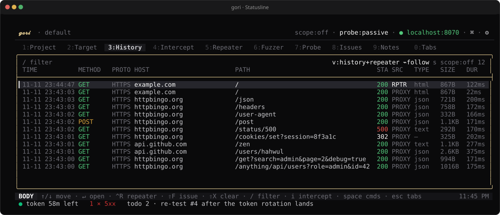

+++
title = "Custom TUI Statusline"
description = "An extra row at the bottom of the TUI, filled by a shell command of your own."
weight = 120

[extra]
group = "Customize"
shot = "statusline"
+++

The **statusline** is an opt-in row at the very bottom of the TUI. gori runs a shell command on an interval and renders its stdout as that row. It is a status bar you write yourself, inspired by Claude Code's status line. It ships off, and the `statusline` section stays out of `settings.json` until you change something.

<figure class="tui-shot">
  
  <figcaption>The <strong>statusline</strong> is the last row, under the status bar. This one comes from the <a href="#script">script below</a>. It shows how long the token under test has left, that the target has returned a 5xx, and what is still on the list. None of it appears in the bars above.</figcaption>
</figure>

## Turning it on

Open Preferences with `Ctrl-,`, go to **General**, and the **Statusline** rows are there: the **Statusline** toggle (off by default), the `Command` field, and the `Interval` and `Timeout` seconds. Turn the toggle on and give it a command, and the row appears under the status bar.

The same thing in `settings.json`:

```json
{
  "statusline": {
    "enabled": true,
    "command": "date '+%H:%M'",
    "interval": 3,
    "timeout": 10
  }
}
```

That command is a clock. The rest of this page covers what to put in `command`.

Every key, its default and its meaning are in [`statusline` in the configuration reference](/reference/config/#statusline).

Before you write one:

- **Only the first line of stdout is used**, truncated to the terminal width.
- **ANSI/SGR colour escapes are honoured** (16-colour, 256-colour and truecolor, plus bold, underline and the like), so the row can hold coloured segments.
- **Edits take effect immediately.** Saving a new `command`, `interval` or `timeout` re-runs the command on the next frame instead of waiting out the current interval.

Runs happen off the draw path, so they never block the UI. gori launches the next run only after the previous one has finished, so runs never overlap.

## Presets {#presets}

The top bar already shows gori's own state: the project, capture state, the
address it is bound to, the scan mode. A statusline is useful when it shows what the bar
does not: something from outside gori, or something gori holds but does not count for you.

Each of these is one line, like the settings form's field, and goes straight into `command`.
`\u001b` is how `jq` spells the escape character. The colours are optional. Under each
command is the row it produced.


```sh
jq -rn --argjson exp "$(gori run jwt "$(cat "${GORI_HOME:-$HOME/.gori}/token.jwt")" --format json | jq .payload.exp)" '(($exp - now) / 60 | floor) as $m | if $m < 5 then "\u001b[31m⚠ token \($m)m left\u001b[0m" else "\u001b[32m●\u001b[0m token \($m)m left" end'
```



```sh
p=$(jq -r .project); gori run history --project "$p" -q 'status:>=500' -n 100000 --format json 2>/dev/null | jq -r 'length | if . == 0 then "" else "\u001b[31m\(.) × 5xx\u001b[0m" end'
```



```sh
p=$(jq -r .project); gori run notes --all --project "$p" | awk '/^- \[ \]/ { n++; if (n == 1) first = substr($0, 7) } END { if (n) printf "todo %d · %s", n, first }'
```


Every field in [the context](#context) can go in too (`\(.flows)`, `\(.issues)`, the
mode flags), but check the top bar first. A segment that repeats a chip adds nothing. The
useful ones combine gori's data with something gori cannot know:

```sh
# The project, and the branch you are testing it from.
printf '%s · %s' "$(jq -r .project)" "$(git branch --show-current 2>/dev/null)"
```

## When one line is not enough {#script}

Past a segment or two, keep the command in a script and point `command` at it:

```json
{
  "statusline": {
    "enabled": true,
    "command": "sh \"${GORI_HOME:-$HOME/.gori}/statusline.sh\"",
    "interval": 5
  }
}
```

```sh
#!/bin/sh
# statusline.sh — one row: how long the token has, whether the target is erroring,
# and what is still unchecked. The context arrives on stdin, so read it once.
ctx=$(cat)
project=$(printf '%s' "$ctx" | jq -r .project)

token=$(jq -rn --argjson exp "$(gori run jwt "$(cat "${GORI_HOME:-$HOME/.gori}/token.jwt")" --format json | jq .payload.exp)" \
  '(($exp - now) / 60 | floor) as $m | if $m < 5 then "\u001b[31m⚠ token \($m)m left\u001b[0m" else "\u001b[32m●\u001b[0m token \($m)m left" end')
errors=$(gori run history --project "$project" -q 'status:>=500' -n 100000 --format json 2>/dev/null |
  jq -r 'length | if . == 0 then "" else "\u001b[31m\(.) × 5xx\u001b[0m" end')
todo=$(gori run notes --all --project "$project" |
  awk '/^- \[ \]/ { n++; if (n == 1) first = substr($0, 7) } END { if (n) printf "todo %d · %s", n, first }')

printf '%s' "$token"
[ -n "$errors" ] && printf '   %s' "$errors"
[ -n "$todo" ] && printf '   %s' "$todo"
printf '\n'
```

This prints the row in the shot at the top of this page. It joins the three presets above
and prints each part only when it is not empty. The context is read once into `$ctx`, because
stdin is a pipe (see [below](#context)). The last statement is a plain `printf`, so a quiet
run still exits 0 and the row does not show `⋯ (exit 1)`.

Give it `interval: 5` or more. The script spawns three short-lived processes per run, which is
cheap but not worth doing every second.

## The context on stdin {#context}

Each run receives a JSON context on stdin describing the live session, so scripts can display proxy state without querying gori:

```json
{
  "version": 1,
  "project": "acme",
  "capturing": true,
  "flows": 1234,
  "proxy": { "host": "127.0.0.1", "port": 8070, "addr": "127.0.0.1:8070" },
  "upstream": "",
  "upstream_rules": 0,
  "upstream_env": "",
  "scope": { "active": true, "rules": 2, "sandbox": false },
  "intercept": { "enabled": false, "queued": 0, "direction": "requestonly" },
  "probe": "passive",
  "issues": 7,
  "jobs": { "running": 1, "label": "fuzzing 1" }
}
```

| Field | Type | Description |
|-------|------|-------------|
| `version` | integer | Context schema version (currently `1`) |
| `project` | string | Active project name |
| `capturing` | bool | Whether the proxy is currently capturing |
| `flows` | integer | Number of captured flows |
| `proxy.host` / `proxy.port` / `proxy.addr` | string / integer / string | The address the proxy is listening on |
| `upstream` | string | The **catch-all** upstream proxy address/URI, or empty when connecting directly. A destination matched by an [upstream rule](/reference/config/#upstream-rules) routes elsewhere; this field does not reflect that |
| `upstream_rules` | integer | Number of [upstream rules](/reference/config/#upstream-rules) in effect. Non-zero means routing is per-destination and `upstream` alone does not describe where traffic goes |
| `upstream_env` | string | The process proxy variable routing traffic when `upstream` is empty and no rule claims the host, e.g. `HTTPS_PROXY → http proxy corp.example:3128`, qualified with `· destinations no upstream rule claims` once a rule table narrows it (`the project destination filter admits` when the project's **Destination host** narrows it, both joined with `and`); empty when nothing can reach the environment (a project pin, a non-empty `upstream`, or a `*` rule). Never carries credentials |
| `scope.active` / `scope.rules` | bool / integer | Whether [scope](/guide/proxy/#scope) filtering is in force (the lens is on **and** at least one rule exists), and how many rules there are |
| `scope.sandbox` | bool | Whether the [Sandbox](/guide/proxy/#sandbox) is blocking out-of-scope destinations outright, rather than merely not recording them |
| `intercept.enabled` | bool | Whether catch is on. Real clients are held while it is |
| `intercept.queued` | integer | Messages waiting for a decision right now |
| `intercept.direction` | string | `requestonly` (the default), `responseonly` or `both`: which leg is caught |
| `probe` | string | The [scanner](/guide/scanning/#probe-the-scanner) mode: `off`, `passive`, `active` or `aggressive` |
| `issues` | integer | Issues recorded in this project |
| `jobs.running` | integer | Background jobs in flight (fuzz, mine, discover, …). The activity chip counts the same jobs, so an in-flight Repeater send is not one |
| `jobs.label` | string \| null | What the status bar's activity chip says, e.g. `"fuzzing 1"`; `null` when nothing is running |

The fields from `scope` down describe what gori is set to do next, the same facts the top bar's chips carry. Fields are only ever added and `version` stays `1`, so a script written against an earlier context keeps working.

**stdin is read once.** It is a pipe, so the first command that reads it gets everything and the second gets nothing: `"$(jq -r .project)" "$(jq -r .flows)"` silently prints an empty flow count. Read the whole context with one `jq`, as the presets above do, or capture it first:

```sh
ctx=$(cat); printf '%s · %s flows' "$(echo "$ctx" | jq -r .project)" "$(echo "$ctx" | jq -r .flows)"
```

## When the command fails {#failures}

A command that fails without printing anything reports its exit status instead of leaving the row blank: `⋯ (exit 127)` for a command that was not found, `⋯ (killed)` for one a signal ended. A run that overruns `timeout` is terminated and the row reads `⋯ (timed out)`, and a command gori could not start reads `⋯ (statusline failed)` (or `⋯ (statusline error)` for an internal fault). A command that exits cleanly having printed nothing leaves the row empty. stderr is discarded either way.

These markers are drawn in the caution colour, so a broken statusline is not mistaken for one reporting bad news.

`timeout` is separate from `interval`. Runs never overlap, so a script slower than `interval` refreshes as fast as it can and is not killed for it. Only `timeout` ends a run.

A command that backgrounds work (`curl … &`) must clean up after itself. gori kills the shell it started (`/bin/sh`, or `cmd.exe` on Windows) and cannot reach anything that shell forked. The shell shares gori's process group, so signalling the group would kill gori too. A timed-out run is sent `SIGTERM` before `SIGKILL`, so a `trap … TERM` around `cmd & wait` can tidy up. It is simpler to bound the command itself (`curl --max-time 2`, `timeout 2 …`).

## Where else a command can run

The statusline is one of five settings that carry a command rather than data. The others are [process hooks](/guide/scripting/#process-hooks) and the external editor. A profile exported with `gori settings export` can carry all of them, and both ends of that transfer [say so](/reference/cli/#profiles-that-carry-commands).
