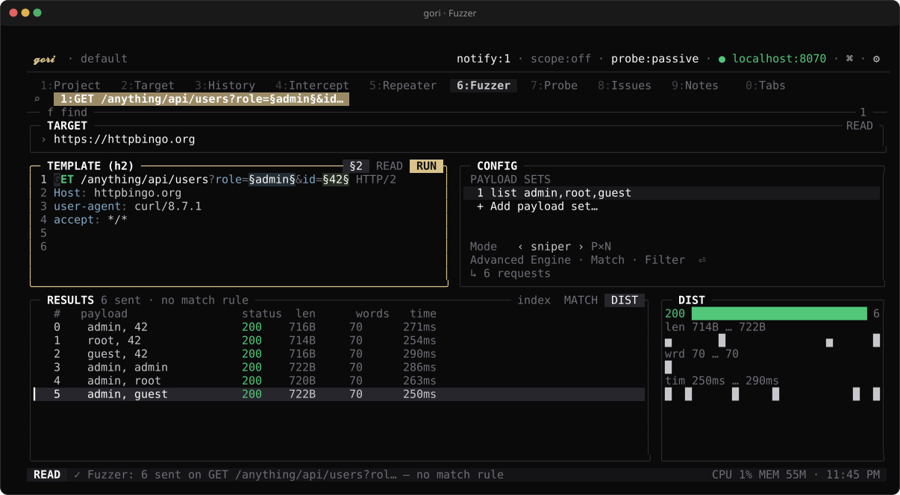

+++
title = "파라미터 퍼징"
description = "캡처한 요청의 한 부분을 표시하고, 워드리스트를 던지고, 튀는 응답을 읽어 냅니다."
weight = 40

[extra]
group = "수동 루프"
+++

이 플레이북은 캡처한 요청에서 값 하나를 표시하고, 그 지점에 페이로드 세트를 던진 뒤, 다르게 동작하는 응답을 찾아 읽습니다. Intruder 스타일 루프를 TUI와 헤드리스에서 다룹니다. 약 10분을 잡으세요.

> **시작하기 전에.** 먼저 [엔게이지먼트 준비](/ko/playbooks/set-up-an-engagement/)를 끝내 대상에 스코프를 잡아 두세요. Fuzzer는 스코프 밖 호스트를 `SCOPE_BLOCKED`로 거부합니다. **History**에 쿼리 키, JSON 필드, 헤더처럼 파라미터를 담은 캡처 플로우가 하나 있어야 합니다. 테스트 권한이 있는 대상만 퍼징하세요. 예시는 `api.example.com`을 대역으로 씁니다.

## 1. Fuzzer로 요청 보내기 {#1-send-a-request-to-the-fuzzer}

실제로 캡처된 요청에서 시작해야 앱이 보낸 바이트를 퍼징합니다. **History**에서 파라미터를 담은 플로우를 선택하고 `Shift-I`를 누르세요. `Ctrl-R`이 Repeater로 보내듯, gori가 요청을 **Fuzzer** 탭으로 복사하고 그리로 전환합니다. 헤드리스에서는 플로우 id가 소스입니다:

```bash
gori run fuzz <flow-id>
```

소스는 원시 요청 파일(`--request`)이나 stdin일 수도 있지만, 캡처한 플로우는 실행을 프로젝트 스코프 안에 묶어 둡니다.

**체크포인트.** **Fuzzer** 탭에 요청 복사본이 템플릿으로 담기며, 표시하기 전까지는 그대로입니다.

## 2. 위치 표시하기 {#2-mark-a-position}

Fuzzer는 표시한 위치를 제외하고 템플릿을 그대로 보냅니다. 변형할 값을 `§…§` 마커로 감싸세요. 값에 커서를 올리고 `Ctrl-A`를 눌러 흔한 파라미터(쿼리 키, 폼·JSON 필드)를 자동 표시하거나, 그 밖의 값(헤더 값, 경로 세그먼트)은 둘레에 마커를 직접 입력합니다.

마커와 페이로드를 어떻게 조합할지가 **모드**이며, CONFIG에서 설정합니다:

| 모드 | 동작 |
|------|----------|
| `sniper` | 한 번에 한 위치, 단일 페이로드 세트를 순환 (기본값) |
| `batteringram` | 표시된 모든 위치에 같은 페이로드 |
| `pitchfork` | 병렬 세트: 각 세트의 *n*번째 페이로드를 함께 |
| `clusterbomb` | 모든 세트에 걸친 전 조합 |

위치가 하나라면 `sniper`를 쓰세요. 나머지 셋은 위치가 둘 이상일 때만 의미가 있습니다. 헤드리스에서 위치는 요청 속 `§…§` 마커, 자동 배치용 `--auto`, 또는 `--mark=TOKEN`에서 오고, 모드는 플래그입니다:

```bash
gori run fuzz <flow-id> --auto --mode sniper
```

**체크포인트.** 정확히 값 하나가 `§…§`로 감싸지고(또는 `Ctrl-A` 이후 하이라이트되고), 모드가 `sniper`로 보입니다.

## 3. 페이로드 붙이기 {#3-attach-payloads}

페이로드 세트는 마커에 치환되는 것입니다. 파일 없이 빠르게 첫 패스를 돌리려면 내장 프리셋(`sqli`, `xss`, `traversal`, `format-string`, `bad-strings`, `command-injection`, `cache-delimiters`)으로 시작하거나, 워드리스트·명시적 목록·숫자 범위·브루트포스 문자 집합을 지정하세요.

**쿼리 문자열이나 form-urlencoded 본문 값에 치환되는 페이로드는 URL 인코딩됩니다.** 그 자리의 원시 공백이나 `<`는 요청 타깃을 끊거나 프레이밍을 깨뜨리므로, gori가 `--encode url`과 같은 방식으로 퍼센트 인코딩합니다. 그 밖의 자리(경로 세그먼트, JSON이나 원시 본문, 헤더, 쿠키 값)는 쓴 대로 나갑니다. 트래버설 탐침의 `%2F`는 다른 시험이 되기 때문입니다. 원시 바이트 자체가 페이로드일 때는 `--no-encode`로 기본값을 끕니다. 페이로드가 이미 퍼센트 이스케이프일 때도 이 옵션을 쓰세요. `%`도 다른 바이트처럼 인코딩되므로 `%00`은 `%2500`으로 나가고, origin의 디코더를 겨눈 널바이트·overlong-UTF-8 탐침은 평범한 텍스트로 도착합니다. 프로세서는 나가는 길에 각 페이로드를 변환합니다(접두/접미, URL·base64·hex 인코딩, 대소문자 접기, 해싱, 또는 정규식 치환). `--encode` 프로세서는 기본 인코딩에 겹쳐지지 않고 기본값을 대체합니다. 나머지 프로세서는 대체하지 않으므로, 쿼리나 form 위치라면 그 출력도 인코딩됩니다. TUI에는 프로세서 행이 없습니다. 마커별로 그 역할을 하는 것은 Decoder 체인입니다. 마커 안에 커서를 두고 `Ctrl-Q`를 눌러 체인을 적습니다(`base64-encode > url-encode` 등). 체인은 전송할 때 모든 페이로드에 적용되고, `--encode`처럼 그 위치의 기본 URL 인코딩을 대체합니다. 편집기는 요청이 나가기 전에 그 마커의 값이 각 단계를 거친 결과를 미리 보여 줍니다.

```bash
gori run fuzz <flow-id> --auto --mode sniper --wordlist params.txt
```

다시 쓸 목록은 [wordlist 카탈로그](/ko/guide/repeater-and-fuzzer/#wordlist-catalog)(`~/.gori/wordlists`)에 두세요. 한 번 저장하면(`gori run wordlist save params.txt --from params.txt`, 또는 Fuzzer의 List 페이로드 에디터에서 `Ctrl-S`) 어느 디렉터리에서든 `--wordlist params.txt`가 이름으로 찾습니다. 프로젝트도 페이로드 출처가 됩니다. `--payload-from 'host:api.example.com param-values'`는 앱의 클라이언트가 이미 보낸 값으로 세트를 만들고(`param-names`, `path-segments`, `js-endpoints`는 다른 조각을 읽습니다), TUI에서는 **Project** 페이로드 타입입니다. 프로젝트를 읽을 뿐 아무것도 보내지 않습니다. 자격 증명처럼 보이는 값은 허용하지 않는 한 빠집니다. [프로젝트에서 가져오는 페이로드](/ko/guide/repeater-and-fuzzer/#payloads-from-the-project)를 참고하세요.

**체크포인트.** CONFIG에 페이로드 세트가 나열되고, 마커에 체인을 붙였다면 `Ctrl-Q` 미리보기가 그 마커의 값이 체인을 거친 결과를 보여 줍니다. `gori run fuzz`도 첫 요청 전에 몇 개의 쿼리/폼 위치를 인코딩하는지 한 번 알려 줍니다.

## 4. 매처 설정하고 실행하기 {#4-set-a-matcher-and-run}

매처는 결과 표에 어떤 응답을 드러낼지 정합니다. status, size, words, 왕복 시간, 또는 본문 정규식으로 필터링하고(ffuf 스타일. lines, 응답 헤드 부분 문자열, gRPC status는 헤드리스 전용), **자동 보정(auto-calibration)**을 켜서 노이즈 기준선(소프트 404, 뭐든 받아 주는 200)이 진짜 히트를 묻어 버리지 않게 하세요. `Ctrl-R`로 실행합니다.

헤드리스에서 매처 플래그는 `--mc`/`--fc`(status), `--ms`/`--fs`(size), `--mw`/`--fw`(words), `--ml`/`--fl`(lines), `--mt`/`--ft`(왕복 시간, ms), `--mr`/`--fr`(본문 정규식), `--mh`/`--fh`(응답 헤드의 대소문자 무시 부분 문자열), `--mg`/`--fg`(gRPC status), 그리고 자동 보정용 `--ac`입니다:

```bash
gori run fuzz <flow-id> \
  --auto \
  --wordlist params.txt \
  --mode sniper \
  --mc 200,302 \
  --fs 0 \
  --ac
```

실행이 스스로 멈추게 할 수도 있습니다. `--stop-after-matches 1`은 첫 매처 히트에서 실행을 끝내고, `--stop-on`은 별도의 조건을 지정합니다(`status:500`, 또는 본문에서 그 문자열이 처음 사라지는 순간을 잡는 `'!regex:Invalid password'`). 어느 쪽이든 실행은 `condition_met`으로 끝나고, 멈추게 한 행이 기록됩니다. TUI에서는 둘 다 CONFIG 창의 **Advanced** 행으로 여는 **ADVANCED** 카드에 있는 행입니다.

첫 후보는 `200`인데 그 뒤로는 전부 `403`이라면, 요청에 앱이 한 번만 받아 주는 CSRF 토큰이나 nonce가 실려 있는 것입니다. 후보마다 앞서 새 값을 가져오는 요청 시점 매크로를 실행에 붙이세요. [세션 이어 가기](/ko/playbooks/carry-a-session/#6-fetch-a-fresh-token-for-every-request)에서 자세히 다룹니다.

### 차이가 시계뿐일 때 {#when-the-only-difference-is-the-clock}

시간 기반 블라인드 페이로드(`' OR SLEEP(5)--`, `; ping -c 10 127.0.0.1`, `pg_sleep`)는 아무 일도 하지 않은 페이로드와 status도, 바이트 길이도, 단어 수도, 본문도 똑같이 돌아옵니다. 위의 매처로는 둘을 구분할 수 없습니다. `--mt`는 왕복 시간으로 매칭합니다.

```bash
gori run fuzz <flow-id> --auto -w sleep-payloads.txt --mt '>=4500' --timeout 15
```

단위는 밀리초입니다. 타임아웃된 전송도 `--mt`에서는 매치로 셉니다. 오리진을 설정한 타임아웃 너머로 밀어낸 페이로드는 같은 신호가 가장 뚜렷하게 나타난 경우이기 때문입니다. 거부되거나 닿지 않은 전송은 여전히 결과가 아니고, `--mt`를 `--mc 200`과 함께 쓰면 응답이 필요한데 타임아웃에는 응답이 없습니다. `--mt` 실행에서는 `--retries`도 타임아웃을 재전송하지 않습니다. 그 행이 곧 발견이기 때문입니다.

타이밍은 노이즈가 많습니다(공유 오리진, 느린 홉, 운 나쁜 일시 정지 한 번). `--mt` 행도 다른 매치처럼 믿기 전에 손으로 재전송해 보세요.

<figure class="tui-shot">
  
  <figcaption><strong>Fuzzer</strong>: 템플릿에 표시된 위치 하나, CONFIG 패널의 페이로드 세트와 <code>sniper</code> 모드, 그리고 각 요청이 도착할 때마다 채워지는 결과 표.</figcaption>
</figure>

**체크포인트.** 요청이 도착할수록 결과 표가 채워집니다. status나 size로 정렬해 튀는 값을 위로 끌어올리세요.

## 5. 결과 읽고 다음 단계 준비하기 {#5-read-results-and-seed-the-next-step}

찾는 것은 주변 행과 어긋나는 행입니다. 나머지가 `404`인데 혼자 뜬금없는 `200`이나 `500`, 또는 페이로드 하나만 다르게 처리되어 길이가 튀는 행입니다. 결과에서 `Space` 메뉴로 **Repeater**에 넘기거나 **Comparer**로 기준선과 diff를 떠서, 그 페이로드를 손으로 파고드세요.

수천 행짜리 스윕에는 **Group by shape**(`Space` → `Z` **Display…**, 그다음 **Group by shape**)를 쓰세요. RESULTS를 서로 다른 응답마다 한 행으로 접습니다. 페이로드 반사, id, 숫자, 타임스탬프, 응답마다 바뀌는 헤더는 무시하고 드문 모양부터 나열합니다. `→`는 클러스터를 펼쳐 구성원을 보여 주고 `←`는 다시 접습니다. 헤드리스에서는 저장된 실행에 `gori run fuzz show RUN_ID --clusters`로 같은 질문을 합니다. [응답 모양으로 결과 묶기](/ko/guide/repeater-and-fuzzer/#grouping-results-by-response-shape)를 참고하세요.

실행 전체를 남기려면, 끝난 뒤 에디터를 READ 모드에 둔 채 **`Shift-E`**를 누르세요. 스윕이 도는 동안 gori는 완전한 요청/와이어/응답 행을 전부 디스크에 비공개로 스풀하고, 화면은 5,000행 / 64 MiB로 제한된 창을 유지합니다. Shift-E는 그 완전한 스풀을 프로젝트로 승격시킵니다. 마지막으로 성공한 실행은 해당 Fuzzer 세션과 함께 제한된 창으로 자동으로 다시 열리고, `Ctrl-P`에서 **Run history**로 더 오래된 실행을 고를 수 있으며, CLI/MCP는 아카이브 전체를 페이지 단위로 읽습니다. 헤드리스에서는 영구 저장을 명시하고 id로 들여다봅니다:

```bash
gori run fuzz save <flow-id> --auto --wordlist params.txt --mc 200,302
gori run fuzz list
gori run fuzz show RUN_ID
gori run fuzz show RUN_ID RESULT_INDEX --format json
```

긴 스윕이라면 `--keep interesting`(ADVANCED 카드의 **Keep interesting only**)이 모든 행 대신 매칭된 행, 결함이 있는 행(오류, 재전송, 잘린 응답), 그리고 실행을 멈추게 한 행만 저장합니다.

`save` 없는 `gori run fuzz …`는 일회성이므로, 기존 스크립트가 프로젝트 데이터베이스를 불리지 않습니다.

앱이 이름을 밝히지 않은 숨은 파라미터는 **Miner**로 찾습니다. Miner는 서버가 받아 주지만 드러내지 않는 후보 이름을 추측합니다. [Param Miner](/ko/guide/scanning/#param-miner)를 보세요.

## 다음 단계 {#next-steps}

- [세션 이어 가기](/ko/playbooks/carry-a-session/): 이후의 모든 요청을 로그인한 사용자로 재전송
- [Fuzzer 레퍼런스](/ko/guide/repeater-and-fuzzer/#fuzzer): 어택 모드, 페이로드 세트, 매처 전체
- [Param Miner](/ko/guide/scanning/#param-miner): 앱이 이름조차 밝히지 않은 파라미터 찾기
