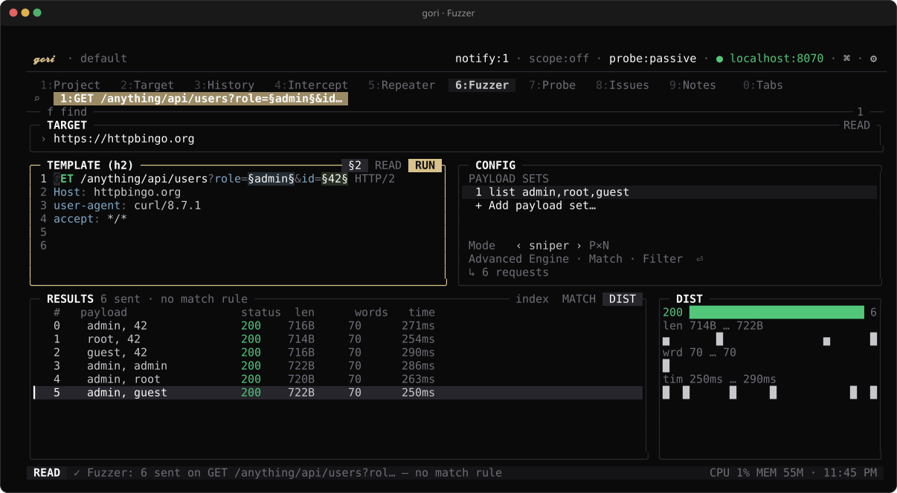

+++
title = "Fuzz a parameter"
description = "Mark one part of a captured request, throw a wordlist at it, and read the responses that stand out."
weight = 40

[extra]
group = "The manual loop"
+++

This playbook marks one value in a captured request, throws a payload set at that spot, and reads the responses for the one that behaves differently. It covers the Intruder-style loop in the TUI and headless. Budget about ten minutes.

> **Before you begin.** [Set up an engagement](/playbooks/set-up-an-engagement/) first, so your target is scoped. The Fuzzer refuses an out-of-scope host with `SCOPE_BLOCKED`. Have one captured flow in **History** that carries a parameter: a query key, a JSON field, a header. Only fuzz a target you are authorized to test. The examples use `api.example.com` as a stand-in.

## 1. Send a request to the Fuzzer

Start from a real captured request, so you fuzz the bytes the app sent. In **History**, select the flow that carries the parameter and press `Shift-I`. gori copies it into the **Fuzzer** tab and switches you there, as `Ctrl-R` does for Repeater. Headless, the flow id is the source:

```bash
gori run fuzz <flow-id>
```

A source can also be a raw request file (`--request`) or stdin, but a captured flow keeps the run inside your project scope.

**Checkpoint.** The **Fuzzer** tab holds a copy of the request as its template, unchanged until you mark it.

## 2. Mark a position

The Fuzzer sends the template verbatim except where you mark a position. Wrap the value to vary in `§…§` markers: put the cursor on it and press `Ctrl-A` to auto-mark the common params (query keys, form and JSON fields), or type the markers by hand around anything else (a header value, a path segment).

How markers and payloads combine is the **mode**, set in CONFIG:

| Mode | Behavior |
| ------ | ---------- |
| `sniper` | One position at a time, cycling a single payload set (default) |
| `batteringram` | The same payload in every marked position |
| `pitchfork` | Parallel sets: payload *n* from each set together |
| `clusterbomb` | Every combination across all sets |

For a single position, use `sniper`. The other three matter only with more than one position. Headless, positions come from the `§…§` markers in the request, `--auto` to place them for you, or `--mark=TOKEN`, and the mode is a flag:

```bash
gori run fuzz <flow-id> --auto --mode sniper
```

**Checkpoint.** Exactly one value is wrapped in `§…§` (or highlighted after `Ctrl-A`), and the mode reads `sniper`.

## 3. Attach payloads

A payload set is what gets substituted into the marker. Start with a built-in preset (`sqli`, `xss`, `traversal`, `format-string`, `bad-strings`, `command-injection`, `cache-delimiters`) for a fast first pass with no file, or point at a wordlist, an explicit list, a numeric range, or a brute-force character set.

**A payload spliced into a query-string or form-urlencoded body value is URL-encoded.** A raw space or `<` there would end the request-target or break the framing, so gori percent-encodes it as `--encode url` does. Everywhere else (a path segment, a JSON or raw body, a header, a cookie value) the bytes go on the wire as written, since a `%2F` in a traversal probe would be a different test. `--no-encode` turns the default off when the raw byte *is* the payload. Use it also when the payload is already a percent-escape. `%` is encoded like any other byte, so `%00` goes out as `%2500` and a null-byte or overlong-UTF-8 probe aimed at the origin's decoder arrives as plain text. Processors transform each payload on the way out (prefix/suffix, URL/base64/hex encoding, case folding, hashing, or a regex replace). An `--encode` processor replaces the default encoding instead of stacking on it. The other processors do not, so a query or form position still encodes their output. The TUI has no processor rows. Its per-marker equivalent is a Decoder chain. Put the cursor inside a marker and press `Ctrl-Q` to write one (`base64-encode > url-encode`, …). It runs over every payload on send and, like `--encode`, replaces the default URL-encoding for that position. The editor previews the marker's value through each step before any request goes out.

```bash
gori run fuzz <flow-id> --auto --mode sniper --wordlist params.txt
```

Keep a list you will use again in the [wordlist catalog](/guide/repeater-and-fuzzer/#wordlist-catalog) (`~/.gori/wordlists`). Save it once (`gori run wordlist save params.txt --from params.txt`, or `Ctrl-S` in the Fuzzer's List payload editor) and `--wordlist params.txt` finds it by name from any directory. The project is a payload source too. `--payload-from 'host:api.example.com param-values'` builds the set from the values the app's clients already sent (`param-names`, `path-segments` and `js-endpoints` read other slices), and in the TUI it is the **Project** payload type. It reads the project and sends nothing. A value that looks like a credential stays out unless you opt in. See [Payloads from the Project](/guide/repeater-and-fuzzer/#payloads-from-the-project).

**Checkpoint.** CONFIG lists your payload set, and if you gave a marker a chain, the `Ctrl-Q` preview shows that marker's value after the chain. `gori run fuzz` also prints once, before the first request, how many query/form positions it is encoding for.

## 4. Set a matcher and run

A matcher decides which responses the results table shows. Filter on status, size, words, round-trip time, or a body regex, ffuf-style (lines, a response-head substring and gRPC status are headless-only), and turn on **auto-calibration** so a noisy baseline (a soft 404, a catch-all 200) doesn't drown the real hits. Press `Ctrl-R` to run.

Headless, the matcher flags are `--mc`/`--fc` (status), `--ms`/`--fs` (size), `--mw`/`--fw` (words), `--ml`/`--fl` (lines), `--mt`/`--ft` (round-trip time in ms), `--mr`/`--fr` (body regex), `--mh`/`--fh` (a case-insensitive substring of the response head), `--mg`/`--fg` (gRPC status), and `--ac` to auto-calibrate:

```bash
gori run fuzz <flow-id> \
  --auto \
  --wordlist params.txt \
  --mode sniper \
  --mc 200,302 \
  --fs 0 \
  --ac
```

A run can also stop itself. `--stop-after-matches 1` ends it on the first matcher hit, and `--stop-on` names a separate condition (`status:500`, or `'!regex:Invalid password'` for the first body that no longer carries it). Either ends the run as `condition_met`, with the row that tripped it recorded. In the TUI both are rows on the **ADVANCED** card, opened from the CONFIG pane's **Advanced** row.

If the first candidate comes back `200` and every one after it `403`, the request carries a CSRF token or nonce the app accepts once. Give the run a request-time macro that fetches a fresh one before each candidate. [Carry a session](/playbooks/carry-a-session/#6-fetch-a-fresh-token-for-every-request) walks through it.

### When the only difference is the clock

A time-based blind payload (`' OR SLEEP(5)--`, `; ping -c 10 127.0.0.1`, a `pg_sleep`) comes back with the same status, the same byte length, the same words and the same body as the payload that did nothing. None of the matchers above can tell them apart. `--mt` matches on round-trip time:

```bash
gori run fuzz <flow-id> --auto -w sleep-payloads.txt --mt '>=4500' --timeout 15
```

The unit is milliseconds. A send that timed out counts as a match on `--mt`, since a payload that pushed the origin past your timeout is the strongest form of the signal. A refused or unreachable send is still not a result, and combining `--mt` with `--mc 200` still needs a response, which a timeout does not have. On a `--mt` run, `--retries` does not re-send a timeout, because that row is the finding.

Timing is noisy (a shared origin, a slow hop, one unlucky pause). Re-send a `--mt` row by hand before trusting it, as with any other match.

<figure class="tui-shot">
  
  <figcaption>The <strong>Fuzzer</strong>: one marked position in the template, a payload set and <code>sniper</code> mode in the CONFIG pane, and the results table filling as each request lands.</figcaption>
</figure>

**Checkpoint.** The results table fills as requests land. Sort it by status or size to bring the outliers to the top.

## 5. Read results and seed the next step

The finding is the row that doesn't match its neighbours: an unexpected `200` or `500` where the rest return `404`, or a length that jumps when one payload lands differently. A result's `Space` menu sends it on to the **Repeater**, or to the **Comparer** to diff it against the baseline, so you can probe that payload by hand.

For a sweep of thousands, use **Group by shape** (`Space` → `Z` **Display…**, then **Group by shape**). It folds RESULTS into one row per distinct answer, with payload echoes, ids, numbers, timestamps and per-response headers ignored, and lists the rare shapes first. `→` opens a cluster to its members and `←` folds it again. Headless, a saved run answers the same question with `gori run fuzz show RUN_ID --clusters`. See [Grouping Results by Response Shape](/guide/repeater-and-fuzzer/#grouping-results-by-response-shape).

To keep the complete run, leave the editor in READ mode and press **`Shift-E`** after it finishes. During the sweep gori privately spools every full request/wire/response row to disk while the pane stays bounded to 5,000 rows / 64 MiB. Shift-E promotes the complete spool into the project. The latest successful run reopens automatically as a bounded window with its Fuzzer session. **Run history** (type it into `Ctrl-P`) selects an older run, while CLI/MCP can page the whole archive. Headless, make persistence explicit and inspect it by id:

```bash
gori run fuzz save <flow-id> --auto --wordlist params.txt --mc 200,302
gori run fuzz list
gori run fuzz show RUN_ID
gori run fuzz show RUN_ID RESULT_INDEX --format json
```

On a long sweep, `--keep interesting` (the ADVANCED card's **Keep interesting only**) stores only the matched rows, the ones carrying a fault (an error, a re-send, a truncated response) and the row that stopped the run, instead of every row.

`gori run fuzz …` without `save` stays ephemeral, so existing scripts do not grow the project database.

For hidden parameters the app never names, use the **Miner**. It guesses candidate names the server accepts but doesn't advertise. See [Param Miner](/guide/scanning/#param-miner).

## Next Steps

- [Carry a session](/playbooks/carry-a-session/): replay every later request as a logged-in user
- [Fuzzer reference](/guide/repeater-and-fuzzer/#fuzzer): attack modes, payload sets, and matchers in full
- [Param Miner](/guide/scanning/#param-miner): find the parameters the app never named
