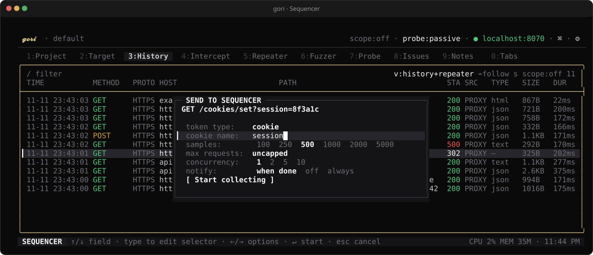

+++
title = "토큰 랜덤성 평가"
description = "세션 토큰 수백 개를 수집하고 Sequencer가 그것이 얼마나 예측 가능한지 채점하게 합니다."
weight = 90

[extra]
group = "워크벤치"
+++

예측 가능한 세션 쿠키, CSRF 토큰, 리셋 코드는 공격자가 위조하거나 추측할 수 있습니다. **Sequencer**는 그런 토큰을 수백 개 수집해 각각이 실제로 지닌 예측 불가능성을 채점합니다. 이 플레이북에서는 등급 평가 한 번을 처음부터 끝까지(겨냥, 수집, 읽기, 내보내기) 진행합니다. 10분 정도 걸리며, 대부분은 서버가 샘플을 내주기를 기다리는 시간입니다.

> **시작하기 전에.** 먼저 [엔게이지먼트 준비](/ko/playbooks/set-up-an-engagement/)로 대상에 스코프를 잡으세요. Sequencer는 라이브 요청을 여러 번 재전송합니다. 샌드박스와 제외 규칙은 모든 재전송을 막고, `gori run sequence`와 MCP 도구는 예외를 선언하지 않는 한 스코프 밖 대상을 거부합니다(TUI 실행에는 Repeater처럼 그런 사전 검사가 없습니다). 등급을 매길 토큰을 응답에서 설정하는 플로우가 하나 필요합니다(세션이나 CSRF 토큰의 `Set-Cookie`). 토큰은 권한이 있는 대상에서만 수집하세요. 샘플 하나하나가 갓 발급된 실제 자격 증명입니다.

## 1. Sequencer를 토큰에 겨냥하기 {#1-point-the-sequencer-at-a-token}

Sequencer 탭은 기본적으로 바 밖에 있습니다. **`0`**을 누르고 "seq"를 입력하거나 `Ctrl-P` → **Go to Sequencer**를 쓰세요.

캡처한 플로우를 입력으로 넣습니다. **History**에서 응답이 토큰을 설정하는 플로우를 선택한 뒤 `Space` `>` `s`(**Send flow to…** → **Send to Sequencer**)를 누릅니다. **SEND TO SEQUENCER** 카드가 History 위에 열리고, 유력한 세션 쿠키가 자동 감지되어 있습니다. 추측이 틀렸다면 거기서 토큰 종류를 Cookie, Header, Regex, Position, JSONPath 중 하나로 바꾸세요.

토큰의 고정된 골격(`sess_v1_` 접두사, 버전 바이트, 패딩)을 추출에서 잘라 낼 필요는 없습니다. gori가 샘플 전체에서 변하지 않는 위치를 찾아내 바이트·비트 단위 테스트를 변하는 부분에만 돌리므로, 고정된 구조 때문에 등급이 내려가지도, 구조가 랜덤으로 계산되지도 않습니다([구조는 비밀이 아닙니다](/ko/guide/sequencer/#structure-is-not-secret) 참고).

<figure class="tui-shot">
  
  <figcaption>캡처한 플로우를 <strong>Sequencer</strong>로 보내면 세션 쿠키가 자동 감지되며, 수집 전에 샘플 크기와 동시성을 설정할 수 있습니다.</figcaption>
</figure>

**체크포인트.** 카드에 방금 고른 토큰 위치와 함께 샘플 목표와 동시성이 표시됩니다.

## 2. 샘플 수집하기 {#2-collect-samples}

카드에서 **Start**를 눌러 수집합니다. 실행은 백그라운드에서 이어지고 Sequencer 탭에 표시됩니다(그 탭에서 `c`는 재설정, `Ctrl-R`은 다시 수집). gori는 목표 개수에 이를 때까지 소스 요청을 반복해 재전송하며 각 응답에서 토큰을 뽑아냅니다. `Ctrl-X`로 일찍 멈출 수 있습니다. 세션 토큰은 상태를 갖는 경우가 많고(요청마다 서버 측 카운터가 증가합니다) 병렬로 보내면 응답이 발급 순서와 다르게 도착할 수 있으므로, 수집은 기본적으로 **동시성 1**로 돌아갑니다. 엔드포인트가 무상태일 때만 올리세요.

같은 수집을 헤드리스로 하면 플로우 42를 재전송하고, `SESSIONID` 쿠키를 추출해, 토큰 500개를 모읍니다:

```bash
gori run sequence 42 --cookie SESSIONID --count 500
```

**체크포인트.** 재전송 응답이 들어올 때마다 **SAMPLES** 개수가 목표치를 향해 올라갑니다.

## 3. 등급 읽기 {#3-read-the-grade}

**ANALYSIS** 패널 맨 위에는 비트 단위의 **유효 엔트로피**(effective entropy)와 그에 따른 등급이 나옵니다. 유효 엔트로피는 토큰당 실제 예측 불가능성을 보수적으로 추정한 값입니다. 등급은 **Secure**(≥ 88비트), **Moderate**(≥ 60), **Weak**(≥ 30), **Critical**(30 미만)이며, 실패한 통계 테스트 하나마다 한 단계씩 내려갑니다. 그 아래에는 gori가 토큰 비트스트림에 돌린 통계 테스트 묶음(monobit, runs, chi-square, 직렬 상관, 압축 등)이 있습니다.

엔트로피 수치가 높고 모든 행이 통과하면, gori가 가진 모든 테스트에서 토큰이 *랜덤하게 보인다*는 뜻입니다. 반복되는 토큰은 예측할 수 있으므로, **중복**이나 **연속** 토큰이 하나라도 있으면 엔트로피가 아무리 높아도 판정이 **Critical**로 떨어집니다. 샘플이 작으면(쓸 만한 토큰 약 20개 미만) 확실한 실패도 경고로 낮아지고 등급에 상한이 걸리므로, 좋은 등급을 믿기 전에 더 모으세요.

**체크포인트.** **ANALYSIS** 패널에 전체 등급 하나와 그 근거인 테스트별 표가 표시됩니다.

## 4. 판정 내보내기 {#4-export-the-verdict}

수집한 토큰은 유효한 자격 증명이므로 gori는 디스크에 쓰지 않으며, 토큰은 세션과 함께 사라집니다. 판정을 남기려면 `⇧E`로 원하는 경로에 Markdown 리포트를 내보내거나(팔레트에서는 같은 리포트를 JSON으로 내보낼 수 있습니다), `Space` → `a`로 **Issue**로 등록합니다. 이때 Critical은 `critical`, Weak는 `high`, Moderate는 `medium`, Secure는 `info`로 매핑됩니다. 둘 다 토큰 값은 담지 않습니다. 리포트는 빈도표와 판정으로 만들어집니다.

**체크포인트.** 등급이 리포트나 Issue로 저장되어 있고, 원본 토큰은 어디에도 남지 않았습니다.

## 다음 단계 {#next-steps}

- [OAST로 블라인드 취약점 확인](/ko/playbooks/confirm-blind-vulns-oast/): 응답에 드러나지 않는 버그를 다루는 다음 워크벤치
- [Sequencer](/ko/guide/sequencer/): 토큰 위치, 테스트 묶음, 구조 감지의 전체 레퍼런스
- [CLI Reference](/ko/reference/cli/#run-sequence): 붙여넣은 목록용 `--tokens`를 포함한 모든 `gori run sequence` 플래그
