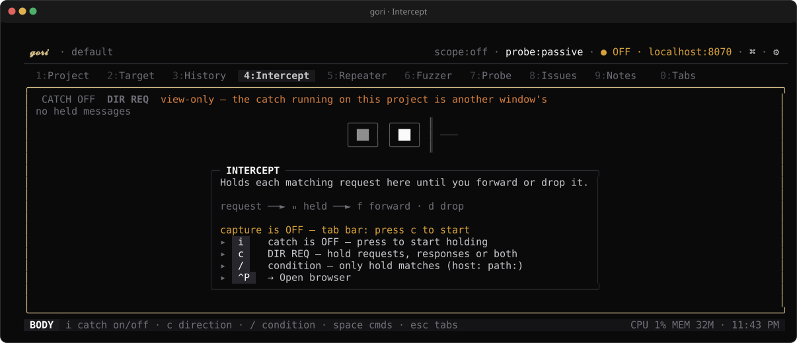

+++
title = "플로우 중 가로채기 및 수정"
description = "요청을 흐름 중간에 붙잡아 바꾸고 계속 흘려보낸 뒤, 그 변경을 규칙으로 고정합니다."
weight = 30

[extra]
group = "수동 루프"
+++

이 플레이북에서는 클라이언트가 기다리는 동안 진행 중인 요청을 붙잡아 와이어에서 수정해 전달한 뒤, 그 편집을 인터셉트를 꺼도 적용되는 Match & Replace 규칙으로 만듭니다. 10분 정도 걸립니다.

> **시작하기 전에.** 스코프를 정한 엔게이지먼트를 [준비](/ko/playbooks/set-up-an-engagement/)하고, 캡처를 켜고(`c`), 클라이언트를 프록시로 향하게 하세요. 예시에서는 `api.example.com`을 씁니다.

## 1. 인터셉트 무장 {#1-arm-intercept}

`i`를 눌러 **Intercept**를 켜거나, **Intercept** 탭을 열어 거기서 catch를 무장합니다. 조건이 비어 있으면 결정을 내릴 때까지 프록시를 지나는 모든 요청을 붙잡습니다(`s` 스코프 렌즈가 켜져 있으면 스코프 안의 모든 요청). 켜기 전에 필터 바에서 쿼리 언어 표현식으로 좁히세요:

```text
host:api.example.com method:POST
```

이제 대상으로 가는 POST만 붙잡히고 나머지는 통과합니다. History 필터의 토큰이 여기서도 동작합니다(`host:`, `path:`, `method:`, `scheme:`, `status:`에 더해 `AND` / `OR` / `NOT`).

<figure class="tui-shot">
  
  <figcaption><strong>Intercept</strong> 탭. <kbd>i</kbd>로 catch를 토글하고 방향을 고른 뒤, 매칭되는 트래픽만 붙잡아 전송 도중에 forward, drop, 편집합니다.</figcaption>
</figure>

> **WebSocket은 예외입니다.** WebSocket 메시지는 catch 조건에 `proto:ws`가 들어 있을 때**만** 붙잡힙니다. 빈 조건이나 호스트 필터만으로는 무장되지 않습니다. HTTP는 반대여서 빈 조건이 모든 것을 붙잡습니다. 메시지가 많은 채팅이나 트레이딩 소켓은 그렇게 넓은 필터에 걸리면 멈춰 버립니다.

**체크포인트.** Intercept 탭에 catch가 켜져 있고, 조건이 필터 바에 있습니다.

## 2. 요청을 잡아 편집하기 {#2-catch-a-request-and-edit-it}

브라우저 클릭, `curl`, Repeater 전송 등으로 클라이언트에서 매칭되는 요청을 발생시킵니다. 요청은 Intercept 큐에서 멈춥니다. 요청을 선택하고 `↵` / `e`를 눌러 raw 바이트를 에디터에서 열고(Repeater가 쓰는 것과 같은 INS 모드 에디터), 필요한 것을 바꾼 뒤(헤더 값, JSON 필드, 경로 등) `Ctrl-R`로 편집된 요청을 **forward**(전달)합니다. `Esc`는 전송 없이 에디터를 빠져나오되 편집은 유지하므로, 큐에서 `f`를 눌러도 전달됩니다. 에디터 안에서 `f`는 `f` 글자를 입력합니다.

Headless로는 TUI가 실행 중일 때 두 번째 터미널에서 같은 큐를 조작할 수 있습니다:

```bash
gori run intercept                       # 붙잡힌 항목 + catch 상태 나열
gori run intercept edit 3 --raw-file edited.txt   # 편집된 바이트로 항목 3 전달
```

TUI 에디터에서 편집된 요청은 `Content-Length`가 재동기화되고(기본 켜짐, `Ctrl-L`로 토글) 직접 입력한 `$ENV.KEY` [환경 변수](/ko/guide/repeater-and-fuzzer/#environment-variables)와 `$GEN.*` 토큰이 확장되어 전달됩니다. extract 규칙의 `$BIND.NAME` 바인딩은 이 경로에서 해석되지 않습니다. 잡힌 메시지에 원래 있던 토큰과 `$$` 이스케이프는 클라이언트의 바이트이므로 도착한 그대로 나가며, 직접 입력한 토큰이라도 그 이름이 잡힌 메시지에 이미 있었다면 마찬가지입니다. 직접 입력한 `$$ENV.KEY` 같은 이스케이프도 입력한 그대로 전달됩니다. `gori run intercept edit`는 아무것도 확장하지 않고 본문을 바이트 그대로 보내며, `--no-update-content-length`를 주면 선언한 `Content-Length`를 유지합니다. 나머지는 입력한 대로 나갑니다.

**체크포인트.** 편집된 요청이 origin에 도달합니다. **History**로 전환해 그 플로우에서 변경 내용과 origin의 응답을 확인하세요.

## 3. Forward, drop, 또는 편집 {#3-forward-drop-or-edit}

붙잡힌 항목마다 다음 세 가지 중 하나를 결정해야 합니다:

- **Forward** (`f`)는 항목을 바이트 그대로, 또는 2단계의 편집을 반영해 내보냅니다. 붙잡힌 항목이 쌓였을 때 `Shift-F`는 큐 전체를 한 번에 전달합니다.
- **Drop** (`d`)는 항목을 버립니다. HTTP/1.1에서는 클라이언트가 미리 정해진 `502`를 받고, HTTP/2에서는 스트림이 취소됩니다. 요청이 아예 도착하지 않으면 클라이언트가 어떻게 대처하는지 확인할 때 씁니다.
- **편집 후 전달**은 요청을 보내기 전에 바꾸고 싶을 때 씁니다. 2단계가 이 경우입니다.

Forward와 drop은 마킹된 행이 있으면 그 행들에, 없으면 커서 행에 적용됩니다. `t`로 여러 행을 마킹하면 `f` 한 번으로 함께 전달됩니다. 자동으로 적용되는 것은 없습니다.

**체크포인트.** 요청 하나는 손대지 않고 전달하고 다른 하나는 drop했으며, History에 둘 다 기록되어 있습니다. drop은 `dropped by intercept (request)` 메모가 붙은 aborted 플로우로 남습니다.

## 4. Match & Replace로 편집을 영구화하기 {#4-make-an-edit-permanent-with-match-replace}

매칭되는 모든 요청에 적용할 편집은 **Rewriter** 탭에 두세요(Match & Replace 에디터. 기본적으로 탭 바 밖에 있으니 **`0`**을 누르고 "rewriter"를 입력하거나 `Ctrl-P` → **Match & Replace**). 규칙의 연산은 헤드나 본문의 텍스트를 **Replace**, 헤더를 **Add** / **Set** / **Remove**, origin에 연결하지 않고 규칙에서 요청에 답하는 **Short circuit**(미리 적은 응답, 로컬 디렉터리의 파일, History의 `Space` `M`으로 가져온 캡처 플로우의 응답, 또는 close/reset/hang 장애), 매칭된 바이트를 명령에 넘기는 **Pipe** 중 하나입니다. 매칭되는 트래픽에만 적용되도록 규칙의 범위를 host glob으로 제한합니다:

```bash
gori run rewriter add --op set_header --target request \
  --find X-Forwarded-For --value 127.0.0.1 --host '*.example.com'
```

규칙을 어디에 저장할지 고르세요. **project** 규칙은 이 엔게이지먼트의 데이터베이스에 저장되고, **global** 규칙은 `settings.json`에 저장되어 모든 프로젝트에 적용됩니다. 에디터의 `scope:` 행에서 정하거나, headless로 `--scope=global`을 씁니다. 규칙은 저장하는 즉시 적용되며 재시작은 필요 없습니다. 인터셉트를 꺼도 매칭되는 모든 요청에 편집이 반영됩니다.

**체크포인트.** 인터셉트를 꺼도 매칭되는 트래픽에 변경이 자동으로 적용되고, 에디터의 실시간 미리보기에 그 규칙이 최근 플로우 몇 개에 적용될지 나옵니다.

## 다음 단계 {#next-steps}

- [파라미터 퍼징](/ko/playbooks/fuzz-a-parameter/): 이 요청 중 하나를 가져와 값을 워드리스트로 훑기
- [Proxy & History](/ko/guide/proxy/#intercept): Intercept 전체 레퍼런스, HTTP/2와 WebSocket 규칙
- [Match & Replace](/ko/guide/proxy/#match-replace): 모든 rewrite 연산, short-circuit 스텁, global과 project 스코프의 차이
