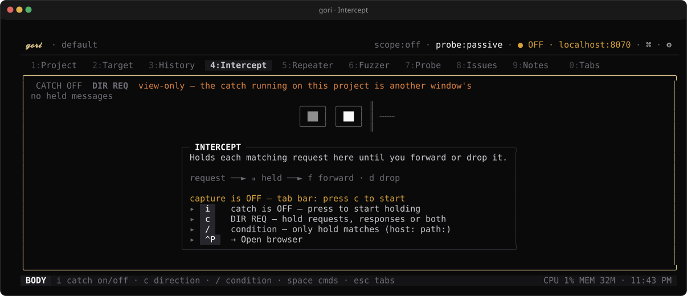

+++
title = "Intercept and modify in flight"
description = "Hold a request mid-flight, change it, let it continue, then make the change stick as a rule."
weight = 30

[extra]
group = "The manual loop"
+++

This playbook holds a live request while the client waits, changes it on the wire, forwards it, and then turns the edit into a Match & Replace rule that applies with intercept off. It takes about ten minutes.

> **Before you begin.** Have an engagement [set up](/playbooks/set-up-an-engagement/) with scope drawn, capture on (`c`), and a client pointed at the proxy. The examples use `api.example.com`.

## 1. Arm intercept

Press `i` to toggle **Intercept** on, or open the **Intercept** tab and arm the catch there. A blank condition holds every request through the proxy until you decide it (with the `s` scope lens on, every in-scope request). Narrow it in the filter bar with a query-language expression before you turn it on:

```text
host:api.example.com method:POST
```

Now only the POSTs to your target are held. The rest pass through. The History filter's tokens work here (`host:`, `path:`, `method:`, `scheme:`, `status:`, plus `AND` / `OR` / `NOT`).

<figure class="tui-shot">
  
  <figcaption>The <strong>Intercept</strong> tab: toggle catch with <kbd>i</kbd>, pick a direction, and hold only matching traffic to forward, drop, or edit in flight.</figcaption>
</figure>

> **WebSocket is the exception.** A WebSocket message is held **only** when the catch condition contains `proto:ws`. A blank condition or a host filter alone does not arm it. HTTP is the other way round, where a blank condition holds everything. A busy chat or trading socket would stall on a filter that broad.

**Checkpoint.** The Intercept tab shows catch is on, and your condition is in the filter bar.

## 2. Catch a request and edit it

Trigger the matching request from your client: a browser click, a `curl`, a Repeater send. It stops in the Intercept queue. Select it and press `↵` / `e` to open its raw bytes in the editor (the same INS-mode editor the Repeater uses), change what you need (a header value, a JSON field, the path), then press `Ctrl-R` to **forward** the edited request. `Esc` leaves the editor without sending and keeps the edit, so `f` on the queue forwards it too. Inside the editor, `f` types an `f`.

Headless, you can drive the same queue from a second terminal against a running TUI:

```bash
gori run intercept                       # list held items + catch state
gori run intercept edit 3 --raw-file edited.txt   # forward item 3 with edited bytes
```

In the TUI editor, an edited request is forwarded with `Content-Length` resynced (on by default; `Ctrl-L` toggles it) and the `$ENV.KEY` [environment variables](/guide/repeater-and-fuzzer/#environment-variables) and `$GEN.*` tokens you typed expanded. Extract-rule `$BIND.NAME` bindings are not resolved on this path. Tokens and `$$` escapes that were already in the held message are the client's bytes and go out as they arrived, as does a token you type whose name the held message already carried. An escape you type, such as `$$ENV.KEY`, is also forwarded as typed. `gori run intercept edit` expands nothing and sends the body verbatim, and `--no-update-content-length` keeps the `Content-Length` you declared. Everything else goes out as typed.

**Checkpoint.** The edited request reaches the origin. Switch to **History** and read the flow to confirm the change and the origin's response.

## 3. Forward, drop, or edit

Every held item waits for you to make one of three decisions:

- **Forward** (`f`) releases the item byte-exact, or with your edits from step 2. `Shift-F` forwards the whole queue at once when a burst has piled up.
- **Drop** (`d`) kills it: on HTTP/1.1 the client gets a canned `502`, on HTTP/2 the stream is cancelled. Use it to see how the client copes when a request never lands.
- **Edit, then forward** is for the request you want to change before it continues, as in step 2.

Forward and drop act on the marked rows if any are set, else the cursor row. Mark a run with `t` and one `f` releases them together. Nothing is auto-applied.

**Checkpoint.** You have forwarded one request untouched and dropped another, and History records both, the drop as an aborted flow noted `dropped by intercept (request)`.

## 4. Make an edit permanent with Match & Replace

An edit you want on every matching request goes in the **Rewriter** tab (the Match & Replace editor, off the tab bar by default: press **`0`** and type "rewriter", or `Ctrl-P` → **Match & Replace**). A rule's operation is **Replace** text in the head or body, **Add** / **Set** / **Remove** a header, **Short circuit** to answer the request from the rule without dialing the origin (a canned response, files from a local directory, a captured flow's response via History's `Space` `M`, or a close/reset/hang fault), or **Pipe** to hand the matched bytes to a command. Scope the rule to a host glob so it fires only for matching traffic:

```bash
gori run rewriter add --op set_header --target request \
  --find X-Forwarded-For --value 127.0.0.1 --host '*.example.com'
```

Choose where the rule lives: **project** rules sit in this engagement's database, **global** rules go in `settings.json` and apply in every project. Set it in the editor's `scope:` row, or `--scope=global` headless. The rule takes effect when you save, with no restart. Turn intercept off and the edit applies to every matching request.

**Checkpoint.** With intercept off, matching traffic carries your change automatically, and the editor's live preview shows how many recent flows the rule would touch.

## Next Steps

- [Fuzz a parameter](/playbooks/fuzz-a-parameter/): take one of these requests and sweep a value across a wordlist
- [Proxy & History](/guide/proxy/#intercept): the full Intercept reference, HTTP/2 and WebSocket rules
- [Match & Replace](/guide/proxy/#match-replace): every rewrite operation, short-circuit stubs, and global vs project scope
