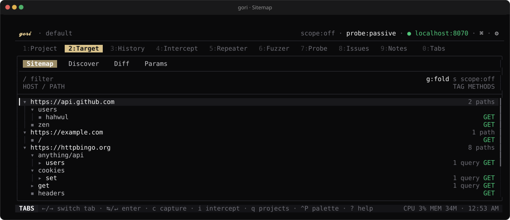

+++
title = "공격면 매핑"
description = "스코프가 걸린 캡처를 host→path 트리로 접고, Discover로 한 번도 클릭하지 않은 엔드포인트를 드러냅니다."
weight = 20

[extra]
group = "기초"
+++

이 플레이북에서는 캡처한 History를 중복 없는 `host → path` 트리로 접고, id 노이즈를 접은 뒤, Discover로 클릭해 보지 않은 엔드포인트까지 가져옵니다. 10분 정도 걸리며, 대부분은 Discover가 백그라운드에서 도는 시간입니다.

> **시작하기 전에.** [엔게이지먼트 준비](/ko/playbooks/set-up-an-engagement/)를 끝내 프로젝트와 스코프를 갖춰 두고, **History**에 접을 행이 쌓일 만큼 대상을 둘러보세요. 3단계는 대상 쪽에서 요청한 적 없는 실제 트래픽을 보내므로, 테스트 권한이 있는 호스트에만 실행하세요. 예시에서는 `api.example.com`을 가상의 대상으로 씁니다.

## 1. 둘러보며 맵 채우기 {#1-browse-to-seed-the-map}

캡처를 켠 채(`c`로 토글) 실제 사용자처럼 앱을 클릭해 둘러봅니다. 로그인하고, 주요 화면을 열고, 폼을 제출하세요. 그런 다음 **Target → Sitemap**을 엽니다. Sitemap은 History의 모든 플로우를 중복 없는 `host → path` 트리로 접어 보여 주며, 엔드포인트마다 method 칩이, 옆에는 scope 마커가 붙습니다.

```bash
gori run sitemap
```

트리는 캡처를 실시간으로 보여 주는 뷰입니다. 이후에 둘러본 내용도 캡처되는 대로 나타납니다. `--in-scope`는 스코프 렌즈처럼 in-scope 호스트로 한정하고, `--hide-static`은 이미지, 폰트, 미디어를 뺍니다(TUI에서는 **Display…** 아래 `Space` `Z` `s`, History와 함께 쓰는 렌즈입니다).

<figure class="tui-shot">
  
  <figcaption><strong>Sitemap</strong>은 캡처를 method 칩과 scope 마커가 달린 <code>host → path</code> 트리로 접습니다.</figcaption>
</figure>

**체크포인트.** 대상 호스트가 경로 트리로 펼쳐지고, 각 경로에 method 칩이 붙습니다.

GraphQL 인트로스펙션 JSON이 있다면 **Import: GraphQL**에서 파일과 엔드포인트 URL을 입력하거나 아래 명령으로 쿼리·뮤테이션마다 요청을 준비합니다. 구독은 개수와 함께 생략하며, 임포트는 트래픽을 보내지 않습니다. [생성 제한](/ko/guide/proxy/#import)을 확인하고, History의 `Pending` 플로우를 Repeater로 보내 플레이스홀더와 인증 헤더를 편집한 뒤 전송하세요.

```bash
gori run import --graphql schema.json --endpoint https://api.example.com/graphql --db ./assessment.db
```

History에 인트로스펙션 응답이 있다면 `123`을 해당 플로우 ID로 바꿉니다. 내보내기 마스킹 없이 디코딩된 본문을 `jq`로 추출해 같은 임포터로 전달합니다.

```bash
gori run show 123 --response-only --format json --no-redact --db ./assessment.db | jq -er '.response.body.text' | gori run import --graphql - --endpoint https://api.example.com/graphql --db ./assessment.db
```

## 2. 시끄러운 id 접기 {#2-fold-noisy-ids}

REST API에서 `/user/1`, `/user/2`, `/order/9f3c…`는 식별자만 다릅니다. Sitemap은 path-param id를 접으므로, `/user/1`과 `/user/2`가 한 노드를 공유하고 긴 id는 `{uuid}` 하나로 접힙니다. 쿼리 문자열 변형도 같은 방식으로 접힙니다(`/search?q=1`과 `/search?q=2`는 `/search`로). 두 접기는 기본으로 켜져 있습니다. 값을 하나하나 봐야 할 때는 `g`로 id 접기를, `Shift-G`로 쿼리 접기를 토글합니다.

```bash
gori run sitemap            # id를 기본으로 접습니다; --no-group은 전부 보여 줍니다
                            # /search?q=1 + /search?q=2는 /search로 접힙니다; --no-fold-query는 펼칩니다
```

**체크포인트.** 숫자와 uuid 모양의 세그먼트가 각각 한 노드로 접히고, 트리가 서로 다른 엔드포인트만 남도록 줄어듭니다.

## 3. Discover로 한 번도 클릭하지 않은 것 찾기 {#3-find-what-you-never-clicked-with-discover}

Sitemap은 둘러본 것만 보여 줍니다. **Discover**는 클릭하지 않은 링크를 spider로 따라가고, 대상이 스스로 밝히는 것(`robots.txt`, `sitemap.xml`, `.well-known/` 레지스트리)과 JavaScript에 인용된 경로를 읽은 뒤, 링크되지 않은 디렉터리(`/admin`, `.git/config`, `/api/v2`)를 brute-force합니다. **Target → Discover**를 열거나, **Sitemap** 노드 또는 **History** 플로우에서 `Space` `>` `D`(**Send flow to…** → **Discover here**)를 누르면 실행이 그 서브트리로 한정됩니다. 팝업에서 탐색 방식(spider, brute-force, 또는 둘 다), 최대 깊이, 크롤 스코프, 동시성을 고릅니다. 실행은 백그라운드에서 진행됩니다. Discover 서브탭에서 `^X`로 멈추고 `p`로 일시정지합니다.

```bash
gori run discover --target https://api.example.com \
  --max-depth 3 \
  --extensions php,json,bak \
  --format jsonl
```

> Discover는 추측한 경로마다 대상 쪽에서 요청한 적 없는 실제 요청을 보냅니다. 테스트 권한이 있는 시스템에만 실행하세요. 실행은 프로젝트 스코프 안에 머물고, 샌드박스와 exclude 규칙은 항상 적용됩니다.

캡처한 JavaScript에서도 엔드포인트를 찾을 수 있으며, 읽을 때는 요청을 보내지 않습니다. Sitemap에서 `Space` `J`(**Scan JavaScript**)는 프로젝트에 이미 있는 JS 응답과 인라인 스크립트를 읽고, 스크립트가 참조하지만 요청된 적 없는 경로를 흐린 `js` 행으로 그립니다. 헤드리스에서는 `gori run sitemap js --scan`이 이 경로들을 나열하고, `gori run sitemap --js-refs`가 트리에 그립니다.

**체크포인트.** 둘러본 적 없는 새 경로가 Sitemap에 나타나고, 실행 요약에 찾은 것과 캘리브레이터가 억제한 것이 나옵니다.

## 4. 공격면 읽고 손대기 {#4-read-and-act-on-the-surface}

gori는 Discover가 찾은 결과마다 Discover가 구성한 요청과 origin이 돌려준 응답을 저장합니다. 발견된 노드를 선택하고 `o`를 누르면 History와 같은 상세 뷰에서 그 교환이 열려 헤더, 본문, 정렬된 JSON을 볼 수 있습니다(`Enter`는 노드를 펼치거나 접기만 합니다). 거기서 `^R`로 **Repeater**에 보내 직접 다룹니다.

트리아지하면서 중요한 경로를 `t`로 마킹하고(`t`를 연달아 누르면 연속된 행이 마킹됩니다), `Space` 메뉴로 태그를 달거나 여기서 호스트를 스코프에 추가해, 중요한 엔드포인트가 다음 캡처에도 남게 하세요. 이 동작들은 트래픽을 보내지 않습니다.

호스트나 서브트리에서 `p`를 누르면 그 요청에 실린 모든 파라미터 이름을, 나타난 위치와 값이 응답에 반사되었는지와 함께 나열합니다(**Target → Params**, `gori run sitemap params`). `⇧E`는 선택한 호스트나 서브트리를 OpenAPI 3.0.3 문서로 내보냅니다. 경로는 템플릿으로, 스키마는 추론해서 담지만 자격 증명 값은 절대 쓰지 않습니다(`gori run sitemap export`). 테스트를 시작한 뒤에는 `gori run sitemap --untested`(MCP `list_sitemap{untested:true}`)가 아직 어떤 액티브 도구도 테스트하지 않은 엔드포인트만 남깁니다. Repeater, Fuzzer, Miner, Sequencer, Authorize, Probe, Retest가 History에 기록한 플로우와 저장된 퍼즈 실행으로 판단합니다.

**체크포인트.** 발견된 엔드포인트를 열어 실제 응답을 읽고, Repeater로 넘길 수 있습니다.

## 다음 단계 {#next-steps}

- [플로우 중 가로채기 및 수정](/ko/playbooks/intercept-and-modify/): 이 요청 중 하나를 잡아 와이어에서 바꾸기
- [Proxy & History](/ko/guide/proxy/#sitemap): Sitemap 전체 레퍼런스, 접기, 마킹
- [Scanning & Issues](/ko/guide/scanning/): Discover의 캘리브레이션, 봉쇄, headless 플래그 심화
