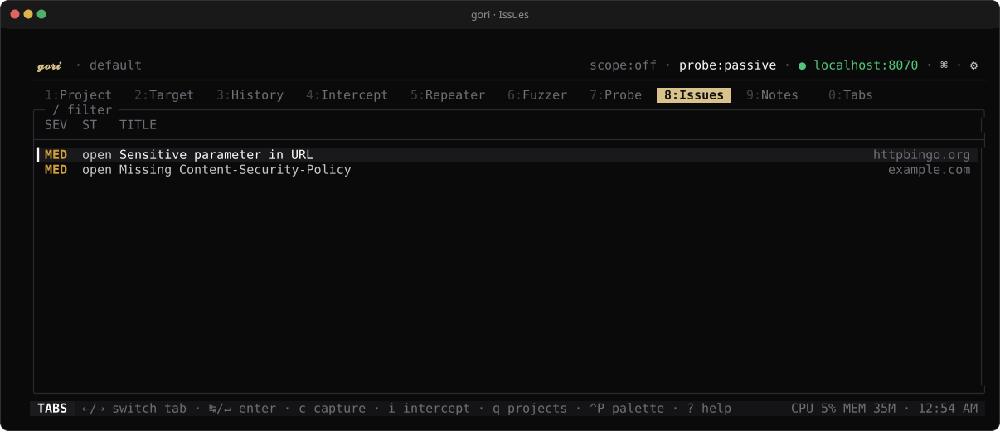

+++
title = "트리아지와 리포트"
description = "흩어진 발견들을 이슈로 모으고, diff로 수정을 증명하고, 동료가 읽을 수 있는 리포트로 내보냅니다."
weight = 110

[extra]
group = "마무리"
+++

지금쯤이면 발견이 Probe 탭, Repeater 탭, 머릿속에 흩어져 있을 겁니다. 이 플레이북에서는 이 발견을 넘겨줄 수 있는 형태로 모읍니다. 심각도가 붙은 이슈, 이를 증명하는 diff, gori 없이도 동료가 읽을 수 있는 리포트입니다. 10분 정도 걸립니다. 여기서는 이미 캡처한 것으로 작업하므로 새 트래픽을 거의 보내지 않습니다.

> **시작하기 전에.** 리포트로 쓸 만한 캡처·테스트 트래픽이 담긴 엔게이지먼트가 필요합니다. 앞선 플레이북을 먼저 끝내거나, 직접 쓰던 프로젝트를 가져오세요. 예시에서는 `api.example.com`을 가상의 대상으로 씁니다.

## 1. 패시브 발견 훑어보기 {#1-skim-passive-findings}

**Probe**는 캡처되는 모든 플로우와 모든 Repeater 전송에 패시브 검사를 돌립니다. 이 검사는 요청을 보내지 않으므로 가장 부담 없는 출발점입니다. **Probe** 탭을 여세요. 발견은 검사와 호스트로 묶여 있어, 한 행이 수십 건의 히트를 대표할 수 있습니다(관대한 CORS, 누락된 보안 헤더, 쿠키 위생, URL 속 시크릿 등).

행을 열면 **AFFECTED URLS** 목록이 증거입니다. `↑`/`↓`로 훑고, `Enter`로 그 URL이 캡처된 플로우를 History와 같은 상세 뷰로 열며, `r`로 Repeater에 보내 더 파고듭니다.

같은 결과를 헤드리스로도 볼 수 있고, 이때도 아무것도 보내지 않습니다:

```bash
gori run probe                       # 패시브 발견만
gori run probe --severity high       # high와 critical (하한선)
gori run probe --category cors       # 단일 카테고리
```

**체크포인트.** Probe 탭에 발견이 심각도와 카테고리로 묶여 나열되고, 각 항목에서 그 발견이 나온 플로우를 열 수 있습니다. 이 발견을 만드는 동안 History의 요청 수는 늘지 않았습니다.

## 2. 이슈 파일링 {#2-file-an-issue}

**Issues**는 결국 리포트에 넘길 트리아지 목록입니다. **History** 플로우에서 `Shift-F`를 눌러 이슈를 파일링하고(Repeater 탭에서는 `Space` → **Link…** → `+ New issue…`), **Probe** 발견은 Probe 탭에서 이슈로 승격합니다. 심각도(`info`부터 `critical`까지)와 상태(`open`, `confirmed`, `false-positive`, `resolved`)를 지정하세요. 파일링한 플로우가 증거로 링크됩니다. 이슈에서 `Enter`를 누르면 이슈가 열리고, 그 플로우는 **RELATED** 행에 있습니다. 그 행에서 `↵`는 교환을 제자리에서 보여 주고 `s`는 History에서 엽니다.

<figure class="tui-shot">
  
  <figcaption><strong>Issues</strong> 탭. 승격한 발견마다 심각도와 상태가 있고, 이를 증명하는 증거 플로우가 링크되어 있습니다.</figcaption>
</figure>

스크립트에서는 이슈를 직접 파일링·갱신할 수 있고, `--flow`를 주면 같은 명령에서 증거도 링크합니다:

```bash
gori run issues create --title "IDOR on /v1/users/{id}" --severity high --host api.example.com --flow 42
gori run issues update 7 --status confirmed --notes "Verified on staging"
gori run probe promote 12            # Probe 발견을 Issues로 확정
```

**체크포인트.** **Issues** 탭에 심각도와 함께 이슈가 보이고, 이슈를 열면 **RELATED** 아래에 증거 플로우가 보입니다.

## 3. Comparer로 증명하기 {#3-prove-it-with-the-comparer}

발견은 이전과 이후를 나란히 놓으면 더 설득력이 있습니다. 인증 없는 `403` 옆에 인증된 `200`을, 또는 패치된 응답 옆에 취약한 응답을 두는 식입니다. **Comparer**는 두 메시지 A와 B를 담아 diff합니다.

요청과 응답이 있는 곳이면 어디서든 슬롯을 채울 수 있습니다. **History**에서 첫 플로우를 선택하고 `Space` `>` `c`(**Send flow to…** → **Send to Comparer**)를 눌러 슬롯 A에 넣습니다. 두 번째도 같은 방식으로 보내 슬롯 B를 채웁니다. Repeater 전송이나 Fuzzer 결과 행도 같은 방식으로 들어가며, 둘 다 캡처된 플로우를 남기지 않으므로, diff에 넣으려면 이 방법을 써야 합니다. Comparer 탭에서는 `a` / `b`로 캡처된 플로우를 각 슬롯에 골라 넣습니다. 이 경로는 활성 Scope 렌즈를 거치므로, 스코프 밖 대조군이 필요하면 렌즈를 꺼야 합니다.

두 컬럼 사이의 구분선에 A→B 델타가 표시되며, `403 → 200`이면 대개 그것으로 충분합니다. `←`/`→`로 요청 diff와 응답 diff를 오가고, 변경된 행에서는 다른 바이트만 빨강·초록으로 강조됩니다.

```bash
gori run compare 41 42 --pane response --changes-only
```

**체크포인트.** diff에서 발견을 증명하는 변화가 강조됩니다. `403 → 200` 같은 상태 변화나 바뀐 값 하나입니다.

## 3b. 지난 엔게이지먼트 대비 리테스트 {#3b-retest-against-the-last-engagement}

Comparer는 메시지 하나가 바뀌었음을 증명합니다. 리테스트는 같은 질문을 표면 전체에 적용합니다. *지난번 이후 뭐가 새로 생겼고, 사라졌고, 다르게 응답하나?* 이전 평가가 별도의 gori 프로젝트에 남아 있다면 명령 하나면 됩니다.

```bash
gori run diff --from q1-audit --to q3-retest --format md
```

엔드포인트 키는 Sitemap이 그리는 폴딩 템플릿(`/users/{uuid}`)을 그대로 씁니다. 그래서 각 엔게이지먼트가 우연히 캡처한 식별자 때문에 모든 행이 added/removed 쌍으로 갈라지지 않습니다. `changed` 판정도 바이트 동일성이 아니라 허용 오차 범위로 내리므로, 길이가 조금 달라지는 페이지는 발견으로 잡히지 않습니다. 대화형으로는 **Target → Diff**입니다. `a`로 기준을 고르고, 행에서 `↵`를 누르면 양쪽 캡처가 Comparer로 넘어가 바이트 단위로 보여줍니다.

판정은 뜻을 구분해서 읽으세요. `gone`은 새 캡처가 *요청했고* `404`를 받았다는 뜻이고, `not seen`은 아예 요청하지 않았다는 뜻으로, 수정된 게 아니라 이번 리테스트의 커버리지 공백입니다. 리포트 끝에는 아직 열려 있는 이슈들과 그 이슈가 걸려 있던 엔드포인트의 현재 상태가 붙습니다. 요청은 보내지 않습니다.

표면 전체가 아니라 발견 하나를 다시 확인하려면 그 이슈에 **리테스트**를 붙이세요. 그 발견을 재현하는 Repeater 세션을 순서대로 두고, 세션마다 기대 결과를 최대 하나 답니다(`status:403`, `json:data.role=admin`, `json-absent:data.token`, `body:same`). `json:` 경로는 `--jsonpath`와 같은 방식으로 읽히며(`data.user.id`, `$.items[0].id`), 읽을 수 없는 경로는 나중에 통과로 처리되는 대신 스텝을 적는 시점에 거부됩니다. 이슈 상세에서는 `⇧R`(**Retest…**)이고, 헤드리스로는 이렇게 합니다:

```bash
gori run retest add --issue 7 --repeater 12 --assert 'json-absent:data.token'
gori run retest run --issue 7
```

`retest run`은 스코프와 샌드박스 게이트를 거쳐 보내고, 전송마다 History에 기록하며, 판정이 `pass`일 때만 `0`으로 끝납니다.

**체크포인트.** `--format md`는 리테스트 산출물에 붙여 넣을 수 있는 섹션을 만들어 주고, 개수 위에 양쪽의 커버리지가 함께 적힙니다.

## 4. 노트와 링크 남기기 {#4-keep-notes-and-links}

이슈로 남기기에는 맞지 않는 내용도 있습니다. **Notes**는 시도한 것, 통한 페이로드, 나중에 다시 볼 단서를 적어 두는 자유 형식의 프로젝트별 Markdown 문서입니다(프로젝트당 여러 개). **Notes** 탭에서 만들고 편집합니다.

흩어진 증거를 하나로 묶으려면 History, Repeater, Fuzzer, Miner에서 `Space` → **Link…**를 누르세요. 카드 하나에 모든 이슈 *와* 모든 노트가 나열되고, 위에 `+ New issue…` / `+ New note…`가 고정됩니다. 지금 보고 있는 것을 기존 이슈에 붙이는 것과, 이미 링크된 새 이슈를 파일링하는 것이 같은 키 입력으로 됩니다. 입력한 글자로 제목·호스트·상태를 필터링하며, 생성 행을 고르면 그 글자가 새 이슈의 제목이 됩니다. 링크하려는 대상에 아직 아무것도 파일링된 적이 없으면 커서는 `+ New issue…`에 놓이고(가장 흔한 첫 파일링), 링크가 이미 있으면 첫 기존 이슈에 놓입니다. **이슈**를 고르면 *바이트*까지 함께 남습니다. 취약점을 확인해 준 응답은 그대로 두면 다음 Repeater 전송이나 보존 정리로 사라지지만, 같은 단계에서 변경 불가 복사본으로 동결됩니다. 이슈의 RELATED 카드에 **FROZEN** 행으로 표시되고 모든 내보내기에 SHA-256과 함께 실립니다. 노트는 포인터만 받습니다. 아직 교환이 없는 대상(대기 중 플로우, 보낸 적 없는 탭)도 링크는 됩니다. 카드의 `↵` 토큰에 누르기 전부터 그렇게 표시되고(`↵ link — nothing to freeze: …`), 누른 뒤에는 토스트에 같은 내용이 다시 나옵니다.

직접 새 이슈를 파일링하면 그 이슈가 **바로 열립니다**. 폼이 커밋되면 새 이슈의 Issues 상세가 열리고, 토스트 끝에 돌아가는 방법이 적힙니다(`issue #21 created and linked · frozen as evidence #5 · esc returns to History`). 그 `esc`는 드릴인과 커서까지 그대로 있던 자리로 되돌립니다. (Diff에서 줄줄이 파일링하는 재검증 스윕은 그 자리에 머뭅니다.)

```bash
gori run notes create --text "SSRF candidate on /fetch, needs OAST to confirm"
gori run notes --all
```

**체크포인트.** Notes 탭에 노트가 있고, 링크한 이슈 아래에 증거 플로우나 세션이 나열됩니다.

## 5. 리포트 내보내기 {#5-export-the-report}

이슈 트리아지가 끝나면, gori 없이도 동료가 읽을 수 있는 Markdown 문서 하나로 내보냅니다:

```bash
gori run issues --format markdown --export report.md
```

TUI에서는 Issues 탭의 `⇧E`가 같은 리포트입니다. 목록의 힌트 줄에 이 키가 적혀 있습니다. 형식을 고르고(`↵ export`), 저장 경로를 고르면 됩니다(`↵ write`, 파일이 이미 있으면 `↵ overwrite`).

사람이 아니라 기계가 읽는다면 SARIF로 내보내세요. GitHub code scanning, DefectDojo, Azure DevOps가 읽는 형식입니다:

```bash
gori run issues --format sarif --export issues.sarif
gh api -X POST /repos/OWNER/REPO/code-scanning/sarifs \
  -f commit_sha="$(git rev-parse HEAD)" -f ref=refs/heads/main \
  -f sarif="$(gzip -c issues.sarif | base64 | tr -d '\n')"
```

이슈 하나는 result 하나가 되며 URL과 심각도를 담습니다. 플로우를 링크해 두었다면 요청·응답이 `webRequest`/`webResponse`로 함께 들어갑니다(`--include-sensitive`를 주지 않으면 Authorization, Cookie, Set-Cookie, API 키 헤더 값은 `[REDACTED]`로 나갑니다). `false-positive`나 `resolved`로 트리아지한 이슈는 SARIF *suppression*으로 나가므로, gori에서 정리한 발견은 대시보드에서도 정리된 상태로 남고 다시 열리지 않습니다.

발견의 근거가 된 원본 트래픽을 넘기려면, History 쿼리 결과를 HAR 로그 하나로 내보내세요. STDOUT으로 출력되고, Burp·Charles·브라우저 네트워크 패널로 불러들일 수 있으며, gori로 다시 임포트됩니다:

```bash
gori run history -q 'host:api.example.com status:200' --format har > evidence.har
```

**체크포인트.** `report.md`가 디스크에 있고 심각도 순으로 정렬된 이슈 목록이 들어 있으며, `evidence.har`에는 근거가 된 플로우가 들어 있습니다. SARIF로 내보냈다면 `jq '.runs[0].results | length' issues.sarif`가 이슈 개수와 일치합니다.

## 저장한 응답 두 개로 인계 연습하기

[샘플 HAR](/samples/evidence-handoff.har)를 내려받아 새 연습 프로젝트에 가져옵니다. 같은 URL에서 얻은 응답 두 개가 담겨 있습니다.

1. 작성자는 두 번째 응답에서 달라진 점을 찾아 이슈를 만들고, 판단의 근거가 된 교환을 고정합니다. Markdown 보고서를 내보냅니다.
2. 검토자에게 보고서와 같은 연습 프로젝트를 건넵니다. 고정한 응답을 열어 상태 코드와 본문의 `revision` 값을 알려 달라고 합니다. 걸린 시간과 작성자에게 도움을 요청했는지를 기록합니다.
3. 읽기 전용 MCP 클라이언트에 같은 보고서와 프로젝트를 주고, 두 값과 증거 ID를 묻습니다. 작성자가 고정한 사본과 세 값이 일치하는지 확인합니다.

## 다음 단계 {#next-steps}

- [AI 코파일럿 세션 실행](/ko/playbooks/run-an-ai-co-pilot/): 같은 프로젝트에 에이전트를 붙이고 중요한 동작을 계속 확인하기
- [Scanning & Issues](/ko/guide/scanning/): Probe, Issues, Notes, Comparer 전체 레퍼런스
- [CLI Reference](/ko/reference/cli/): `run issues`, `run compare`, `run history --format har` 전체
